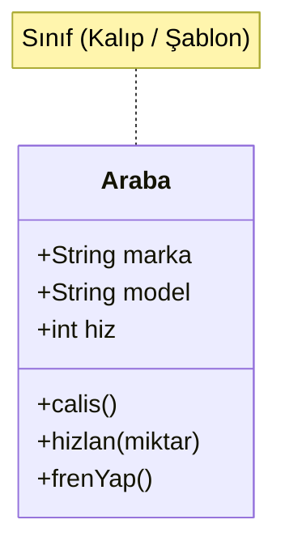

# 1. Java Dünyasına Giriş ve Nesneye Dayalı Programlama (OOP)

Bu doküman, Java programlama diline giriş yapan öğrenciler ve eğitmenler için hazırlanmıştır. Java'nın temel felsefesini, **"Java'da her şeyin bir sınıf ve nesne yapısı içinde var olması"** mantığını, örnek bir program üzerinden bileşenlerini ve kodun nasıl derlenip çalıştırıldığını açıklar.

---

> 📖 **İlgili Bölüm Dokümanları:**
> - 🐧 [2. Temel Linux Komutları ve Terminal Rehberi (2_linux.md)](./2_linux.md)
> - 📦 [3. Değişkenler, Veri Tipleri ve Hatalar (3_degisken.md)](./3_degisken.md)

---

## 📌 İçindekiler
1. [Java'nın Felsefesi: "Her Şey Bir Nesnedir"](#1-javanın-felsefesi-her-şey-bir-nesnedir)
2. [Nesneye Dayalı Programlama (OOP) Mantığı](#2-nesneye-dayalı-programlama-oop-mantığı)
   - [Sınıf (Class) ve Nesne (Object) İlişkisi](#sınıf-class-ve-nesne-object-ilişkisi)
   - [OOP'nin 4 Temel İlkesi](#oopnin-4-temel-ilkesi)
3. [Örnek Java Programı ve Satır Satır İnceleme](#3-örnek-java-programı-ve-satır-satır-inceleme)
   - [Merhaba Dünya (Main.java)](#merhaba-dünya-mainjava)
   - [OOP Mantığını Gösteren İkinci Bir Örnek](#oop-mantığını-gösteren-ikinci-bir-örnek)
4. [Java'nın Çalışma Mantığı: Derleme ve Çalıştırma](#4-javanın-çalışma-mantığı-derleme-ve-çalıştırma)
   - [JDK, JRE ve JVM İlişkisi](#jdk-jre-ve-jvm-ilişkisi)
   - [Komut Satırında (Terminal) Derleme ve Çalıştırma](#komut-satırında-terminal-derleme-ve-çalıştırma)
5. [Yeni Başlayanlar İçin Önemli Kurallar ve Sık Yapılan Hatalar](#5-yeni-başlayanlar-için-önemli-kurallar-ve-sık-yapılan-hatalar)

---

## 1. Java'nın Felsefesi: "Her Şey Bir Nesnedir"

C veya Python gibi dillerde boş bir metin dosyası açıp doğrudan:
```python
# Python'da sınıf tanımlamadan tek satır çalıştırılabilir:
print("Merhaba Dünya")
```
yazabilirsiniz. Ancak **Java'da bu mümkün değildir**.

Java saf bir **Nesne Yönelimli Programlama (OOP)** dilidir. Java'da:
- Yazacağınız **tek bir satır kod bile mutlaka bir sınıfın (`class`) sınırları içinde** yer almak zorundadır.
- Programın kendisi, fonksiyonları (metotları) ve verileri (alanları) sınıf yapılarının içine paketlenir.
- Konsola yazı yazdıran standart komut bile (`System.out.println`) aslında `System` sınıfındaki statik bir nesne referansı olan `out` üzerinden çağrılan bir metottur.

> 💡 **Özetle:** Java'da hiçbir kod parçası "başıboş" veya sınıflardan bağımsız yaşayamaz. Programın başlangıç noktası (`main` metodu) bile bir sınıfın üyesidir.

---

## 2. Nesneye Dayalı Programlama (OOP) Mantığı

Gerçek dünyada etrafımızda gördüğümüz her şey birer nesnedir: bir araba, bir öğrenci, bir banka hesabı, bir masa... Her nesnenin:
1. **Durumu / Özellikleri (State / Fields):** Rengi, yaşı, modeli, bakiyesi.
2. **Davranışları (Behaviors / Methods):** Çalışması, hızlanması, para çekmesi, ses çıkarması.

### Sınıf (Class) ve Nesne (Object) İlişkisi

* **Sınıf (Class):** Bir nesnenin nasıl olacağını tarif eden mimari plan, şablon veya kalıptır. Tek başına hafızada yer tutmaz, sadece bir tanımdır.
* **Nesne (Object / Instance):** O kalıp kullanılarak bellekte (`Heap`) somut olarak üretilmiş örnektir.



Aynı `Araba` sınıf kalıbından dilediğimiz kadar farklı nesne (`araba1: Kırmızı BMW`, `araba2: Beyaz Renault`) üretebiliriz.

### OOP'nin 4 Temel İlkesi

| İlke | Türkçe Adı | Açıklama |
| :--- | :--- | :--- |
| **Encapsulation** | Kapsülleme | Verilerin (değişkenlerin) doğrudan dışarıdan değiştirilmesini engelleyip metotlar (`getter`/`setter`) aracılığıyla güvenli erişim sağlama. |
| **Inheritance** | Kalıtım / Miras | Bir sınıfın başka bir sınıftan ortak özellikleri ve davranışları devralması (`extends`). |
| **Polymorphism** | Çok Biçimlilik | Bir metodun farklı sınıflarda farklı biçimlerde davranabilmesi (ör. `Hayvan.sesCikar()` metodunun `Kopek` için havlama, `Kedi` için miyavlama olması). |
| **Abstraction** | Soyutlama | Karmaşık sistem detaylarını gizleyip sadece gerekli ve önemli arayüzü sunma (`abstract class`, `interface`). |

---

## 3. Örnek Java Programı ve Satır Satır İnceleme

### Merhaba Dünya (`Main.java`)

Aşağıda Java'da yazılabilecek en temel program yer almaktadır:

```java
public class Main {
    public static void main(String[] args) {
        // Bu bir yorum satırıdır; derleyici tarafından yok sayılır.
        System.out.println("Merhaba Dünya");
    }
}
```

#### Satır Satır Açıklama:

1. **`public class Main`**
   - `public`: Bu sınıfa diğer paketlerden ve dış dünyadan (en önemlisi JVM'den) serbestçe erişilebileceğini belirtir (erişim belirteci).
   - `class`: Yeni bir sınıf tanımı başlatır.
   - `Main`: Sınıfımızın adıdır. **Kural:** Dosya adı ile `public` sınıfın adı birebir aynı olmalıdır (`Main.java`).

2. **`public static void main(String[] args)`**
   - Bu, Java programlarının **başlangıç kapısıdır (entry point)**. JVM programı başlatırken doğrudan bu imzaya sahip metodu arar.
   - `public`: JVM sınıf dışından bu metoda erişebilmelidir.
   - `static`: **En kritik kelime!** Henüz `Main` sınıfından hiçbir nesne (`new Main()`) üretilmemişken dahi JVM'in bu metodu doğrudan çağırabilmesini sağlar.
   - `void`: Bu metodun işini bitirdiğinde geriye herhangi bir değer döndürmeyeceğini ifade eder.
   - `main`: Başlangıç metodunun özel adıdır.
   - `String[] args`: Programa komut satırından parametre/argüman aktarmak için kullanılan dizi parametresidir.

3. **`System.out.println("Merhaba Dünya");`**
   - `System`: Java'nın standart kütüphanesinde bulunan yerleşik bir sistem sınıfıdır.
   - `out`: Standart çıktı akışını (konsolu) temsil eden statik nesne referansıdır.
   - `println`: Konsola metni yazdıran ve ardından imleci bir alt satıra geçiren (print line) metottur.
   - `;`: Java'da her ifade satırı mutlaka noktalı virgül ile sonlandırılmalıdır.

---

### OOP Mantığını Gösteren İkinci Bir Örnek

Java'da nesnelerin nasıl tanımlandığını ve kullanıldığını anlamak için basit bir model:

```java
// Sınıf (Kalıp)
class Ogrenci {
    String ad;
    int numara;

    void selamVer() {
        System.out.println("Merhaba, ben " + ad + ", numaram: " + numara);
    }
}

// Programın Çalıştığı Ana Sınıf
public class OkulProgrami {
    public static void main(String[] args) {
        // 'new' anahtar kelimesi ile kalıptan bir nesne (örnek) üretiyoruz:
        Ogrenci ogr1 = new Ogrenci();
        ogr1.ad = "Ahmet";
        ogr1.numara = 101;
        ogr1.selamVer(); // Çıktı: Merhaba, ben Ahmet, numaram: 101

        Ogrenci ogr2 = new Ogrenci();
        ogr2.ad = "Ayşe";
        ogr2.numara = 102;
        ogr2.selamVer(); // Çıktı: Merhaba, ben Ayşe, numaram: 102
    }
}
```

---

## 4. Java'nın Çalışma Mantığı: Derleme ve Çalıştırma

Java'nın en ünlü sloganı: **"Write Once, Run Anywhere" (Bir Kez Yaz, Her Yerde Çalıştır)** prensibidir.

Java kodu doğrudan işletim sisteminin makine koduna (0 ve 1'lere) derlenmez. Bunun yerine platformdan bağımsız ara bir formata, yani **Bayt Kodu (Bytecode)** formatına dönüştürülür.

### JDK, JRE ve JVM İlişkisi


* **JVM (Java Virtual Machine):** Bayt kodunu okuyup o an çalışan işletim sisteminin anlayacağı makine koduna çeviren sanal makinedir.
* **JRE (Java Runtime Environment):** JVM + Java'nın standart kütüphanelerini içerir (yalnızca hazır programları çalıştırmak içindir).
* **JDK (Java Development Kit):** JRE + Geliştirici araçlarını içerir (derleyici `javac`, hata ayıklayıcı vb.). Kod yazmak ve derlemek için JDK şarttır.

---

### Komut Satırında (Terminal) Derleme ve Çalıştırma

> 💡 *Terminalde klasör açma, dosya listeleme ve gezinme komutları için [2_linux.md](./2_linux.md) rehberine göz atabilirsiniz.*

Bir Java programını komut satırından derleyip çalıştırmak için 2 temel adım izlenir:

#### 1. Adım: Derleme (`javac`)
Yazdığımız insan tarafından okunabilir `.java` dosyasını derleyiciye veririz:

```bash
javac Main.java
```

* Bu komut başarılı olursa terminalde çıktı vermez.
* Bulunduğunuz klasörde **`Main.class`** isimli yeni bir dosya oluşur. Bu dosya Java Bayt Kodudur.

#### 2. Adım: Çalıştırma (`java`)
Üretilen bayt kodunu JVM üzerinde çalıştırmak için `java` komutuna sınıfın adı verilir:

```bash
java Main
```

> ⚠️ **DİKKAT:** Çalıştırırken dosya uzantısı olan `.class` yazılmaz! Sadece sınıf adı (`Main`) yazılır.

#### Komut Satırı Çıktısı:
```text
Merhaba Dünya
```

---

## 5. Yeni Başlayanlar İçin Önemli Kurallar ve Sık Yapılan Hatalar

1. **Dosya Adı ile Sınıf Adı Birebir Eşleşmelidir:**
   - Eğer sınıfınız `public class Main` ise, dosyanızın adı mutlaka `Main.java` olmalıdır. `main.java` (küçük harfle) yazmak büyük-küçük harfe duyarlı işletim sistemlerinde derleme hatası verir.
2. **Java Büyük/Küçük Harfe Duyarlıdır (Case-Sensitive):**
   - `main`, `Main`, `MAIN` Java için tamamen farklı şeylerdir.
   - Metot başlangıcı mutlaka küçük `main` olmalıdır.
3. **Noktalı Virgül (`;`) Zorunluluğu:**
   - Her komut satırının sonuna `;` konulmalıdır. Blok başlangıç ve bitiş parantezlerinin (`{ }`) sonuna noktalı virgül konmaz.
4. **Çalıştırma Hatası (`java Main.class` Yanılgısı):**
   - Hatalı: `java Main.class` ❌
   - Doğru: `java Main` ✅
5. **Static Metot Kuralı:**
   - `main` metodu `static` olduğu için, bu metodun içinden sınıf düzeyindeki diğer metot ve değişkenlere doğrudan erişmek için onların da `static` olması veya sınıfın bir nesnesinin (`new`) oluşturulması gerekir.
6. **Parantezleme Hataları ve Dengesiz Parantez Kullanımı (`{ }`, `( )`, `[ ]`):**
   - Açılan her süslü parantez (`{`), normal parantez (`(`) ve köşeli parantez (`[`) mutlaka eşiyle kapatılmalıdır.
   - Özellikle sınıf ve metot bloklarını belirleyen süslü parantezlerin (`{ }`) eksik bırakılması veya fazladan yazılması; `reached end of file while parsing` ya da `class, interface, or enum expected` gibi yeni başlayanların en sık karşılaştığı derleme hatalarına sebep olur.
   - **İpucu:** Kod girintilemesine (indentation) özen göstermek, hangi parantezin nerede açılıp kapandığını görmeyi çok kolaylaştırır.
