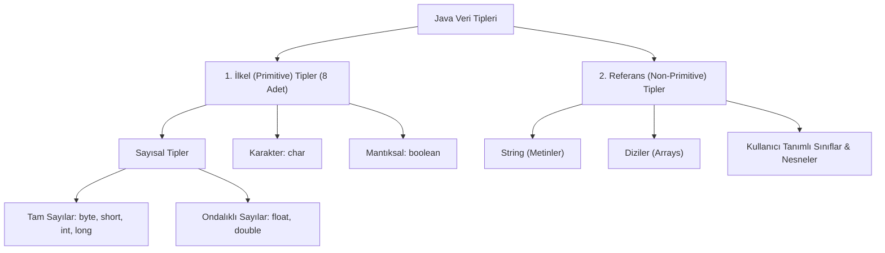

# Java'da Değişkenler ve Veri Tipleri Rehberi

Bu rehber, Java programlama dilinde değişken kavramını, değişken tanımlama kurallarını, ilkel (primitive) ve referans veri tiplerini, ders kapsamında hazırlanan [`Selam.java`](file:///c:/Users/asus/Documents/GitHub/dersler/java/0_giris/Selam.java) ve [`Degisken.java`](file:///c:/Users/asus/Documents/GitHub/dersler/java/0_giris/Degisken.java) örneklerinin incelemesini, sabit değerlerle not ortalaması hesaplayan örnek bir uygulamayı ve programlamaya yeni başlayanların en sık yaptığı hataları kapsamlı olarak ele almaktadır.

---

## 📌 İçindekiler
1. [Değişken (Variable) Nedir?](#1-değişken-variable-nedir)
2. [Değişken Tanımlama ve Değer Atama](#2-değişken-tanımlama-ve-değer-atama)
3. [Değişken İsimlendirme Kuralları ve Standartları](#3-değişken-isimlendirme-kuralları-ve-standartları)
4. [Java Veri Tipleri (Data Types)](#4-java-veri-tipleri-data-types)
   - [İlkel (Primitive) Veri Tipleri](#ilkel-primitive-veri-tipleri)
   - [İlkel Olmayan (Referans) Tip: String](#ilkel-olmayan-referans-tip-string)
   - [Veri Tipleri Özet Tablosu](#veri-tipleri-özet-tablosu)
5. [Mevcut Kodların İncelenmesi](#5-mevcut-kodların-incelenmesi)
   - [Selam.java: Çıktı ve Yorum Satırları](#selamjava-çıktı-ve-yorum-satırları)
   - [Degisken.java: Türler ve Birleştirme](#degiskenjava-türler-ve-birleştirme)
6. [Örnek Uygulama: Not Ortalaması Hesaplama](#6-örnek-uygulama-not-ortalaması-hesaplama)
7. [En Çok Yapılan Hatalar ve Çözümleri](#7-en-çok-yapılan-hatalar-ve-çözümleri)

---

## 1. Değişken (Variable) Nedir?

Bir program çalışırken verileri (sayılar, metinler, durumlar vb.) bilgisayarın geçici hafızasında (**RAM**) saklamak zorundadır.

**Değişken**, RAM bellekte ayrılan bir alana verilen **isimdir (etikettir)**.
- Değişkeni bir "kutu" gibi düşünebilirsiniz:
  - Kutunun bir **türü** vardır (sadece tamsayı alan kutu, sadece metin alan kutu).
  - Kutunun bir **adı** vardır (ona ulaşmak için kullandığımız etiket).
  - Kutunun bir **içeriği (değeri)** vardır (saklanan veri).

---

## 2. Değişken Tanımlama ve Değer Atama

Java **statik tipli (strongly/statically typed)** bir dildir. Yani bir değişkeni kullanmadan önce onun hangi türde veri tutacağını açıkça belirtmek zorundasınız.

### Temel Sözdizimi:
```java
VeriTipi degiskenAdi = ilkDeger;
```

### Değişken Oluşturma Yöntemleri:

```java
// 1. Tanımlama ve ilk değer atamasını aynı anda yapma (En yaygın yöntem)
int yas = 20;

// 2. Önce tanımlayıp (declaration), sonra değer atama (initialization)
int puan;
puan = 85;

// 3. Aynı türden birden fazla değişkeni tek satırda tanımlama
int sayi1 = 10, sayi2 = 20, toplam;
toplam = sayi1 + sayi2;
```

---

## 3. Değişken İsimlendirme Kuralları ve Standartları

Java'da değişkenlere isim verirken derleyicinin zorunlu kıldığı kurallar ve sektörde kabul görmüş yazım standartları (*naming conventions*) vardır:

### ⚠️ Zorunlu Kurallar (Uyulmazsa Derleme Hatası Verir):
1. **Rakam ile başlayamaz:**
   - `int 1inciSayi = 5;` ❌ *(Hatalı)*
   - `int sayi1 = 5;` ✅ *(Doğru)*
2. **Boşluk ve Özel Karakter İçeremez:**
   - Değişken isimlerinde boşluk, tire (`-`), nokta (`.`), `@`, `%` gibi karakterler kullanılamaz. Sadece harfler, rakamlar, alt tire (`_`) ve dolar işareti (`$`) kullanılabilir.
   - `int ogrenci no = 100;` ❌
   - `int ogrenci_no = 100;` ✅
3. **Java Anahtar Kelimeleri (Reserved Keywords) Kullanılamaz:**
   - `class`, `public`, `static`, `void`, `int`, `new`, `if`, `for` gibi dile ait özel sözcükler değişken adı yapılamaz.
4. **Büyük / Küçük Harfe Duyarlıdır (Case-Sensitive):**
   - `yas`, `Yas` ve `YAS` Java için tamamen farklı üç değişkendir.

### 💡 İyi Kodlama Alışkanlıkları (Convention):
- **camelCase Kullanımı:** İlk kelime küçük harfle başlar, sonraki kelimelerin ilk harfi büyük yazılır (Örn: `ogrenciVizeNotu`, `kullaniciAdi`, `maksimumHiz`).
- **Anlamlı İsimler:** Tek harfli (`a`, `b`, `x`) isimler yerine değişkenin amacını anlatan isimler tercih edilmelidir (`toplamFiyat`, `sayac`).
- **İngilizce Karakter:** Türkçe karakterler (`ç`, `ğ`, `ı`, `ö`, `ş`, `ü`) teknik olarak çalışsa da karakter kodlaması problemlerini önlemek için evrensel standart olan İngilizce alfabe karakterleri tercih edilmelidir.

---

## 4. Java Veri Tipleri (Data Types)

Java'da veri tipleri rastgele seçilmez; bilgisayar belleğindeki (**RAM**) saklanma şekillerine, boyutlarına ve yeteneklerine göre iki temel kategoriye ayrılır:

1. **İlkel (Primitive) Veri Tipleri:** Doğrudan basit bir değeri tutan, Java'nın çekirdeğinde tanımlı 8 temel türdür.
2. **Referans (Non-Primitive) Veri Tipleri:** Bellekteki karmaşık nesneleri gösteren (adresleyen) türlerdir (`String`, Diziler, kendi yazdığımız Sınıflar).

Aşağıdaki hiyerarşik şema, Java'daki veri tiplerinin soy ağacını özetlemektedir:



---

### 🧠 Neden Bu Ayrım Var? (İlkel vs. Referans Farkı)

Öğrencilerin en sık sorduğu: *"Neden `int` veya `double` küçük harfle yazılırken `String` büyük harfle başlıyor?"* sorusunun cevabı tam olarak buradadır:

| Karşılaştırma Kriteri | İlkel (Primitive) Tipler | Referans (Non-Primitive) Tipler |
| :--- | :--- | :--- |
| **Toplam Sayı** | Sadece **8 adettir** (Java tarafından sabitlenmiştir). | Sınırsızdır (Java kütüphaneleri ve bizim oluşturduğumuz sınıflar). |
| **Yazım Kuralı** | Her zaman **küçük harfle** başlar (`int`, `boolean`, `char`). | Sınıf oldukları için **büyük harfle** başlar (`String`, `Scanner`, `Ogrenci`). |
| **Bellekteki Yeri** | Değerin bizzat kendisi hızlı bellek olan **Stack** bölgesinde saklanır. | Nesnenin gövdesi **Heap** bellekte yaşar; değişken ise onun **adresini (referansını)** tutar. |
| **Metot Kullanımı** | **Nesne değildir.** Yanına nokta (`.`) koyup metot çağıramazsınız (`sayi.length()` ❌ geçersizdir). | **Nesnedir.** Zengin hazır metotları vardır (`isim.length()`, `isim.toUpperCase()` ✅ çalışır). |
| **İlk Değer Durumu** | Boş olamazlar, sayısal tipler varsayılan `0`, boolean `false` alır. | Henüz bir nesneye bağlanmamışsa `null` (hiçlik) değerini alabilir. |
| **Hafıza Boyutu** | Boyutları sabittir (Örn: `int` her zaman 4 byte yer kaplar). | Tutan verinin büyüklüğüne göre dinamik olarak değişir. |

---

### İlkel (Primitive) Veri Tipleri

#### 1. Tam Sayı Tipleri:
- **`byte`:** Çok küçük tamsayılar için (-128 ile 127 arası). 1 byte yer kaplar.
- **`short`:** Küçük tamsayılar için (-32.768 ile 32.767 arası). 2 byte yer kaplar.
- **`int`:** Java'da standart tamsayı tipidir (-2 milyar ile +2 milyar arası). 4 byte yer kaplar.
- **`long`:** `int` sınırını aşan devasa sayılar için kullanılır. 8 byte yer kaplar. Sayının sonuna `L` veya `l` eklenmelidir.
  ```java
  long dunyaNufusu = 8000000000L;
  ```

#### 2. Ondalıklı Sayı Tipleri:
- **`float`:** 32-bit tek duyarlıklı ondalıklı sayı. Değerin sonuna mutlaka `f` veya `F` konulmalıdır.
  ```java
  float pi = 3.14f;
  ```
- **`double`:** 64-bit çift duyarlıklı ondalıklı sayı. Java'da ondalıklı sayıların varsayılan standardıdır.
  ```java
  double hassasOran = 0.123456789;
  ```

#### 3. Karakter Tipi:
- **`char`:** Tek bir karakteri saklar (16-bit Unicode). **Mutlaka tek tırnak (`' '`) içinde yazılır.**
  ```java
  char notHarfi = 'A';
  char sembol = '#';
  ```

#### 4. Mantıksal Tip:
- **`boolean`:** Yalnızca iki değer alabilir: `true` (doğru) veya `false` (yanlış). Karar yapılarında ve koşullarda kullanılır.
  ```java
  boolean gectiMi = true;
  boolean sistemeGirdiMi = false;
  ```

### İlkel Olmayan (Referans) Tip: `String`
- Metinsel ifadeleri saklamak için kullanılan bir sınıftır (nesnedir).
- **Mutlaka çift tırnak (`" "`) içinde yazılır.**
  ```java
  String ogrenciAdi = "Ahmet Yılmaz";
  ```

---

### Veri Tipleri Özet Tablosu

| Veri Tipi | Boyut | Değer Aralığı / Açıklama | Örnek Tanımlama |
| :--- | :--- | :--- | :--- |
| `byte` | 1 byte (8-bit) | -128 ile 127 | `byte plaka = 34;` |
| `short` | 2 byte (16-bit)| -32,768 ile 32,767 | `short yil = 2026;` |
| **`int`** | 4 byte (32-bit)| ~ -2.14 milyar ile +2.14 milyar | `int maas = 45000;` |
| `long` | 8 byte (64-bit)| Çok büyük tamsayılar (sonuna `L`) | `long mesafe = 150000000L;` |
| `float` | 4 byte (32-bit)| 6-7 basamak hassasiyet (sonuna `f`) | `float faiz = 4.25f;` |
| **`double`**| 8 byte (64-bit)| 15-16 basamak hassasiyet | `double bakiye = 1250.75;` |
| `char` | 2 byte (16-bit)| Tek karakter, tek tırnak (`' '`) | `char cinsiyet = 'E';` |
| `boolean`| 1 bit | `true` veya `false` | `boolean aktif = true;` |
| **`String`**| Değişken | Metin kümesi, çift tırnak (`" "`) | `String sehir = "İstanbul";` |

---

## 5. Mevcut Kodların İncelenmesi

Ders dizininde yer alan örnek kodların detaylı açıklamaları:

### `Selam.java`: Çıktı ve Yorum Satırları

[`Selam.java`](file:///c:/Users/asus/Documents/GitHub/dersler/java/0_giris/Selam.java) dosyası Java'da konsola yazdırma metotlarını ve yorum satırlarını gösterir:

```java
public class Selam {
  public static void main(String [] args){
    // println: Yazdıktan sonra imleci bir alt satıra indirir.
    System.out.println("Selam millet!");
    System.out.println("Sana da selam");

    // print: Yazdıktan sonra alt satıra GEÇMEZ, bir sonraki çıktı yanından devam eder.
    System.out.print(" ben matrix");
    System.out.print(" ben matrix");

    // Tek satırlı yorum: Derleyici tarafından tamamen göz ardı edilir.

    /*
      Çok satırlı yorum:
      Birden fazla satıra yayılan açıklamalar
      için kullanılır.
    */
  }
}
```

* **Konsol Çıktısı:**
  ```text
  Selam millet!
  Sana da selam
   ben matrix ben matrix
  ```
* **Önemli Ayrım:** `println` satır atlatırken, `print` aynı satırda ekleme yapmaya devam eder.

---

### `Degisken.java`: Türler ve Birleştirme

[`Degisken.java`](file:///c:/Users/asus/Documents/GitHub/dersler/java/0_giris/Degisken.java) dosyasında farklı veri türleri tanımlanmış ve ekrana yazdırılmıştır:

```java
public class Degisken {
  public static void main(String [] args){
    // Tamsayı değişkeni tanımlama ve değer atama
    int num = 5;
    
    // Metin ile değişkeni birleştirme (String Concatenation):
    System.out.println("num:" + Integer.toString(num));
    System.out.println(num);

    // Diğer temel veri türleri:
    float f = 3.14f;       // 'f' sonekine dikkat ediniz
    char ch = 'A';         // Tek tırnak
    String str = "Zafer";  // Çift tırnak
    boolean bl = true;     // true veya false
    byte bt = 34;          // Küçük tamsayı
  }
}
```

* **İpucu:** Java'da `"num:" + num` şeklinde yazıldığında, Java otomatik olarak `num` değişkenini metne çevirir; `Integer.toString(num)` yazılması zorunlu değildir ancak arka plandaki tip dönüşümünü anlamak adına öğreticidir.

---

## 6. Örnek Uygulama: Not Ortalaması Hesaplama

Aşağıdaki program, bir öğrencinin **vize**, **final** ve **proje** notlarını kod içerisinde sabit ilk değerlerle tanımlayarak ağırlıklı not ortalamasını hesaplar.

```java
public class NotOrtalamasi {
    public static void main(String[] args) {
        // 1. Öğrenci Bilgileri (String ve int türü)
        String ogrenciAdi = "Zeynep Kaya";
        int ogrenciNo = 452;

        // 2. Not Değerleri (İlk değer atamaları kod içerisinde yapılmıştır)
        double vizeNotu = 75.0;
        double projeNotu = 85.0;
        double finalNotu = 60.0;

        // 3. Ağırlık Katsayıları (Vize %30, Proje %20, Final %50)
        double vizeAgirligi = 0.30;
        double projeAgirligi = 0.20;
        double finalAgirligi = 0.50;

        // 4. Ağırlıklı Ortalama Hesabı
        double genelOrtalama = (vizeNotu * vizeAgirligi) +
                               (projeNotu * projeAgirligi) +
                               (finalNotu * finalAgirligi);

        // 5. Geçme Durumu (Baraj notu: 60.0)
        boolean gectiMi = genelOrtalama >= 60.0;

        // 6. Harf Notu (char türü)
        char harfNotu = 'B';

        // 7. Sonuçların Ekrana Yazdırılması
        System.out.println("==================================");
        System.out.println("   ÖĞRENCİ NOT BİLGİ SİSTEMİ      ");
        System.out.println("==================================");
        System.out.println("Öğrenci No     : " + ogrenciNo);
        System.out.println("Öğrenci Adı    : " + ogrenciAdi);
        System.out.println("----------------------------------");
        System.out.println("Vize Notu      : " + vizeNotu + " (%30)");
        System.out.println("Proje Notu     : " + projeNotu + " (%20)");
        System.out.println("Final Notu     : " + finalNotu + " (%50)");
        System.out.println("----------------------------------");
        System.out.println("Genel Ortalama : " + genelOrtalama);
        System.out.println("Harf Notu      : " + harfNotu);
        System.out.println("Dersten Geçti mi? : " + (gectiMi ? "EVET, BAŞARILI" : "HAYIR, KALDI"));
        System.out.println("==================================");
    }
}
```

### Program Çıktısı:
```text
==================================
   ÖĞRENCİ NOT BİLGİ SİSTEMİ      
==================================
Öğrenci No     : 452
Öğrenci Adı    : Zeynep Kaya
----------------------------------
Vize Notu      : 75.0 (%30)
Proje Notu     : 85.0 (%20)
Final Notu     : 60.0 (%50)
----------------------------------
Genel Ortalama : 69.5
Harf Notu      : B
Dersten Geçti mi? : EVET, BAŞARILI
==================================
```

---

## 7. En Çok Yapılan Hatalar ve Çözümleri

Programlamaya yeni başlayan öğrencilerin değişkenlerle çalışırken en sık karşılaştığı hatalar şunlardır:

### 1. Değişkene İlk Değer Atamadan Kullanmaya Çalışmak (Uninitialized Variable)
Java'da metot içerisindeki yerel (*local*) değişkenlerin otomatik bir varsayılan değeri yoktur. Değer vermeden okumaya çalışırsanız derleyici hata verir:

```java
// ❌ HATA:
int toplam;
System.out.println(toplam); 
// Derleme Hatası: variable toplam might not have been initialized

// ✅ DOĞRU:
int toplam = 0; // İlk değer atanmalıdır
System.out.println(toplam);
```

---

### 2. Değişken İsimlerini Yanlış Kullanmak (Yazım ve Kapsam Hataları)

- **Büyük/Küçük Harf Uyuşmazlığı (Case Sensitivity):**
  ```java
  int sayi = 10;
  System.out.println(Sayi); // ❌ HATA: cannot find symbol (Sayi bulunamadı)
  ```
- **Aynı İsimle Tekrar Tanımlama:**
  ```java
  int yas = 20;
  int yas = 25; // ❌ HATA: variable yas is already defined in method main
  
  // ✅ DOĞRU: Türü tekrar yazmadan sadece değer güncellenmelidir:
  yas = 25;
  ```

---

### 3. Veri Tiplerine Dikkat Etmeme (Tür Uyuşmazlığı / Type Mismatch)

- **`float` Tanımlarken `f` Harfini Unutmak:**
  Java'da yazılan her ondalıklı sayı varsayılan olarak `double` kabul edilir. Bu nedenle `float` değişkenine atanırken `f` eklenmelidir:
  ```java
  float oran = 3.14;   // ❌ HATA: incompatible types: possible lossy conversion from double to float
  float oran = 3.14f;  // ✅ DOĞRU
  ```

- **Tek Tırnak (`' '`) ile Çift Tırnak (`" "`) Karışıklığı:**
  - `char` için tek tırnak, `String` için çift tırnak kullanılır:
  ```java
  char harf = "A";   // ❌ HATA: String, char değişkenine atanamaz
  char harf = 'A';   // ✅ DOĞRU
  
  String ad = 'Ali'; // ❌ HATA
  String ad = "Ali"; // ✅ DOĞRU
  ```

---

### 4. Tam Sayı Bölmesi Tuzağı (Integer Division Trap)

İki tamsayı birbirine bölündüğünde Java sonucu da tamsayı olarak hesaplar ve ondalık kısmı atar:

```java
int vize = 75;
int finalNotu = 80;

// ❌ TUZAK: (75 + 80) / 2 = 155 / 2 = 77 (0.5 kısmı atılır!)
double ortalama = (vize + finalNotu) / 2;
System.out.println(ortalama); // Çıktı: 77.0 olur (77.5 DEĞİL!)

// ✅ ÇÖZÜM: Bölen sayıyı double (2.0) olarak yazmak veya tür dönüşümü (casting) yapmak:
double dogruOrtalama = (vize + finalNotu) / 2.0;
System.out.println(dogruOrtalama); // Çıktı: 77.5 ✅
```
