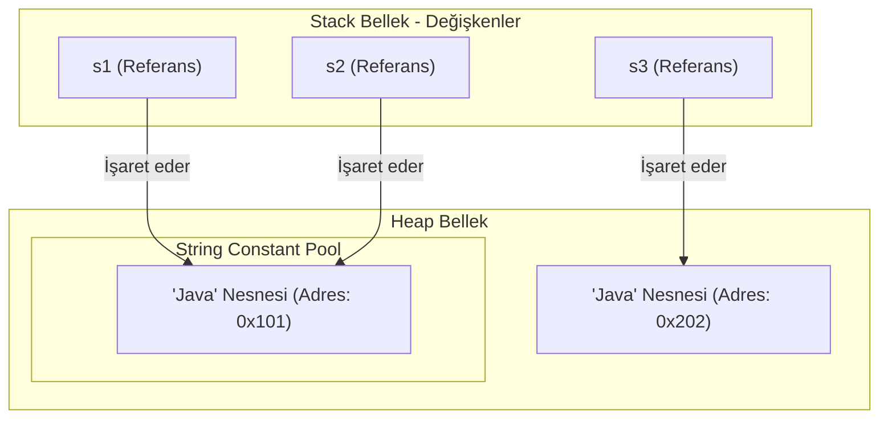

# 6. Java'da String Yapısı ve Metotları Rehberi

Bu rehber, Java programlama dilinde metinsel verileri temsil eden **`String` sınıfını**, String nesnelerinin bellekteki çalışma mekanizmasını (**String Constant Pool**), değişmezlik (**Immutability**) ilkesini, en sık kullanılan hazır alt metotlarını ve dizindeki [`MyString.java`](./MyString.java) demo programının detaylı incelemesini ele almaktadır.

---

> 📖 **İlgili Bölüm Dokümanları:**
> - ☕ [1. Java Dünyasına Giriş ve OOP (1_java_giris.md)](./1_java_giris.md)
> - 🐧 [2. Temel Linux Komutları (2_linux.md)](./2_linux.md)
> - 📦 [3. Değişkenler ve Veri Tipleri (3_degisken.md)](./3_degisken.md)
> - 🔒 [4. Sabitler ve Literaller (4_sabitler.md)](./4_sabitler.md)
> - ⚡ [5. Operatörler (5_operatörler.md)](./5_operatörler.md)

---

## 📌 İçindekiler
1. [Java'da String Nedir? İlkel Tiplerden Farkı](#1-javada-string-nedir-ilkel-tiplerden-farkı)
2. [Bellek Mantığı: String Constant Pool ve Değişmezlik (Immutability)](#2-bellek-mantığı-string-constant-pool-ve-değişmezlik-immutability)
3. [Kritik Soru: `==` ile `.equals()` Arasındaki Fark Nedir?](#3-kritik-soru--ile-equals-arasındaki-fark-nedir)
4. [En Çok Kullanılan String Metotları Kataloğu](#4-en-çok-kullanılan-string-metotları-kataloğu)
   - [A. Uzunluk ve Karakter Erişimi (`length`, `charAt`, `toCharArray`)](#a-uzunluk-ve-karakter-erişimi)
   - [B. Alt Metin Koparma (`substring`)](#b-alt-metin-koparma-substring)
   - [C. Arama ve Kontrol (`indexOf`, `contains`, `startsWith`, `endsWith`)](#c-arama-ve-kontrol)
   - [D. Karşılaştırma (`equals`, `equalsIgnoreCase`, `compareTo`)](#d-karşılaştırma)
   - [E. Harf Dönüşümü ve Boşluk Temizleme (`toUpperCase`, `trim`, `strip`)](#e-harf-dönüşümü-ve-boşluk-temizleme)
   - [F. Metin Değiştirme (`replace`, `replaceAll`)](#f-metin-değiştirme)
   - [G. Bölme ve Birleştirme (`split`, `String.join`, `concat`)](#g-bölme-ve-birleştirme)
   - [H. Boşluk ve Doluluk Kontrolü (`isEmpty`, `isBlank`)](#h-boşluk-ve-doluluk-kontrolü)
   - [I. Tür Dönüştürme (`String.valueOf`)](#i-tür-dönüştürme)
5. [Örnek Kod: MyString.java Programı](#5-örnek-kod-mystringjava-programı)
6. [En Çok Yapılan Hatalar ve Tuzaklar](#6-en-çok-yapılan-hatalar-ve-tuzaklar)
7. [Alıştırmalar ve Örnek Ödev Programları](#7-alıştırmalar-ve-örnek-ödev-programları)

---

## 1. Java'da String Nedir? İlkel Tiplerden Farkı

Java'da `int`, `double`, `boolean` gibi türler ilkel (*primitive*) verilerdir. Ancak **`String` bir ilkel tür DEĞİLDİR; Java'nın `java.lang` paketinde tanımlanmış yerleşik bir SINIFTIR (Class).**

Bu yüzden:
- Büyük harfle başlar (`String`).
- Bellekte bir nesne (*object*) olarak yer tutar.
- Yanına nokta (`.`) konarak onlarca hazır yetenek ve metot çağrılabilir (`metin.length()`, `metin.toUpperCase()`).

---

## 2. Bellek Mantığı: String Constant Pool ve Değişmezlik (Immutability)

Java'da String nesnelerinin iki benzersiz mimari özelliği vardır:

### A. String Havuzu (String Constant Pool)
Programlarda metinler çok sık kullanıldığı için Java belleği (RAM) optimize etmek amacıyla özel bir havuz tutar:
- Çift tırnakla tanımlanan metinler havuzda aranır:
  ```java
  String s1 = "Java";
  String s2 = "Java"; // Yeni nesne açılmaz! Havuzdaki s1'in adresini işaret eder.
  ```
- `new` anahtar kelimesiyle oluşturulan metinler ise havuzu yok sayarak Heap bellekte **ayrı bir nesne** üretir:
  ```java
  String s3 = new String("Java"); // Ayrı bir adreste yaşar!
  ```

### B. Değişmezlik (Immutability) İlkesi
Bir `String` nesnesi bellekte oluşturulduktan sonra **ASLA değiştirilemez**.

Bir String üzerinde bir metot çağırdığınızda (örn: `s.toUpperCase()`), orijinal metin değişmez; Java hafızada **tamamen yeni bir String nesnesi** oluşturur ve onu döndürür:

```java
String ad = "ali";
ad.toUpperCase(); 

System.out.println(ad); // Çıktı yine "ali" kalır! Değişmez!
ad = ad.toUpperCase();  // Değişimi kalıcı yapmak için değişkene GERİ ATANMALIDIR.
System.out.println(ad); // Çıktı: "ALI"
```

---

## 3. Kritik Soru: `==` ile `.equals()` Arasındaki Fark Nedir?

Bu konu Java mülakatlarının ve öğrenci sınavlarının **1 numaralı sorusudur**:



* **`==` Operatörü:** İki değişkenin **bellekteki referanslarını (adreslerini)** karşılaştırır.
* **`.equals()` Metodu:** Değişkenlerin işaret ettiği nesnelerin **karakter içeriklerinin aynı olup olmadığına** bakar.

```java
String s1 = "Java";
String s2 = "Java";
String s3 = new String("Java");

System.out.println(s1 == s2);      // true  (Çünkü ikisi de havuzdaki 0x101 adresini gösterir)
System.out.println(s1 == s3);      // false (Biri 0x101, diğeri 0x202 adresindedir! TUZAK!)
System.out.println(s1.equals(s3)); // true  (İçerikleri 'J-a-v-a' harfiyen aynıdır!)
```

> 🚨 **ALTIN KURAL:** Java'da metinleri karşılaştırırken **ASLA `==` KULLANMAYIN**, daima **`.equals()`** veya **`.equalsIgnoreCase()`** metodunu kullanın!

---

## 4. En Çok Kullanılan String Metotları Kataloğu

### A. Uzunluk ve Karakter Erişimi

| Metot | Dönüş Türü | Açıklama ve Örnek (`String s = "Kodlama";`) |
| :--- | :---: | :--- |
| **`length()`** | `int` | Karakter sayısını verir. `s.length()` ➡️ `7` |
| **`charAt(index)`** | `char` | Verilen indisteki karakteri döner (0'dan başlar). `s.charAt(0)` ➡️ `'K'` |
| **`toCharArray()`** | `char[]` | Metni `char` dizisine dönüştürür. |

---

### B. Alt Metin Koparma (`substring`)

| Metot | Açıklama |
| :--- | :--- |
| **`substring(int baslangic)`** | Belirtilen indisten metnin sonuna kadar olan kısmı kesip alır. |
| **`substring(int baslangic, int bitis)`** | `baslangic` indisinden başlar, `bitis` indisine kadar alır. **DİKKAT: Bitiş indisi dahil DEĞİLDİR!** `[baslangic, bitis)` |

```java
String kelime = "Kahraman";
System.out.println(kelime.substring(6));    // "an" (6. indisten sona kadar)
System.out.println(kelime.substring(0, 6)); // "Kahram" (0 dahil, 6 hariç!)
```

---

### C. Arama ve Kontrol

| Metot | Dönüş Türü | Açıklama |
| :--- | :---: | :--- |
| **`indexOf(str)`** | `int` | Aranan metnin ilk geçtiği indisi döner. Bulamazsa **`-1`** döner. |
| **`lastIndexOf(str)`**| `int` | Aranan metnin sondan başa doğru ilk geçtiği indisi döner. |
| **`contains(str)`** | `boolean` | Metin içerisinde aranan parça var mı? (`true`/`false`) |
| **`startsWith(str)`** | `boolean` | Metin belirtilen ifadeyle mi başlıyor? |
| **`endsWith(str)`** | `boolean` | Metin belirtilen ifadeyle mi bitiyor? |

```java
String dosya = "odev_raporu.pdf";
boolean pdfMi = dosya.endsWith(".pdf"); // true
int noktaYeri = dosya.indexOf(".");      // 11
```

---

### D. Karşılaştırma

| Metot | Açıklama |
| :--- | :--- |
| **`equals(str)`** | Büyük/küçük harf duyarlı olarak içerik eşitliğini kontrol eder. |
| **`equalsIgnoreCase(str)`** | Büyük/küçük harf farkını yok sayarak eşitliği kontrol eder (`"EVET"` ile `"evet"` eşittir). |
| **`compareTo(str)`** | Alfabetik (sözlük) sırasına göre karşılaştırır. Eşitse `0`, önceyse negatif, sonraysa pozitif tamsayı döner. |

---

### E. Harf Dönüşümü ve Boşluk Temizleme

| Metot | Açıklama |
| :--- | :--- |
| **`toUpperCase()`** | Tüm harfleri büyük harfe çevirir. |
| **`toLowerCase()`** | Tüm harfleri küçük harfe çevirir. |
| **`trim()`** | Metnin başındaki ve sonundaki tüm gereksiz boşlukları temizler. |
| **`strip()`** | Java 11 ile gelen, Unicode boşlukları da kapsayan gelişmiş `trim` metodudur. |

```java
String input = "   kullanici_adi   ";
String temiz = input.trim(); // "kullanici_adi"
```

---

### F. Metin Değiştirme

| Metot | Açıklama |
| :--- | :--- |
| **`replace(eski, yeni)`** | Belirtilen harf veya alt metnin tamamını yenisiyle değiştirir. |
| **`replaceAll(regex, yeni)`** | Düzenli ifade (Regex) kalıbına uyan kısımları değiştirir (Örn: tüm rakamları silme). |

```java
String tarih = "2026/10/24";
String formatli = tarih.replace("/", "."); // "2026.10.24"
```

---

### G. Bölme ve Birleştirme

| Metot | Açıklama |
| :--- | :--- |
| **`split(ayrac)`** | Metni belirtilen ayraca göre bölüp bir `String[]` dizisi olarak döndürür. |
| **`String.join(ayrac, elemanlar)`** | Dizi veya koleksiyon elemanlarını araya ayraç koyarak tek bir metin yapar. |
| **`concat(str)`** | İki metni uç uca ekler (`+` operatörü ile aynı işi yapar). |

```java
String meyveler = "Elma,Armut,Muz";
String[] dizi = meyveler.split(","); // ["Elma", "Armut", "Muz"]

String yeniMetin = String.join(" - ", dizi); // "Elma - Armut - Muz"
```

---

### H. Boşluk ve Doluluk Kontrolü

| Metot | `""` (Boş) | `"   "` (Sadece Boşluk) | `"Java"` (Dolu) |
| :--- | :---: | :---: | :---: |
| **`isEmpty()`** | `true` (Uzunluk = 0) | **`false`** (Karakter var) | `false` |
| **`isBlank()`** (Java 11+) | `true` | **`true`** (Boşlukları yok sayar) | `false` |

---

### I. Tür Dönüştürme (`String.valueOf`)

Herhangi bir veri türünü (`int`, `double`, `boolean`, `char[]`) güvenle metinsel `String` formatına çevirmek için statik **`String.valueOf()`** metodu kullanılır:

```java
int sayi = 100;
String yazi = String.valueOf(sayi); // "100"
```

---

## 5. Örnek Kod: `MyString.java` Programı

Dizinde yer alan [`MyString.java`](./MyString.java) kaynak kodu, yukarıda listelenen tüm metotları bölüm bölüm tek bir `main` metodu içinde canlı olarak çalıştırır.

Programı çalıştırmak için:
```bash
javac MyString.java
java MyString
```

---

## 6. En Çok Yapılan Hatalar ve Tuzaklar

1. **`==` Tuzağı:** Metin kıyaslarken `==` kullanmak adres kıyasladığı için programda beklenmedik mantık hatalarına yol açar. Her zaman `.equals()` kullanılmalıdır.
2. **Değişmezlik (Immutability) İhmali:**
   ```java
   String ad = "  ahmet  ";
   ad.trim(); // ❌ HATA: Orijinal 'ad' değişmez!
   ad = ad.trim(); // ✅ DOĞRU: Geri atanmalıdır.
   ```
3. **`StringIndexOutOfBoundsException` (İndis Aşımı):**
   - 5 karakterli `"Java!"` metninde indisler `0, 1, 2, 3, 4`'tür.
   - `metin.charAt(metin.length())` yazmak hata fırlatır! Doğrusu: `metin.charAt(metin.length() - 1)` olmalıdır.
4. **`NullPointerException`:**
   - Eğer bir String değişkenine değer atanmamışsa (`String s = null;`), üzerinde `s.length()` veya `s.equals(...)` çağırmak programı anında çökertir.
   - İpucu: Sabit bir metinle kıyaslama yaparken `s.equals("admin")` yerine `"admin".equals(s)` yazmak `NullPointerException` hatasını otomatik önler.

---

## 7. Alıştırmalar ve Örnek Ödev Programları

### ✍️ Pratik Sınıf İçi Alıştırmalar:
1. **İsim Formatlayıcı:** Düzensiz girilmiş bir tam adı (Örn: `String adSoyad = "   zafer   yavuz   ";`) `trim()`, `substring()` ve `toUpperCase()` kullanarak `"Zafer Yavuz"` formatına getiren kod satırlarını yazınız.
2. **E-Posta Doğrulama:** Bir e-posta adresinin (`"ogrenci@universite.edu.tr"`) geçerli bir üniversite adresi olup olmadığını `contains("@")` ve `endsWith(".edu.tr")` ile kontrol eden tek satırlık bir `boolean gecerliMi = ...;` ifadesi yazınız.
3. **Karakter Değişimi:** Bir metindeki tüm Türkçe karakterleri İngilizce karşılıklarıyla (örn: `ç` ➡️ `c`, `ş` ➡️ `s`, `ğ` ➡️ `g`) değiştiren peş peşe `.replace()` zinciri kurunuz.

### 📋 Ödev Programları ve Proje Konuları:

#### Ödev 1: Hassas Bilgi Maskeleme Programı (`MetinMaskeleme.java`)
- **Gereksinimler:**
  - Kod içinde sabit tanımlanmış 11 haneli bir TC Kimlik Numarası (`"12345678901"`) ve 16 haneli bir Kredi Kartı Numarası (`"5528-1234-5678-9012"`) alınız.
  - TC Kimlik numarasının ilk 3 ve son 2 hanesini açık bırakıp aradaki 6 haneyi yıldızlayınız (`"123******01"`).
  - Kredi kartı numarasındaki tireleri `replace("-", "")` ile kaldırıp sadece son 4 hanesini gösteriniz (`"************9012"`).
  - Yöntem: `substring()` ve `length()` metotlarını dinamik olarak kullanınız.

#### Ödev 2: Cümle ve Kelime Analiz Aracı (`KelimeAnaliz.java`)
- **Gereksinimler:**
  - Sabit bir paragraf metni tanımlayınız (Örn: `"Java nesneye dayalı, güvenli ve platformdan bağımsız güçlü bir programlama dilidir."`).
  - Metnin toplam karakter sayısını (`length`),
  - `split(" ")` kullanarak toplam kelime sayısını,
  - `indexOf("güvenli")` ile belirli bir anahtar kelimenin kaçıncı karakterde başladığını,
  - Metnin tamamen BÜYÜK harfli ve tamamen küçük harfli halini ekrana yazdırınız.

#### Ödev 3: Palindrom Test Edici (`PalindromKelime.java`)
- **Gereksinimler:**
  - Bir kelimenin (Örn: `"kayak"`, `"kabak"`, `"madam"`) tersten okunuşuyla düzden okunuşunun aynı olup olmadığını kontrol ediniz.
  - Metnin ilk ve son karakterlerini `charAt()`, `length()` ile karşılaştırarak adım adım doğruluğunu ekrana basınız.
