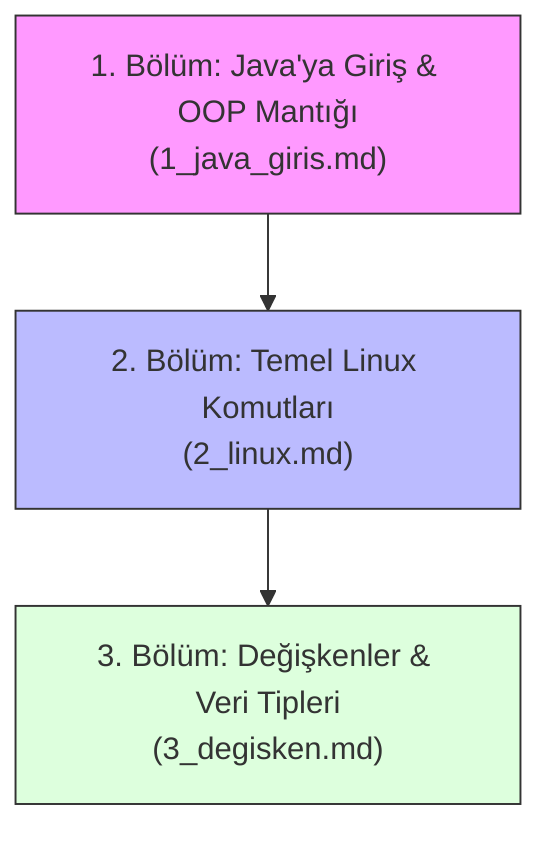

# 0. Giriş: Java Programlamaya Giriş Modülü

Bu dizin, **Java Programlama Dersi** için hazırlanan başlangıç modülüdür. Java'nın çalışma prensiplerini, Nesneye Dayalı Programlama (OOP) temellerini, geliştirme ortamlarında kullanılan temel Linux terminal komutlarını ve değişkenler konusunu adım adım ele alan kapsamlı ders dokümanlarını ve örnek kodları barındırır.

---

## 🧭 Konu Anlatımı ve Ders Rehberleri İndeksi

Aşağıdaki sırayı takip ederek modülü eksiksiz bir şekilde tamamlayabilirsiniz:



| No | Konu Başlığı | Dosya | Açıklama ve Kapsam |
| :---: | :--- | :--- | :--- |
| **01** | **Java Dünyası & OOP Mantığı** | [1_java_giris.md](./1_java_giris.md) | • Java'da programın kendisinin bile nesne/sınıf olması<br>• Sınıf (*Class*) ve Nesne (*Object*) kavramları<br>• OOP'nin 4 temel ilkesi (*Encapsulation, Inheritance, vb.*)<br>• `Main.java` analizi (`public`, `static`, `void`, `main`)<br>• JDK, JRE, JVM ilişkisi ve `javac` / `java` komutları |
| **02** | **Temel Linux & Terminal Rehberi** | [2_linux.md](./2_linux.md) | • Dizin gezinme ve listeleme (`pwd`, `ls`, `cd`, `clear`)<br>• Dosya/klasör yönetimi (`mkdir`, `touch`, `cp`, `mv`, `rm`)<br>• Dosya içeriği okuma (`cat`, `less`, `head`, `tail`)<br>• Sistem ve Java sürüm sorgulama (`cat /etc/os-release`, `which`)<br>• Terminal kısayolları (`Tab`, `Ctrl+C`, `Ctrl+L`) |
| **03** | **Değişkenler & Veri Tipleri** | [3_degisken.md](./3_degisken.md) | • Değişken tanımlama (*declaration*) ve değer atama (*initialization*)<br>• İsimlendirme kuralları ve `camelCase` standardı<br>• 8 İlkel (*Primitive*) tip ve `String` nesnesi<br>• Stack vs. Heap bellek çalışma mantığı<br>• Sabit verilerle **Not Ortalaması Hesaplama** programı<br>• En sık yapılan derleme hataları ve tuzaklar |

---

## 💻 Dizindeki Örnek Java Kodları

Ders anlatımlarında kullanılan ve bu dizinde yer alan çalıştırılabilir Java kaynak kodları:

| Kaynak Dosya | İlgili Konu | Açıklama |
| :--- | :--- | :--- |
| [`Main.java`](./Main.java) | İlk Program | Java'nın en temel yapısı, `main` metodu ve konsola `Merhaba Dünya` yazdırma. |
| [`Selam.java`](./Selam.java) | Çıktı & Yorumlar | `System.out.println()` ile `System.out.print()` arasındaki farklar, tek satırlı (`//`) ve çok satırlı (`/* */`) yorum kullanımı. |
| [`Degisken.java`](./Degisken.java) | Değişken Tipleri | `int`, `float`, `char`, `String`, `boolean`, `byte` türlerinin tanımlanması ve metin birleştirme (*concatenation*). |
| [`konular.md`](./konular.md) | Ders İzlencesi | Ders müfredatı, önerilen kaynak kitap, temel komut notları ve pratik alıştırma yönergeleri. |

---

## ⚡ Hızlı Başlangıç: Kodları Nasıl Derleyip Çalıştırırsınız?

Terminali (Komut İstemi / Bash) bu dizin (`0_giris`) içinde açtıktan sonra:

```bash
# 1. Kaynak kodu bayt koduna (.class) derleyin:
javac Main.java

# 2. Üretilen sınıfı JVM üzerinde çalıştırın (uzantısız!):
java Main
```

---

## 🎯 Modül Öğrenim Kazanımları

Bu modülü tamamlayan bir öğrenci:
1. Java'nın neden saf bir nesne yönelimli dil olduğunu ve her kodun neden bir sınıf içinde var olması gerektiğini anlar.
2. `javac` derleyicisi ile kaynak koddan (`.java`) ara bayt kodu (`.class`) oluşturmayı ve `java` komutuyla JVM üzerinde çalıştırmayı öğrenir.
3. Linux / Terminal komutlarıyla dosya ve klasörleri hatasız yönetebilir.
4. Java'nın ilkel veri tipleri ile referans tipleri arasındaki temel farkları, bellek kullanımını (Stack/Heap) ve değişken isimlendirme standartlarını kavrar.
5. Değişken tanımlarken yapılan yaygın hataları (ilk değer atamama, parantez dengesizliği, tür uyumsuzluğu, tam sayı bölmesi tuzağı) hızlıca fark edip düzeltebilir.
