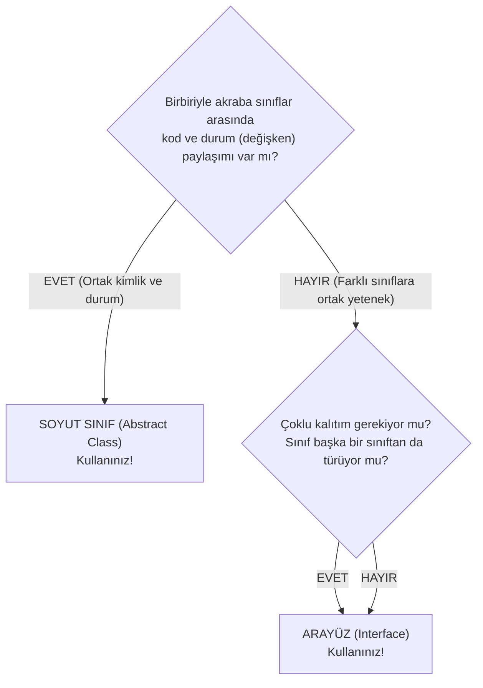

# 11. Java'da Arayüzler (Interfaces) ve Soyut Sınıflarla Karşılaştırma

Bu doküman; Java'da **Arayüz (Interface)** kavramını, **`implements`** anahtar kelimesi ile sınıflara ortak yetenekler kazandırmayı, Java'nın çoklu miras çözümünü, arayüzlerdeki sabit değişkenleri, Java 8 ve 9 ile gelen **`default`**, **`static`** ve **`private`** metotları ve **Soyut Sınıf (Abstract Class) ile Arayüz (Interface)** arasındaki mimari farkların kapsamlı karşılaştırmasını ele almaktadır.

---

> 📖 **İlgili Bölüm Dokümanları:**
> - 🔙 [Önceki Bölüm: Soyut Sınıflar (Abstract Classes) (A_soyut-sınıflar.md)](./A_soyut-sınıflar.md)
> - 🔝 [Modül Başlangıcı: Sınıf ve Nesne Temelleri (1_class-tanım.md)](./1_class-tanım.md)

---

## 📌 İçindekiler
1. [Arayüz (Interface) Nedir ve Temel Felsefesi](#1-arayüz-interface-nedir-ve-temel-felsefesi)
   - [Tam Soyutlama (Full Abstraction) ve Sözleşme (Contract) İlkesi](#tam-soyutlama-full-abstraction-ve-sözleşme-contract-ilkesi)
   - [Gerçek Dünya Analojisi: Elektrik Prizi ve USB Standardı](#gerçek-dünya-analojisi-elektrik-prizi-ve-usb-standardı)
2. [`interface` Tanımlama ve `implements` Sözdizimi](#2-interface-tanımlama-ve-implements-sözdizimi)
   - [Temel Arayüz Tanımı](#temel-arayüz-tanımı)
   - [Çoklu Arayüz Uygulama (Multiple Implementation)](#çoklu-arayüz-uygulama-multiple-implementation)
   - [Bir Arayüzün Başka Arayüzleri Genişletmesi (`extends`)](#bir-arayüzün-başka-arayüzleri-genişletmesi-extends)
3. [Arayüz Bileşenlerinin Varsayılan Kuralları](#3-arayüz-bileşenlerinin-varsayılan-kuralları)
   - [Değişkenler: Otomatik Olarak `public static final` Sabitler](#değişkenler-otomatik-olarak-public-static-final-sabitler)
   - [Metotlar: Otomatik Olarak `public abstract`](#metotlar-otomatik-olarak-public-abstract)
   - [Kurucu Metot (Constructor) Neden Kesinlikle Bulunmaz?](#kurucu-metot-constructor-neden-kesinlikle-bulunmaz)
4. [Modern Java Yenilikleri (Java 8 ve Java 9)](#4-modern-java-yenilikleri-java-8-ve-java-9)
   - [1. `default` Metotlar (Geriye Dönük Uyumluluk)](#1-default-metotlar-geriye-dönük-uyumluluk)
   - [2. `static` Metotlar (Arayüz Seviyesinde Araç Fonksiyonları)](#2-static-metotlar-arayüz-seviyesinde-araç-fonksiyonları)
   - [3. `private` Metotlar (Java 9 - Kod Tekrarını Önleme)](#3-private-metotlar-java-9---kod-tekrarını-önleme)
5. [Soyut Sınıflar (Abstract Class) vs. Arayüzler (Interface)](#5-soyut-sınıflar-abstract-class-vs-arayüzler-interface)
   - [Büyük Karşılaştırma Tablosu](#büyük-karşılaştırma-tablosu)
   - ["IS-A" (-dır) vs. "CAN-DO" (-ebilir / Yetenek) Ayrımı](#is-a--dır-vs-can-do--ebilir--yetenek-ayrımı)
   - [Karar Rehberi: "Hangisini Ne Zaman Seçmeliyim?"](#karar-rehberi-hangisini-ne-zaman-seçmeliyim)
6. [Özel Arayüz Türleri](#6-özel-arayüz-türleri)
   - [Fonksiyonel Arayüzler (Functional Interfaces - `@FunctionalInterface`)](#fonksiyonel-arayüzler-functional-interfaces)
   - [İşaretçi Arayüzler (Marker Interfaces)](#işaretçi-arayüzler-marker-interfaces)
7. [Adım Adım Çalıştırılabilir Kod Örnekleri](#7-adım-adım-çalıştırılabilir-kod-örnekleri)
   - [Örnek 1: Temel Arayüz ve Çoklu Yetenek (`Yazdirilabilir`, `Guvenli` & `Fatura.java`)](#örnek-1-temel-arayüz-ve-çoklu-yetenek)
   - [Örnek 2: "CAN-DO" Yetenek Ayrımı (`Ucabilir`, `Yuzebilir` & `Ordek.java`)](#örnek-2-can-do-yetenek-ayrımı)
   - [Örnek 3: Java 8 `default` ve `static` Metotlar (`BildirimKanali.java`)](#örnek-3-java-8-default-ve-static-metotlar)
8. [Sık Yapılan Hatalar ve Önemli Kurallar](#8-sık-yapılan-hatalar-ve-önemli-kurallar)
9. [Öğrenciler İçin Pekiştirici Sınıf İçi Alıştırmalar](#9-öğrenciler-için-pekiştirici-sınıf-içi-alıştırmalar)
10. [Ödev Konuları ve Mini Projeler](#10-ödev-konuları-ve-mini-projeler)

---

## 1. Arayüz (Interface) Nedir ve Temel Felsefesi?

Java'da **Arayüz (Interface)**; bir sınıfın dış dünyaya karşı vermeyi taahhüt ettiği **resmi bir sözleşmedir (contract)**.

Arayüz şunu söyler:
> *"Beni uygulayan (`implements`) her sınıf, benim listelediğim metotları mutlaka kendi içinde kodlamak ZORUNDADIR! Bu metotları nasıl kodladığı beni ilgilendirmez; ama o metotların orada olacağını dış dünyaya garanti ederim."*

---

### Tam Soyutlama (Full Abstraction) ve Sözleşme İlkesi

Geleneksel Java'da bir arayüz:
- Hiçbir nesne durumu (state) tutmaz.
- Hiçbir gövdeli kod barındırmaz.
- **%100 saf soyutlamadır.**

```
+-------------------------------------------------------------+
|               ARAYÜZ: Surulebilir (Drivable)                |
|  - gazVer()                                                 |
|  - frenYap()                                                |
+-------------------------------------------------------------+
               ^                            ^
               | (implements)               | (implements)
+---------------------------+  +------------------------------+
|     class Otomobil        |  |        class Bisiklet        |
|  - gazVer() -> Motora bas |  |  - gazVer() -> Pedalı çevir  |
|  - frenYap() -> Diski sık |  |  - frenYap() -> Pabucu sık   |
+---------------------------+  +------------------------------+
```

---

### Gerçek Dünya Analojisi: Elektrik Prizi ve USB Standardı

- **Elektrik Prizi:** Evinizdeki duvar prizi bir arayüzdür. 220V elektrik verir ve 2 yuvarlak deliğe sahiptir. Priz, oraya bir ütü mü, televizyon mu yoksa telefon şarj aleti mi takıldığını umursamaz. Fiş standardına uyan her cihaz prize takılabilir ve çalışır!
- **USB Girişi:** Bilgisayarınızdaki USB portu bir arayüzdür. Klavyeyi de, fareyi de, vantilatörü de aynı porta takabilirsiniz. Cihazların iç yapıları tamamen farklıdır ama hepsi "USB protokolünü" uygulamıştır.

---

## 2. `interface` Tanımlama ve `implements` Sözdizimi

### Temel Arayüz Tanımı
`class` yerine **`interface`** anahtar kelimesi kullanılır:

```java
public interface SesCikarabilir {
    // Gövdesiz soyut metot (public abstract varsayılandır)
    void sesCikar();
}
```

Bir sınıf arayüzü uygulamak için **`implements`** anahtar kelimesini kullanır:

```java
public class Kopek implements SesCikarabilir {
    @Override
    public void sesCikar() {
        System.out.println("Hav hav!");
    }
}
```

---

### Çoklu Arayüz Uygulama (Multiple Implementation)

Hatırlarsanız Java'da bir sınıf birden fazla sınıftan `extends` **edemezdi** (Elmas Problemi sebebiyle). 
Fakat **bir sınıf aynı anda İSTEDİĞİ KADAR ARAYÜZÜ uygulayabilir (`implements`)**:

```java
public class AkilliTelefon implements Telefon, Kamera, MuzikCalar, GPS {
    // 4 farklı arayüzün tüm metotlarını tek sınıfta birleştirebilir!
}
```

Bu özellik Java'nın **çoklu kalıtım (multiple inheritance)** ihtiyacını tamamen güvenli ve çakışmasız biçimde çözmesini sağlar!

---

### Bir Arayüzün Başka Arayüzleri Genişletmesi (`extends`)

Bir sınıf bir arayüzü `implements` eder; fakat **bir arayüz başka bir arayüzü `extends` edebilir** (ve hatta birden fazla arayüzü aynı anda `extends` edebilir!):

```java
public interface AkilliCihaz extends InternetBaglanabilir, SarjEdilebilir {
    void guncellemeKontrolEt();
}
```

---

## 3. Arayüz Bileşenlerinin Varsayılan Kuralları

Java'da bir arayüzün içine kod yazarken derleyici bazı kelimeleri siz yazmasanız bile **otomatik olarak ekler**:

### 1. Değişkenler: Otomatik `public static final`
Arayüz içinde tanımlanan her değişken istisnasız **KÜRESEL BİR SABİTTİR**:
- `public`: Herkes görebilir.
- `static`: Arayüz adı üzerinden erişilir (`Arayuz.SABIT`).
- `final`: Değeri sonradan asla değiştirilemez.

```java
public interface BoyutSabitleri {
    int MAKS_BOYUT = 100; // Arka planda: public static final int MAKS_BOYUT = 100;
}
```

---

### 2. Metotlar: Otomatik `public abstract`
Arayüz metotlarının başına `public` veya `abstract` yazmasanız dahi Java bunları otomatik olarak ekler:

```java
public interface Cizilebilir {
    void ciz(); // Arka planda: public abstract void ciz();
}
```

> ⚠️ **KRİTİK UYARI:** Alt sınıf bu metodu `@Override` ederken başına **mutlaka `public` yazmak zorundadır!** Aksi halde erişim belirleyicisini daralttığınız gerekçesiyle derleme hatası alırsınız.

---

### 3. Kurucu Metot (Constructor) Neden Kesinlikle Bulunmaz?

Arayüzlerde hiçbir zaman kurucu metot (`Constructor`) yazılamaz!
- Çünkü arayüzler kendi içlerinde hiçbir nesne durumu (özellik/field) saklamazlar.
- Durumu olmayan bir şeyin başlatılmasına (`initialization`) da gerek yoktur.

---

## 4. Modern Java Yenilikleri (Java 8 ve Java 9)

Geleneksel Java'da arayüzlerde tek bir satır bile gövdeli kod yazılamazdı. Ancak bu durum büyük kurumsal projelerde ciddi bir soruna yol açtı:
> *Milyonlarca sınıfın uyguladığı dev bir arayüze yeni tek bir metot eklerseniz, o arayüzü uygulayan tüm sınıflar derleme hatası verir ve çöker!*

Bu sorunu çözmek için Java 8 ve 9 ile arayüzlere **gövdeli metot desteği** getirildi:

---

### 1. `default` Metotlar (Java 8+)
Arayüz içine `default` kelimesi yazılarak **gövdeli metot** eklenebilir. Alt sınıflar bu metodu ezmek **zorunda değildir**; isterlerse aynen kullanırlar, isterlerse ezebilirler:

```java
public interface Loglanabilir {
    void logKaydet(String mesaj); // Soyut metot

    // Default Metot (Geriye Dönük Uyumluluk için):
    default void logFormatiBas() {
        System.out.println("[STANDART LOG BAŞLIĞI - " + java.time.LocalDate.now() + "]");
    }
}
```

---

### 2. `static` Metotlar (Java 8+)
Arayüze ait yardımcı ve araç fonksiyonları tanımlamak için kullanılır. Doğrudan `ArayuzAdi.metot()` şeklinde çağrılır:

```java
public interface Matematiksel {
    static int mutlakDeger(int sayi) {
        return sayi < 0 ? -sayi : sayi;
    }
}

// Kullanım:
int sonuc = Matematiksel.mutlakDeger(-15); // 15
```

---

### 3. `private` Metotlar (Java 9+)
Arayüz içindeki birden fazla `default` metodun paylaştığı ortak kodları gizlemek için kullanılır. Dışarıdan veya alt sınıflardan erişilemez:

```java
public interface Guvenlik {
    default void girisYap() {
        ortakKontrol();
        System.out.println("Giriş yapıldı.");
    }

    // Java 9 Private Yardımcı Metot:
    private void ortakKontrol() {
        System.out.println("Token doğrulandı.");
    }
}
```

---

## 5. Soyut Sınıflar (Abstract Class) vs. Arayüzler (Interface)

İşte Java mülakatlarının ve nesneye yönelimli tasarım sınavlarının **1 numaralı sorusu**:

### Büyük Karşılaştırma Tablosu

| Özellik | Soyut Sınıf (Abstract Class) | Arayüz (Interface) |
| :--- | :--- | :--- |
| **Anahtar Kelimeler** | `abstract class` / `extends` | `interface` / `implements` |
| **Çoklu Kalıtım** | ❌ Desteklemez (Tek sınıftan türeyebilir) | ✅ **Destekler** (Sınırsız arayüz uygulanabilir) |
| **Değişkenler** | Her türlü değişken olabilir (`private`, `protected`, `int sayi;`) | Yalnızca `public static final` sabitler olabilir |
| **Metot Türleri** | Gövdeli ve gövdesiz her türlü metot olabilir | Varsayılan soyuttur; Java 8+ ile `default`/`static` gelebilir |
| **Erişim Belirleyiciler** | `public`, `protected`, `private`, `default` hepsi serbesttir | Metotlar her zaman `public`'tir (Java 9 private hariç) |
| **Kurucu (Constructor)** | ✅ **Vardır** (Alt sınıflar `super` ile çağırır) | ❌ **ASLA YOKTUR** |
| **İlişki Anlamı** | **"IS-A" (-dır / -dir)** (Kimlik / Soy Ağacı) | **"CAN-DO" (-ebilir / Yetenek)** (Sözleşme) |
| **Hız / Performans** | Biraz daha hızlıdır (doğrudan vtable çağrısı) | Arayüz tablosu aramasından ötürü çok hafif daha yavaştır |

---

### "IS-A" (-dır) vs. "CAN-DO" (-ebilir / Yetenek) Ayrımı

```
      SOYUT SINIF (IS-A)                    ARAYÜZ (CAN-DO)
   "Köpek bir HAYVANDIR"               "Ördek bir UÇABİLENDİR"
   "Kartal bir HAYVANDIR"              "Uçak bir UÇABİLENDİR"
   "Uçak bir HAYVAN DEĞİLDİR!"         "Süpermen bir UÇABİLENDİR"
```

- Eğer nesneler arasında biyolojik veya mantıksal bir **soy/kimlik bağı** varsa ve ortak durum (değişkenler) paylaşacaklarsa $\rightarrow$ **Soyut Sınıf (Abstract Class)** kullanılır.
- Eğer birbirinden tamamen alakasız nesnelere (Ördek, Uçak ve Süpermen) **ortak bir yetenek (uçabilme - `Ucabilir`)** kazandırmak istiyorsanız $\rightarrow$ **Arayüz (Interface)** kullanılır!

---

### Karar Rehberi: "Hangisini Ne Zaman Seçmeliyim?"



---

## 6. Özel Arayüz Türleri

### Fonksiyonel Arayüzler (Functional Interfaces)
İçerisinde **yalnızca 1 adet soyut metot** barındıran arayüzlerdir. Java'nın modern Lambda ifadelerinin (`->`) temelini oluşturur. Başına `@FunctionalInterface` konarak garanti altına alınır:

```java
@FunctionalInterface
public interface Hesaplayici {
    int hesapla(int a, int b); // Tek bir soyut metot!
}
```

Standart kütüphanedeki `Runnable` (`run()`), `Comparable` (`compareTo()`) bunun en popüler örnekleridir.

---

### İşaretçi Arayüzler (Marker Interfaces)
İçinde **hiçbir metot veya sabit bulunmayan**, tamamen boş arayüzlerdir. JVM'e veya kütüphanelere o sınıf hakkında özel bir yetki veya bilgi vermek (etiketlemek) için kullanılır:
- `java.io.Serializable`: Bu sınıfın nesneleri diske veya ağa bayt olarak yazılabilir.
- `java.lang.Cloneable`: Bu sınıfın nesneleri hafızada kopyalanabilir.

---

## 7. Adım Adım Çalıştırılabilir Kod Örnekleri

---

### Örnek 1: Temel Arayüz ve Çoklu Yetenek

Bir e-ticaret faturasının hem **yazdırılabilir** hem de **dijital arşivlenebilir** olmasını sağlayalım.

#### `Yazdirilabilir.java` & `Arsivlenebilir.java`
```java
// 1. Arayüz
public interface Yazdirilabilir {
    void fizikselYazdir();
}

// 2. Arayüz
public interface Arsivlenebilir {
    void bulutaYedekle(String sunucuAdresi);
}
```

#### `Fatura.java`
```java
// İki arayüzü aynı anda uygulayan sınıf:
public class Fatura implements Yazdirilabilir, Arsivlenebilir {
    private String faturaNo;
    private double tutar;

    public Fatura(String faturaNo, double tutar) {
        this.faturaNo = faturaNo;
        this.tutar = tutar;
    }

    // Yazdirilabilir arayüzünün metodu:
    @Override
    public void fizikselYazdir() {
        System.out.println("🖨️ Fatura yazıcıdan basılıyor: [" + faturaNo + "] - " + tutar + " TL");
    }

    // Arsivlenebilir arayüzünün metodu:
    @Override
    public void bulutaYedekle(String sunucuAdresi) {
        System.out.println("☁️ Fatura [" + faturaNo + "] " + sunucuAdresi + " adresine şifreli yüklendi.");
    }
}
```

#### `FaturaTest.java`
```java
public class FaturaTest {
    public static void main(String[] args) {
        Fatura f = new Fatura("FTR-2026-001", 4500.0);

        // Doğrudan sınıf üzerinden çağrı:
        f.fizikselYazdir();
        f.bulutaYedekle("https://aws.s3.company.com/fatura");

        System.out.println("\n--- Polimorfik Arayüz Referansları ---");
        // Sadece Yazdirilabilir yeteneği ile bakış:
        Yazdirilabilir yaziciKuyrugu = f;
        yaziciKuyrugu.fizikselYazdir();

        // Sadece Arsivlenebilir yeteneği ile bakış:
        Arsivlenebilir bulutServisi = f;
        bulutServisi.bulutaYedekle("https://backup.cloud.com");
    }
}
```

#### Konsol Çıktısı:
```text
🖨️ Fatura yazıcıdan basılıyor: [FTR-2026-001] - 4500.0 TL
☁️ Fatura [FTR-2026-001] https://aws.s3.company.com/fatura adresine şifreli yüklendi.

--- Polimorfik Arayüz Referansları ---
🖨️ Fatura yazıcıdan basılıyor: [FTR-2026-001] - 4500.0 TL
☁️ Fatura [FTR-2026-001] https://backup.cloud.com adresine şifreli yüklendi.
```

---

### Örnek 2: "CAN-DO" Yetenek Ayrımı (Uçabilenler ve Yüzebilenler)

Farklı soy ağaçlarından gelen varlıkları ortak yetenek arayüzleriyle yönetme:

#### Arayüzler ve Sınıflar
```java
interface Ucabilir {
    void uc();
}

interface Yuzebilir {
    void yuz();
}

// Ördek hem uçar hem yüzer:
class Ordek implements Ucabilir, Yuzebilir {
    private String ad;
    public Ordek(String ad) { this.ad = ad; }

    @Override
    public void uc() { System.out.println(ad + " kanat çırparak göle doğru uçuyor. 🦆"); }

    @Override
    public void yuz() { System.out.println(ad + " göletin üzerinde yüzüyor."); }
}

// Uçak sadece uçar (Hayvan değildir!):
class Ucak implements Ucabilir {
    private String model;
    public Ucak(String model) { this.model = model; }

    @Override
    public void uc() { System.out.println(model + " jet motorlarıyla 10.000 metrede uçuyor. ✈️"); }
}

public class YetenekTest {
    // Sadece Ucabilir arayüzünü uygulayan her nesneyi kabul eden polimorfik fonksiyon!
    public static void kalkisIzniVer(Ucabilir ucanVarlik) {
        System.out.print("[Kule İzni Onaylandı] -> ");
        ucanVarlik.uc();
    }

    public static void main(String[] args) {
        Ordek donald = new Ordek("Donald Duck");
        Ucak boeing = new Ucak("Boeing 737");

        kalkisIzniVer(donald);
        kalkisIzniVer(boeing);
    }
}
```

---

### Örnek 3: Java 8 `default` ve `static` Metotlar

#### `BildirimKanali.java`
```java
public interface BildirimKanali {
    // Sabit Değişken (public static final)
    String SISTEM_SURUMU = "V2.4";

    // Soyut Metot
    void gonder(String alici, String mesaj);

    // Java 8 Default Metot (Gövdesi var! Alt sınıflar ezmek zorunda değil)
    default void topluGonder(String[] alicilar, String mesaj) {
        System.out.println(">> Toplu gönderim döngüsü başlatıldı:");
        for (String alici : alicilar) {
            gonder(alici, mesaj);
        }
    }

    // Java 8 Static Metot (Yardımcı araç fonksiyonu)
    static boolean telefonGecerliMi(String tel) {
        return tel != null && tel.startsWith("+90") && tel.length() == 13;
    }
}
```

#### `SmsServisi.java`
```java
class SmsServisi implements BildirimKanali {
    @Override
    public void gonder(String alici, String mesaj) {
        System.out.println("📱 [SMS Gönderildi] Kime: " + alici + " | Mesaj: " + mesaj);
    }
}

public class BildirimTest {
    public static void main(String[] args) {
        // 1. Statik metot kullanımı (Doğrudan arayüz ismiyle):
        boolean gecerli = BildirimKanali.telefonGecerliMi("+905551234567");
        System.out.println("Telefon formatı geçerli mi? -> " + gecerli);

        // 2. Default metot kullanımı:
        BildirimKanali sms = new SmsServisi();
        sms.gonder("+905551112233", "Tekil mesaj.");

        String[] liste = { "+905551112233", "+905554445566" };
        sms.topluGonder(liste, "Sistem bakım duyurusu."); // Default metot çalışır!
    }
}
```

---

## 8. Sık Yapılan Hatalar ve Önemli Kurallar

### 1. `@Override` Ederken Başına `public` Yazmayı Unutmak
```java
interface Calisabilir {
    void calis(); // Arka planda public abstract'tır
}

class Isci implements Calisabilir {
    // ❌ HATA: calis() in Isci cannot implement calis() in Calisabilir; 
    // attempting to assign weaker access privileges; was public
    void calis() { } 
}
```
Arayüz metotları `public` olduğu için, alt sınıfta başına mutlaka açıkça **`public`** yazılmalıdır!

---

### 2. Arayüz Değişkenini Değiştirmeye Çalışmak
```java
interface Ayarlar {
    int TIMEOUT = 5000;
}

// Kullanımda:
Ayarlar.TIMEOUT = 8000; // ❌ HATA: cannot assign a value to final variable TIMEOUT
```
Arayüz alanları otomatik olarak `final` sabittir, asla değiştirilemez.

---

### 3. İki Arayüzde Aynı İsimde `default` Metot Çakışması
Eğer bir sınıf iki farklı arayüzü uygularsa ve ikisinde de aynı isimde `default` metot varsa derleyici hata verir (*Default Method Diamond Conflict*).
✅ **Çözüm:** Alt sınıf o metodu kendi içinde açıkça ezerek (`@Override`) hangi arayüzün metodunu çağıracağını `ArayuzAdi.super.metot()` ile belirtmelidir.

---

## 9. Öğrenciler İçin Pekiştirici Sınıf İçi Alıştırmalar

### Alıştırma 1: Mimari Tasarım Kararı (Abstract Class mı, Interface mi?)
Aşağıdaki gereksinimler için **Soyut Sınıf mı** yoksa **Arayüz mü** seçilmelidir? Neden?

1. Bir oyundaki `Karakter` hiyerarşisi (Savaşçı, Büyücü). Hepsinin `can`, `mana`, `ad` değişkenleri ve ortak `hasarAl()` metodu var.
2. Bir projedeki `Klonlanabilir` özelliği. Hem `Kullanici` hem `Araba` hem `Dosya` sınıfları kopyalanabilmek istiyor.
3. Çoklu kalıtım gerektiren bir durum: Bir `AkilliSaat` hem `Saat` hem `NabizOlcer` hem `Adimsayar` özelliklerine sahip olacak.

<details>
<summary>🔍 <b>Cevapları ve Açıklamaları Görmek İçin Tıklayın</b></summary>

1. **Soyut Sınıf:** Çünkü sınıflar akrabadır ("IS-A"), ortak durum (can, mana) saklarlar ve kod tekrarını önleyen gövdeli metotları (`hasarAl()`) paylaşırlar.
2. **Arayüz (Interface):** Çünkü Kullanıcı, Araba ve Dosya tamamen alakasız sınıflardır. Onlara ortak bir "yeteneği (CAN-DO)" kazandırmak için `Klonlanabilir` arayüzü en doğrusudur.
3. **Arayüz (Interface):** Çünkü Java sınıflarda çoklu mirasa izin vermez. Çoklu kalıtım ancak `implements Saat, NabizOlcer, Adimsayar` şeklinde arayüzlerle yapılabilir.
</details>

---

### Alıştırma 2: Hata Avı (Bug Hunting)
Aşağıdaki arayüz tanımında derleme hatası veren satırı bulunuz:

```java
public interface VeritabaniServisi {
    int PORT = 3306;
    
    public VeritabaniServisi() {
        System.out.println("Arayüz başladı.");
    }

    void baglan();
}
```

<details>
<summary>🔍 <b>Hata ve Düzeltmeyi Görmek İçin Tıklayın</b></summary>

**Hata:** `public VeritabaniServisi() { ... }` kurucu metot satırı derlenmez (`<identifier> expected` veya `interfaces cannot have constructors`).
**Kural:** Arayüzlerde kurucu metot (`Constructor`) tanımlanamaz!
</details>

---

### Alıştırma 3: Standart Arayüz Pratiği (`Comparable`)
Java'nın yerleşik `Comparable<Ogrenci>` arayüzünü uygulayan bir `Ogrenci` sınıfı tasarlayınız:
- Alanlar: `int no`, `String ad`, `double gpa`.
- `public int compareTo(Ogrenci diger)` metodunu override ederek öğrencileri `gpa` not ortalamalarına göre büyükten küçüğe sıralayacak mantığı yazınız.

---

## 10. Ödev Konuları ve Mini Projeler

---

### 🟢 Ödev 1 (Temel Seviye): Akıllı Ev Aletleri Arayüz Mimarisi (`AkilliEvTest.java`)

**Gereksinimler:**
1. İki bağımsız arayüz oluşturunuz:
   - `AcilipKapanabilir`: `void ac()`, `void kapat()`, `boolean isAcikMi()`.
   - `Ayarlanabilir`: `void seviyeArtir()`, `void seviyeAzalt()`, `int getMevcutSeviye()`.
2. Somut Sınıflar:
   - `AkilliLamba`: Sadece `AcilipKapanabilir` arayüzünü uygulasın.
   - `AkilliTermostat`: Hem `AcilipKapanabilir` hem `Ayarlanabilir` arayüzlerini aynı anda uygulasın (`implements AcilipKapanabilir, Ayarlanabilir`).
3. `AkilliEvTest.java` içinde polimorfik olarak cihazları açıp seviyelerini yöneten bir test senaryosu çalıştırınız.

---

### 🟡 Ödev 2 (Orta Seviye): Çoklu Ödeme Geçidi ve Güvenlik Doğrulaması (`OdemeSistemiTest.java`)

**Gereksinimler:**
1. Arayüz 1: `OdemeKanali`
   - `boolean odemeYap(double tutar);`
   - `default void komisyonBilgisiYazdir()` (Varsayılan %1 komisyon mesajı bassın).
2. Arayüz 2: `GuvenlikDogrulanabilir`
   - `boolean ikiFaktorluDogrula(String smsKodu);`
3. Somut Sınıflar:
   - `KrediKartiServisi`: Her iki arayüzü de uygulasın. Ödeme yapmadan önce SMS kodunu doğrulasın; komisyon bilgisi metodunu ezip (%2.5) olarak güncellesin.
   - `HavaleServisi`: Yalnızca `OdemeKanali` arayüzünü uygulasın (komisyon 0 TL).
4. `OdemeSistemiTest` içinde polimorfik ödeme akışlarını simüle ediniz.

---

### 🔴 Ödev 3 (İleri Seviye): Hibrit Bulut Depolama ve Dosya İşleme Motoru (`BulutTest.java`)

**Gereksinimler (Soyut Sınıf + Arayüz Birlikte!):**
1. Soyut Sınıf: `BulutDepolama`
   - `protected String saglayiciAdi;`
   - `protected double toplamKapasiteGb;`
   - `protected double kullanilanKapasiteGb;`
   - Kurucu metot.
   - Gövdeli metot: `public void alanRaporu()` (Kalan boş alanı formatlı basar).
   - Soyut metot: `public abstract void baglantiKur();`
2. Arayüz 1: `Sifrelenebilir`
   - `void sifrele(String algoritma);`
3. Arayüz 2: `Paylasilabilir`
   - `String paylasimLinkiUret(String dosyaAdi);`
4. Somut Sınıflar:
   - `GoogleDrive`: `BulutDepolama`'dan türer (`extends`) ve her iki arayüzü de (`implements Sifrelenebilir, Paylasilabilir`) uygular!
   - `AwsS3Bucket`: `BulutDepolama`'dan türer ve sadece `Sifrelenebilir` arayüzünü uygular.
5. `BulutTest.java` dosyasında:
   - Soyut sınıf referansıyla ortak kapasite takibi yapınız.
   - Arayüz referanslarıyla dosya şifreleme ve link üretme yeteneklerini test ediniz.

