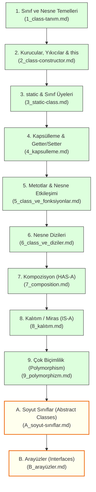

# 5. Modül: Java'da Nesne Yönelimli Programlama (OOP) ve Sınıflar

Bu dizin, **Java Nesne Yönelimli Programlama (Object-Oriented Programming - OOP)** kavramlarını en temelden ileri seviyeye kadar adım adım ele alan kapsamlı ders modülüdür. 

Tüm ders dokümanları pedagojik konu anlatımları, gerçek hayat analojileri, bellek (Stack/Heap) şemaları, çalıştırılabilir kod örnekleri, tuzaklar ve çözümlü alıştırmalar/ödevler ile donatılmıştır.

---

## 🧭 Ders Dokümanları İndeksi ve Öğrenim Sırası

---

## 📋 Modül Konu Başlıkları Tablosu

| No | Doküman | Konu Başlığı | Temel Kazanımlar ve Kapsam |
| :---: | :--- | :--- | :--- |
| **01** | [**1_class-tanım.md**](./1_class-tanım.md) | **Sınıf ve Nesne Temelleri** | • Class & Object mantığı, mimari plan analojisi • Stack ve Heap bellek mimarisi • `public`, `private`, `protected`, `default` erişim belirleyicileri karşılaştırması |
| **02** | [**2_class-constructor.md**](./2_class-constructor.md) | **Kurucu, Yıkıcı & `this`** | • Constructor mantığı ve aşırı yükleme (overloading) • `this` anahtar kelimesi ve kurucu zincirleme (`this(...)`) • C++ Destructor vs. Java Garbage Collector, `AutoCloseable` & `close()` |
| **03** | [**3_static-class.md**](./3_static-class.md) | **`static` Anahtar Kelimesi** | • Nesne değişkeni vs. Sınıf değişkeni farkı, sayaçlar • `Math` sınıfı ve yardımcı (utility) sınıf tasarımı • `static` başlatma blokları (`static { ... }`) ve yaygın derleme tuzakları |
| **04** | [**4_kapsulleme.md**](./4_kapsulleme.md) | **Kapsülleme & Getter/Setter** | • Veri gizleme (*Information Hiding*) ilkesi • Setter içinde veri doğrulama (*validation*) • Salt okunur / yazılır alanlar ve savunmacı kopyalama (*Defensive Copying*) |
| **05** | [**5_class_ve_fonksiyonlar.md**](./5_class_ve_fonksiyonlar.md) | **Metotlar ve Nesne Etkileşimi** | • Java'da *Pass-by-Value* kuralının nesnelerdeki davranışı • Alanların otomatik varsayılan değerleri vs. yerel değişkenler • Metotlardan nesne döndürme (*Return Object*) ve nesneler arası transfer |
| **06** | [**6_class_ve_diziler.md**](./6_class_ve_diziler.md) | **Nesne Dizileri** | • Nesne dizilerinin iki aşamalı başlatma zorunluluğu (`null` tuzağı) • For-each gezinimi, arama, filtreleme, max/min algoritmaları • Metotlara dizi gönderme ve metottan nesne dizisi döndürme |
| **07** | [**7_composition.md**](./7_composition.md) | **Kompozisyon ("HAS-A")** | • Sınıf içinde başka sınıf nesnesi barındırma • Sıkı sahiplik (*Composition*) vs. Gevşek sahiplik (*Aggregation*) • İç sınıflar (*Inner / Nested Classes*) ve Demeter Yasası |
| **08** | [**8_kalıtım.md**](./8_kalıtım.md) | **Kalıtım / Miras ("IS-A")** | • `extends` sözdizimi, üst ve alt sınıf hiyerarşisi • Tekli, çok seviyeli ve hiyerarşik miras modelleri • Java'da sınıflarda çoklu miras yasağı ve **Elmas Problemi (Diamond Problem)** • `super()` çağrı kuralları, `final` sınıflar ve `Object` atası |
| **09** | [**9_polymorphizm.md**](./9_polymorphizm.md) | **Çok Biçimlilik (Polymorphism)** | • Statik (Overloading) vs. Dinamik (Overriding) polimorfizm • `@Override` kuralları ve Dinamik Metot Bağlama (*Dynamic Dispatch*) • Upcasting, Downcasting, `instanceof` ve Pattern Matching |
| **10** | [**A_soyut-sınıflar.md**](./A_soyut-sınıflar.md) | **Soyut Sınıflar (Abstract Classes)** | • `abstract` sınıf ve gövdesiz soyut metot mantığı • Neden `new` yapılamaz? Kurucularının alt sınıflara desteği • Şablon Metot Deseni (*Template Method Pattern*) ve `final` çelişkisi |
| **11** | [**B_arayüzler.md**](./B_arayüzler.md) | **Arayüzler (Interfaces)** | • `interface` ve `implements` ile tam soyutlama ve sözleşme ilkesi • Çoklu arayüz uygulama (Java'nın çoklu miras çözümü) • Java 8/9 ile gelen `default`, `static` ve `private` metotlar • **Büyük Karşılaştırma:** Soyut Sınıf vs. Arayüz seçim rehberi |

