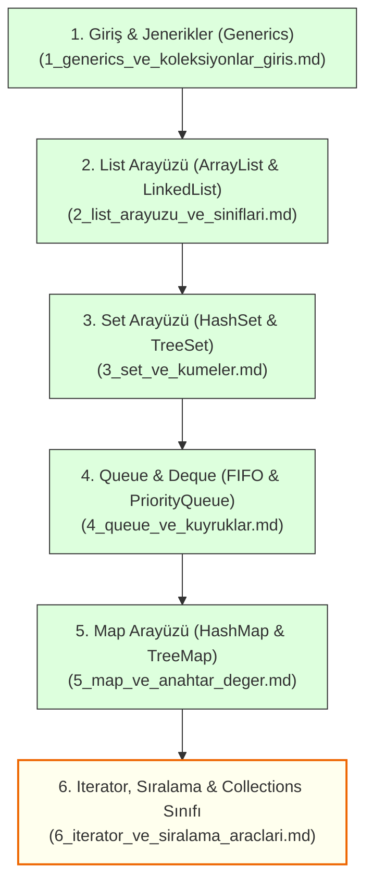

# 6. Modül: Java Koleksiyonları (Java Collections Framework)

Bu dizin, Java'da dinamik veri yapılarının, listelerin, kümelerin, kuyrukların ve anahtar-değer haritalarının yer aldığı **Java Koleksiyon Çerçevesi (Collections Framework - `java.util.*`)** eğitim modülüdür.

Her doküman; konu anlatımları, bellek mimarileri, zaman karmaşıklıkları ($O(1), O(n), O(\log n)$), çalıştırılabilir temiz kod örnekleri, yaygın tuzaklar ve çözümlü alıştırmalar/ödevler ile zenginleştirilmiştir.

---

## 🧭 Ders Dokümanları İndeksi ve Öğrenim Sırası

---

## 📋 Modül Konu Başlıkları Tablosu

| No | Doküman | Konu Başlığı | Temel Kazanımlar ve Kapsam |
| :---: | :--- | :--- | :--- |
| **01** | [**1_generics_ve_koleksiyonlar_giris.md**](./1_generics_ve_koleksiyonlar_giris.md) | **Koleksiyonlara Giriş & Jenerikler** | • Dizilerin sınırları ve dinamik koleksiyon ihtiyacı • İlkel tipler ve sarmalayıcı sınıflar (*Autoboxing / Unboxing*) • Jenerikler (`<T>`) ile tip güvenliği (*Type Safety*) ve elmas operatörü `<>` • Kendi jenerik sınıf/metotlarımızı yazma ve `Collection` / `Iterable` kök arayüzleri |
| **02** | [**2_list_arayuzu_ve_siniflari.md**](./2_list_arayuzu_ve_siniflari.md) | **List Arayüzü ve Uygulamaları** | • `List` arayüzünün doğası: sıralılık, indeks tabanlılık ve tekrara izin verme • `ArrayList` mimarisi: dinamik dizi büyüme formülü ($1.5\times$) ve $O(1)$ okuma hızı • `LinkedList` mimarisi: çift yönlü bağlı liste (düğümler) ve başa/araya hızlı ekleme • `ArrayList` vs. `LinkedList` büyük karşılaştırması ve eski `Vector` / `Stack` (LIFO) yapıları |
| **03** | [**3_set_ve_kumeler.md**](./3_set_ve_kumeler.md) | **Set Arayüzü ve Kümeler** | • `Set` arayüzü ve matematiksel küme mantığı (tekrarsızlık / uniqueness) • `HashSet` ve arka plandaki Hashing / Kova (*Bucket*) mimarisi ($O(1)$) • **Hayati Kural:** `equals()` ve `hashCode()` sözleşmesi ve ezilmesinin önemi • Ekleme sırasını koruyan `LinkedHashSet` ve ağaç tabanlı sıralı `TreeSet` ($O(\log n)$) • Matematiksel küme işlemleri: Birleşim (`addAll`), Kesişim (`retainAll`), Fark (`removeAll`) |
| **04** | [**4_queue_ve_kuyruklar.md**](./4_queue_ve_kuyruklar.md) | **Queue ve Deque Kuyruk Yapıları** | • `Queue` arayüzü ve İlk Giren İlk Çıkar (*FIFO*) prensibi • Hata fırlatan (`add`, `remove`, `element`) vs. Güvenli değer dönen (`offer`, `poll`, `peek`) metotlar • `PriorityQueue` ve Min-Heap mantığı (geliş sırası değil aciliyet sırası, Triyaj analojisi) • Çift uçlu kuyruklar (`Deque`) ve modern Java'da Stack yerine `ArrayDeque` tercihi |
| **05** | [**5_map_ve_anahtar_deger.md**](./5_map_ve_anahtar_deger.md) | **Map Arayüzü (Anahtar - Değer)** | • `Map` arayüzü ve sözlük mimarisi (benzersiz anahtar $\rightarrow$ değer eşleşmesi) • Neden `Collection` arayüzünden türemez? (`K, V` çifti doğası) • En hızlı sözlük `HashMap` ($O(1)$) ve sıra garantisizliği • Ekleme/erişim sıralı `LinkedHashMap` (LRU Cache mantığı) ve anahtarları sıralı `TreeMap` • Map üzerinde gezinme yolları: `keySet()`, `values()`, `entrySet()` ve Java 8 `forEach` |
| **06** | [**6_iterator_ve_siralama_araclari.md**](./6_iterator_ve_siralama_araclari.md) | **Iterator, Sıralama & Araçlar** | • `Iterator` ile gezinme ve `ConcurrentModificationException` tuzağından korunma (`it.remove()`) • Nesneleri sıralama: `Comparable` (doğal sıralama) vs. `Comparator` (esnek/çoklu sıralama) • `java.util.Collections` yardımcı sınıfı: `sort()`, `reverse()`, `shuffle()`, `min()`, `max()`, `frequency()` • Java 9+ değiştirilemez koleksiyon fabrikaları: `List.of()`, `Set.of()`, `Map.of()` kuralları |

