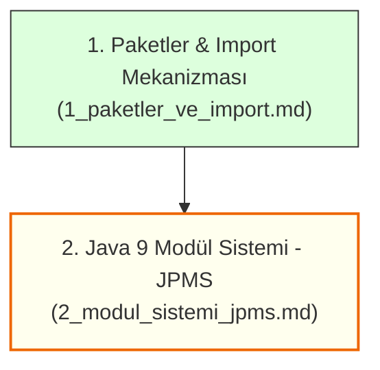

# 7. Modül: Java'da Paketler ve Modül Sistemi (JPMS)

Bu dizin, Java uygulamalarında sınıfların mantıksal ve fiziksel olarak nasıl organize edildiğini, isim çakışmalarının nasıl önlendiğini ve Java 9 ile gelen modern modüler mimariyi (**Java Platform Module System - JPMS**) ele alan eğitim modülüdür.

---

## 🧭 Ders Dokümanları İndeksi

---

## 📋 Modül Konu Başlıkları Tablosu

| No | Doküman | Konu Başlığı | Temel Kazanımlar ve Kapsam |
| :---: | :--- | :--- | :--- |
| **01** | [**1_paketler_ve_import.md**](./1_paketler_ve_import.md) | **Paketler ve İçe Aktarma** | • Fiziksel klasör mimarisi ve isim çakışmasını (*Name Collision*) önleme • Ters alan adı standardı (`com.sirket.proje`) ve dizin eşleşme zorunluluğu • `import` vs. `import static` kullanımı ve otomatik `java.lang` paketi • Paket erişim belirleyicileri (*package-private*), `javac -d` ile derleme ve CLASSPATH |
| **02** | [**2_modul_sistemi_jpms.md**](./2_modul_sistemi_jpms.md) | **Java 9 Modül Sistemi (JPMS)** | • Klasik Java sorunları: "JAR Hell" ve monolitik `rt.jar` kütüphane karmaşası • "Paketlerin paketi" mantığı ve `module-info.java` anatomisi • `exports`, `requires`, `requires transitive`, `opens` direktifleri ve güçlü kapsülleme • Çekirdek modül `java.base` ve `jlink` ile hafif (mini) Java çalışma ortamları üretme |

---

> 🔜 **Sonraki Eğitim Modülü:** [8. Modül: Java İleri Seviye Konular ve Profesyonel Yazılım Geliştirme (8_ileri konular/readme.md)](../8_ileri%20konular/readme.md)
