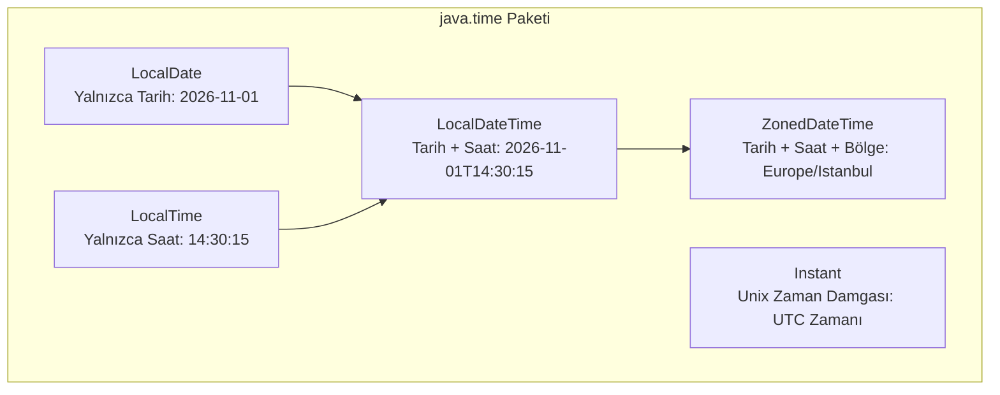

# 2. En Yaygın Hazır Sınıflar ve Modern Tarih-Saat API

Bu doküman; Java standart kütüphanesinde (`java.lang`, `java.util`, `java.math`, `java.time`) yer alan ve profesyonel yazılım geliştirmede her gün karşımıza çıkan en kritik **hazır sınıfları (Utility Classes)** ve Java 8 ile hayatımıza giren modern **Tarih ve Saat API'sini (`java.time`)** tüm ayrıntılarıyla ele almaktadır.

---

> 📖 **İlgili Bölüm Dokümanları:**
> - 🔙 [Önceki Bölüm: Hata ve İstisna Yönetimi (1_istisna_yonetimi.md)](./1_istisna_yonetimi.md)
> - 🏠 [İleri Konular Modül Listesi](readme.md)
> - 🔜 [Sonraki Bölüm: Fonksiyonel Programlama, Lambda ve Stream API (3_lambda_ve_stream_api.md)](./3_lambda_ve_stream_api.md)

---

## 📌 İçindekiler
1. [Neden Hazır Sınıfları Bilmeliyiz? ("Tekerleği Yeniden İcat Etmeme" İlkesi)](#1-neden-hazır-sınıfları-bilmeliyiz)
2. [Matematiksel İşlemler: `Math` Sınıfı](#2-matematiksel-işlemler-math-sınıfı)
   - [En Çok Kullanılan Statik Metotlar ve Sabitler](#en-çok-kullanılan-statik-metotlar-ve-sabitler)
3. [Rastgelelik: `Random` ve `ThreadLocalRandom`](#3-rastgelelik-random-ve-threadlocalrandom)
4. [Metin Manipülasyonu ve Performans: `StringBuilder` vs. `StringBuffer` vs. `String`](#4-metin-manipülasyonu-ve-performans)
   - [Neden `String` İmmutable (Değişmez)? String Pool Mantığı](#neden-string-immutable)
   - [Döngülerde `+` Operatörünün Bellek Felaketi](#döngülerde--operatörünün-bellek-felaketi)
   - [`StringBuilder` ile Bellek Dostu Metin Birleştirme](#stringbuilder-ile-bellek-dostu-metin-birleştirme)
   - [`StringBuffer` ve Thread Güvenliği](#stringbuffer-ve-thread-güvenliği)
5. [Finansal ve Yüksek Hassasiyetli Hesaplamalar: `BigDecimal` ve `BigInteger`](#5-finansal-ve-yüksek-hassasiyetli-hesaplamalar)
   - [IEEE 754 Kayan Nokta (`double`/`float`) Yuvarlama Tuzakları: `0.1 + 0.2 != 0.3`](#kayan-nokta-tuzakları)
   - [`BigDecimal` ile Kuruş Şaşmayan Finansal Matematik](#bigdecimal-ile-kuruş-şaşmayan-finansal-matematik)
   - [`BigInteger` ile Sınırsız Basamaklı Tamsayılar](#biginteger-ile-sınırsız-basamaklı-tamsayılar)
6. [Nesne Yardımcısı: `java.util.Objects`](#6-nesne-yardımcısı-javautilobjects)
   - [`requireNonNull`, `equals` Güvenliği ve `hash`](#objects-metotları)
7. [Modern Java Tarih ve Saat API (`java.time` - JSR 310)](#7-modern-java-tarih-ve-saat-api)
   - [Eski API'nin (`Date`, `Calendar`) Problemleri Nelerdi?](#eski-apinin-problemleri)
   - [Modern Sınıflar: `LocalDate`, `LocalTime`, `LocalDateTime`](#modern-sınıflar)
   - [Zaman Farkı Hesaplama: `Period` (Tarih) ve `Duration` (Zaman)](#zaman-farkı-hesaplama)
   - [Biçimlendirme ve Ayrıştırma: `DateTimeFormatter`](#biçimlendirme-ve-ayrıştırma)
   - [Zaman Dilimleri: `ZonedDateTime` ve `ZoneId`](#zaman-dilimleri)
8. [Adım Adım Çalıştırılabilir Kod Örnekleri](#8-adım-adım-çalıştırılabilir-kod-örnekleri)
   - [Örnek 1: Performans Karşılaştırması (`String` vs `StringBuilder`)](#örnek-1-performans-karşılaştırması)
   - [Örnek 2: Finansal Sepet ve Vergi Hesaplayıcı (`FinansHesaplayici.java`)](#örnek-2-finansal-sepet-ve-vergi-hesaplayıcı)
   - [Örnek 3: Doğum Günü ve Yaş Hesaplama (`TarihIslemleri.java`)](#örnek-3-doğum-günü-ve-yaş-hesaplama)
9. [Sık Yapılan Hatalar ve Önemli Kurallar](#9-sık-yapılan-hatalar-ve-önemli-kurallar)
10. [Öğrenciler İçin Pekiştirici Sınıf İçi Alıştırmalar](#10-öğrenciler-için-pekiştirici-sınıf-içi-alıştırmalar)
11. [Ödev Konuları ve Mini Projeler](#11-ödev-konuları-ve-mini-projeler)

---

## 1. Neden Hazır Sınıfları Bilmeliyiz?

Yazılım geliştiriciler olarak en büyük tuzaklardan biri, dilde zaten son derece optimize ve test edilmiş olarak sunulan yetenekleri sıfırdan yazmaya çalışmaktır. Java platformu;
- Yıllarca optimize edilmiş matematiksel algoritmalar (`Math`),
- Güvenli bellek yönetimiyle çalışan metin mimarileri (`StringBuilder`),
- Finans ve kriptografi için hassas sayı tipleri (`BigDecimal`, `BigInteger`),
- Ve ISO-8601 uluslararası standartlarına tam uyumlu zaman yönetimi (`java.time`)

sağlar. Bu sınıfları ustalıkla kullanmak hem kodunuzu onlarca kat hızlandırır hem de `0.1 + 0.2 = 0.30000000000000004` gibi sinsice gizlenen ölümcül mantık hatalarından korur.

---

## 2. Matematiksel İşlemler: `Math` Sınıfı

`java.lang.Math` sınıfı, matematiksel işlemler için kullanılan tüm metotları **statik (`static`)** olarak sunar. Constructor'ı `private` olduğu için bu sınıftan nesne üretilmez (`new Math()` yapılamaz), doğrudan `Math.metotAdi()` şeklinde çağrılır.

### En Çok Kullanılan Statik Metotlar ve Sabitler

| Metot / Sabit | Açıklama | Örnek | Sonuç |
|---|---|---|---|
| `Math.PI` | Pi sayısı sabiti (yaklaşık 3.14159...) | `double pi = Math.PI;` | `3.141592653589793` |
| `Math.E` | Doğal logaritma tabanı $e$ sayısı | `double e = Math.E;` | `2.718281828459045` |
| `Math.abs(x)` | Mutlak değer alır | `Math.abs(-15)` | `15` |
| `Math.max(a, b)` | İki değerden büyük olanı döner | `Math.max(10, 42)` | `42` |
| `Math.min(a, b)` | İki değerden küçük olanı döner | `Math.min(10, 42)` | `10` |
| `Math.sqrt(x)` | Karekök alır ($\sqrt{x}$) | `Math.sqrt(64.0)` | `8.0` |
| `Math.cbrt(x)` | Küpkök alır ($\sqrt[3]{x}$) | `Math.cbrt(27.0)` | `3.0` |
| `Math.pow(a, b)` | Üs alma işlemi ($a^b$) | `Math.pow(2, 8)` | `256.0` |
| `Math.ceil(x)` | Tavana yuvarlar (en yakın büyük tamsayı) | `Math.ceil(4.1)` | `5.0` |
| `Math.floor(x)` | Tabana yuvarlar (en yakın küçük tamsayı) | `Math.floor(4.9)` | `4.0` |
| `Math.round(x)` | En yakın tamsayıya yuvarlar | `Math.round(4.5)` | `5` |
| `Math.random()` | `[0.0, 1.0)` aralığında rastgele `double` üretir | `Math.random()` | örn: `0.74281` |

```java
public class MathOrnekleri {
    public static void main(String[] args) {
        // Hipotenüs hesaplama: c = sqrt(a^2 + b^2)
        double a = 3.0;
        double b = 4.0;
        double hipotenus = Math.sqrt(Math.pow(a, 2) + Math.pow(b, 2));
        System.out.println("Hipotenüs: " + hipotenus); // 5.0

        // 1 ile 100 arasında rastgele tamsayı üretme
        int rastgeleSayi = (int) (Math.random() * 100) + 1;
        System.out.println("Rastgele Sayı: " + rastgeleSayi);
    }
}
```

---

## 3. Rastgelelik: `Random` ve `ThreadLocalRandom`

`Math.random()` arkada `java.util.Random` sınıfını kullanır. Ancak daha esnek tamsayı, boolean, float veya belirli aralıklarda sayılar üretmek istediğimizde `java.util.Random` nesnesi oluşturmak daha temizdir:

```java
import java.util.Random;

public class RandomKullanimi {
    public static void main(String[] args) {
        Random rnd = new Random();

        // 0 (dahil) ile 50 (hariç) arası tamsayı
        int sayi = rnd.nextInt(50);

        // Belirli bir aralık: [100, 200]
        int aralikliSayi = rnd.nextInt(101) + 100; // 0..100 + 100

        // Rastgele boolean
        boolean zarTura = rnd.nextBoolean();

        // Rastgele double (0.0 ile 1.0 arası)
        double dbl = rnd.nextDouble();

        System.out.println("Sayı: " + sayi + " | Aralık: " + aralikliSayi + " | YazıTura: " + zarTura);
    }
}
```

> [!TIP]
> **Çok İş Parçacıklı (Multithread) Uygulamalarda Dikkat:**
> Birden fazla Thread aynı anda `Random` nesnesini paylaştığında çekişme (thread contention) sebebiyle performans düşer. Java 7 ile gelen `java.util.concurrent.ThreadLocalRandom.current().nextInt(min, max + 1)` hem thread-safe'tir hem de doğrudan alt ve üst sınır parametresi alır.

---

## 4. Metin Manipülasyonu ve Performans

### Neden `String` İmmutable (Değişmez)? String Pool Mantığı

Java'da `String` nesneleri **değiştirilemezdir (immutable)**. Bir `String` nesnesi oluşturulduktan sonra içerisindeki karakterler değiştirilemez.

```java
String s = "Java";
s = s + " Öğreniyorum";
```
Yukarıdaki kodda `"Java"` metni güncellenmez. JVM belleğin **String Pool (Metin Havuzu)** bölgesinde yeni bir `"Java Öğreniyorum"` nesnesi açar ve `s` referansını bu yeni adrese yönlendirir. Eski `"Java"` ise boşta kalır.

```
Bellek Durumu:
[Heap / String Pool]
+----------------------+
| "Java"               | <--- Boşta kaldı (Garbage Collector bekler)
+----------------------+
| " Öğreniyorum"       |
+----------------------+
| "Java Öğreniyorum"   | <--- Referans 's' artık burayı gösteriyor
+----------------------+
```

### Döngülerde `+` Operatörünün Bellek Felaketi

Aşağıdaki gibi bir döngü kurarsanız ne olur?

```java
// ⚠️ KÖTÜ VE ÇOK YAVAŞ KOD!
String sonuc = "";
for (int i = 0; i < 100_000; i++) {
    sonuc += i; // Her adımda YENİ bir String nesnesi kopyalanır ve Heap şişer!
}
```
Bu döngü $100.000$ adet geçici `String` nesnesi üretir, her seferinde diziyi baştan kopyalar ve $O(N^2)$ karmaşıklığı ile saniyelerce (hatta dakikalarca) sürer.

### `StringBuilder` ile Bellek Dostu Metin Birleştirme

`StringBuilder`, dinamik olarak büyüyebilen bir karakter dizisi (`char[]` / Java 9+ `byte[]`) barındıran **mutable (değiştirilebilir)** bir sınıftır.

```java
// ✅ DOĞRU VE ÇOK HIZLI KOD!
StringBuilder sb = new StringBuilder();
for (int i = 0; i < 100_000; i++) {
    sb.append(i); // Var olan dahili tampon diziye ekler, yeni nesne üretmez!
}
String sonuc = sb.toString(); // En son tek bir String oluşturulur.
```

#### `StringBuilder` En Çok Kullanılan Metotlar:
- `append(değer)`: Sonuna metin, sayı, boolean vb. ekler.
- `insert(indeks, metin)`: Belirtilen indekse araya metin sokar.
- `delete(baslangic, bitis)`: Belirtilen aralıktaki karakterleri siler.
- `reverse()`: Metni tersine çevirir (`"ali"` -> `"ila"`).
- `length()` ve `capacity()`: Mevcut karakter uzunluğu ve tampon kapasitesi.

### `StringBuffer` ve Thread Güvenliği

| Özellik | `String` | `StringBuilder` | `StringBuffer` |
|---|---|---|---|
| **Değiştirilebilirlik (Mutability)** | İmmutable (Değişmez) | Mutable (Değişebilir) | Mutable (Değişebilir) |
| **İş Parçacığı Güvenliği (Thread Safety)**| Thread-Safe (Değişmediği için)| **Thread-Safe Değil** (Hızlı) | **Thread-Safe** (`synchronized`) |
| **Performans** | Döngülerde en yavaşı | **En Hızlısı** | Senkronizasyon maliyeti nedeniyle orta |
| **Kullanım Yeri** | Sabit metinler, DTO'lar | Döngüler, tek thread metin inşası | Çoklu thread'lerin ortak metin ürettiği yerler |

> Çoğu senaryoda (%99) tek bir metot içerisinde geçici metin birleştirme yapıldığından tercih edilmesi gereken sınıf **`StringBuilder`**'dır.

---

## 5. Finansal ve Yüksek Hassasiyetli Hesaplamalar

### Kayan Nokta Tuzakları

Bilgisayarlar sayıları ikilik tabanda (binary: 0 ve 1) saklar. Birçok ondalıklı kesir (örneğin $0.1$ veya $0.2$), tıpkı $1/3 = 0.3333...$ gibi ikilik tabanda sonsuz devirli çıkar. Bu yüzden `double` ve `float` tiplerinde hassasiyet kayıpları yaşanır:

```java
double a = 0.1;
double b = 0.2;
System.out.println(a + b); 
// Beklenen: 0.3
// Konsol Çıktısı: 0.30000000000000004 !

if (a + b == 0.3) {
    System.out.println("Eşit!");
} else {
    System.out.println("EŞİT DEĞİL!"); // Bu satır çalışır!
}
```

> [!CAUTION]
> Bankacılık, e-ticaret sepetleri, borsa ve muhasebe sistemlerinde asla `double` veya `float` kullanılmaz! 1 kuruşluk yuvarlama açığı milyonlarca işlemde devasa yasal ve finansal açıklara yol açar.

### `BigDecimal` ile Kuruş Şaşmayan Finansal Matematik

`java.math.BigDecimal`, keyfi hassasiyette (arbitrary-precision) ondalıklı sayılar tutabilen bir sınıftır.

#### ⚠️ Altın Kural: Constructor'a Kesinlikle `String` Verilmelidir!
- ❌ `new BigDecimal(0.1)` -> Kayan nokta hatasını aynen içine kopyalar!
- ✅ `new BigDecimal("0.1")` veya `BigDecimal.valueOf(0.1)` -> Kusursuz $0.1$ oluşturur.

```java
import java.math.BigDecimal;
import java.math.RoundingMode;

public class FinansalHassasiyet {
    public static void main(String[] args) {
        BigDecimal fiyat = new BigDecimal("19.99");
        BigDecimal adet = new BigDecimal("3");
        BigDecimal kdvOrani = new BigDecimal("0.20"); // %20 KDV

        // Çarpma işlemi: multiply
        BigDecimal araToplam = fiyat.multiply(adet); // 59.97

        // KDV Tutarı
        BigDecimal kdvTutari = araToplam.multiply(kdvOrani); // 11.994

        // Toplama işlemi: add
        BigDecimal genelToplam = araToplam.add(kdvTutari); // 71.964

        // Kuruş hanesine (2 basamak) yuvarlama
        BigDecimal yuvarlanmisToplam = genelToplam.setScale(2, RoundingMode.HALF_UP);

        System.out.println("Ara Toplam: " + araToplam);
        System.out.println("KDV Tutarı: " + kdvTutari);
        System.out.println("Ödenecek Tutar: " + yuvarlanmisToplam + " TL"); // 71.96 TL
    }
}
```

#### `BigDecimal` Karşılaştırmalarında `equals` Tuzağı:
`BigDecimal.equals()` ölçeği (scale) de kontrol eder. Yani `"2.0"` ile `"2.00"` `equals` ile eşit **değildir**!
Sayısal eşitlik için daima **`compareTo()`** kullanılmalıdır:
```java
BigDecimal x = new BigDecimal("2.0");
BigDecimal y = new BigDecimal("2.00");

System.out.println(x.equals(y));    // false (ölçekleri farklı)
System.out.println(x.compareTo(y)); // 0 (Sayısal olarak eşittir!)
// compareTo döner: -1 (küçük), 0 (eşit), 1 (büyük)
```

### `BigInteger` ile Sınırsız Basamaklı Tamsayılar

`long` veri tipi maksimum $2^{63}-1 \approx 9.22 \times 10^{18}$ değerini alabilir. Bundan daha büyük sayılar (örneğin 100 faktöriyel veya RSA şifreleme anahtarları) için `java.math.BigInteger` kullanılır:

```java
import java.math.BigInteger;

public class FaktoriyelHesap {
    public static void main(String[] args) {
        BigInteger sonuc = BigInteger.ONE;
        for (int i = 1; i <= 50; i++) {
            sonuc = sonuc.multiply(BigInteger.valueOf(i));
        }
        System.out.println("50! = " + sonuc);
        // 30414093201713378043612608166064768844377641568960512000000000000
    }
}
```

---

## 6. Nesne Yardımcısı: `java.util.Objects`

Java 7 ile gelen `Objects` yardımcı sınıfı, `NullPointerException` hatalarını engellemek ve kod okunabilirliğini artırmak için harika statik metotlar barındırır:

```java
import java.util.Objects;

public class Kullanici {
    private String ad;
    private String tcKimlik;

    public Kullanici(String ad, String tcKimlik) {
        // null kontrolü ve özel hata mesajı
        this.ad = Objects.requireNonNull(ad, "Kullanıcı adı boş (null) olamaz!");
        this.tcKimlik = Objects.requireNonNull(tcKimlik, "TC Kimlik boş olamaz!");
    }

    @Override
    public boolean equals(Object o) {
        if (this == o) return true;
        if (o == null || getClass() != o.getClass()) return false;
        Kullanici that = (Kullanici) o;
        // İki nesne veya referans null olsa dahi çökmeden güvenli karşılaştırma:
        return Objects.equals(this.ad, that.ad) && Objects.equals(this.tcKimlik, that.tcKimlik);
    }

    @Override
    public int hashCode() {
        // Güvenli hash code üretimi:
        return Objects.hash(ad, tcKimlik);
    }
}
```

---

## 7. Modern Java Tarih ve Saat API (`java.time`)

Java 8 öncesinde tarih ve saat işlemleri için `java.util.Date` ve `java.util.Calendar` sınıfları kullanılıyordu.

### Eski API'nin Problemleri:
1. **Değiştirilebilirlik (Mutability):** Bir `Date` nesnesinin saatini değiştirdiğinizde nesnenin kendisi değişir; bu da çoklu thread'lerde yarış durumuna (race condition) sebep olur.
2. **Kafa Karıştırıcı İndeksler:** Ocak ayı 0, Şubat ayı 1 idi. Yıl bilgisi ise 1900 yılından fark olarak tutuluyordu (`date.getYear() + 1900`).
3. **Formatlama Güvensizliği:** `SimpleDateFormat` thread-safe değildi ve eşzamanlı çağrılarda tarihleri çorba yapıyordu.

Java 8 ile **JSR-310** standardı kabul edildi ve tamamen **immutable (değişmez)**, **thread-safe** ve kullanımı sezgisel yeni `java.time` paketi tanıtıldı.



### Modern Sınıflar: `LocalDate`, `LocalTime`, `LocalDateTime`

Tüm bu sınıflar `private` constructor'a sahiptir; `now()` veya `of()` fabrika metotları ile oluşturulurlar:

```java
import java.time.LocalDate;
import java.time.LocalTime;
import java.time.LocalDateTime;
import java.time.Month;

public class ZamanGiris {
    public static void main(String[] args) {
        // Şu anki tarih
        LocalDate bugun = LocalDate.now();
        System.out.println("Bugün: " + bugun); // 2026-11-01

        // Belirli bir tarih oluşturma (Aylar 1'den başlar veya Enum kullanılır!)
        LocalDate cumhuriyetBayrami = LocalDate.of(1923, Month.OCTOBER, 29);
        System.out.println("Cumhuriyet: " + cumhuriyetBayrami); // 1923-10-29

        // Şu anki saat
        LocalTime suAn = LocalTime.now();
        System.out.println("Saat: " + suAn); // 14:30:15.123456789

        // Tarih ve Saat birleşik
        LocalDateTime bulusma = LocalDateTime.of(2026, 12, 31, 20, 0);
        System.out.println("Buluşma: " + bulusma); // 2026-12-31T20:00

        // Tarih Manipülasyonları (İmmutable olduğu için yeni nesne döner!)
        LocalDate birHaftaSonra = bugun.plusWeeks(1);
        LocalDate ucAyOnce = bugun.minusMonths(3);
        System.out.println("1 Hafta Sonra: " + birHaftaSonra);
    }
}
```

### Zaman Farkı Hesaplama: `Period` ve `Duration`

- **`Period`**: Gün, ay, yıl bazlı tarih farkları için kullanılır.
- **`Duration`**: Saat, dakika, saniye, nanosaniye bazlı zaman farkları için kullanılır.

```java
import java.time.LocalDate;
import java.time.LocalTime;
import java.time.Period;
import java.time.Duration;

public class FarkHesaplama {
    public static void main(String[] args) {
        // Tarih farkı: Yaş hesaplama
        LocalDate dogumTarihi = LocalDate.of(2000, 5, 15);
        LocalDate bugun = LocalDate.of(2026, 11, 1);

        Period yasFarki = Period.between(dogumTarihi, bugun);
        System.out.println("Yaşınız: " + yasFarki.getYears() + " yıl, " 
                + yasFarki.getMonths() + " ay, " 
                + yasFarki.getDays() + " gün.");

        // Zaman farkı: Kod çalıştırma süresi
        LocalTime baslangic = LocalTime.of(9, 15, 0);
        LocalTime bitis = LocalTime.of(11, 45, 30);

        Duration sure = Duration.between(baslangic, bitis);
        System.out.println("Toplam Dakika: " + sure.toMinutes()); // 150 dk
        System.out.println("Toplam Saniye: " + sure.getSeconds()); // 9030 sn
    }
}
```

### Biçimlendirme ve Ayrıştırma: `DateTimeFormatter`

Kullanıcıya özel tarih formatları göstermek veya metinden (`String`) tarih okumak için `DateTimeFormatter` kullanılır:

```java
import java.time.LocalDateTime;
import java.time.format.DateTimeFormatter;
import java.util.Locale;

public class FormatlamaOrnegi {
    public static void main(String[] args) {
        LocalDateTime simdi = LocalDateTime.now();

        // 1. Tarihi Metne Çevirme (Formatlama)
        DateTimeFormatter trFormat = DateTimeFormatter.ofPattern("dd MMMM yyyy - HH:mm:ss", new Locale("tr", "TR"));
        String bicimliTarih = simdi.format(trFormat);
        System.out.println("Türkçe Format: " + bicimliTarih);
        // Çıktı: 01 Kasım 2026 - 14:35:10

        // 2. Metinden Tarih Okuma (Parsing)
        String metin = "23/04/2026";
        DateTimeFormatter parseFormat = DateTimeFormatter.ofPattern("dd/MM/yyyy");
        LocalDate okunanTarih = LocalDate.parse(metin, parseFormat);
        System.out.println("Okunan Yıl: " + okunanTarih.getYear()); // 2026
    }
}
```

### Zaman Dilimleri: `ZonedDateTime` ve `ZoneId`

Farklı ülkelerdeki saat dilimlerini yönetmek için `ZoneId` ve `ZonedDateTime` kullanılır:

```java
import java.time.ZonedDateTime;
import java.time.ZoneId;

public class ZamanDilimiOrnegi {
    public static void main(String[] args) {
        // İstanbul saati
        ZonedDateTime istanbulZamani = ZonedDateTime.now(ZoneId.of("Europe/Istanbul"));
        System.out.println("İstanbul: " + istanbulZamani);

        // Aynı anın Tokyo'daki karşılığı
        ZonedDateTime tokyoZamani = istanbulZamani.withZoneSameInstant(ZoneId.of("Asia/Tokyo"));
        System.out.println("Tokyo: " + tokyoZamani);

        // New York saati
        ZonedDateTime nyZamani = istanbulZamani.withZoneSameInstant(ZoneId.of("America/New_York"));
        System.out.println("New York: " + nyZamani);
    }
}
```

---

## 8. Adım Adım Çalıştırılabilir Kod Örnekleri

### Örnek 1: Performans Karşılaştırması (`String` vs `StringBuilder`)

```java
// Dosya: PerformansTesti.java
public class PerformansTesti {
    public static void main(String[] args) {
        int tekrarSayisi = 50_000;

        // 1. String ile birleştirme testi
        long baslangic1 = System.currentTimeMillis();
        String str = "";
        for (int i = 0; i < tekrarSayisi; i++) {
            str += "A";
        }
        long bitis1 = System.currentTimeMillis();
        System.out.println("String (+) süresi: " + (bitis1 - baslangic1) + " ms");

        // 2. StringBuilder ile birleştirme testi
        long baslangic2 = System.currentTimeMillis();
        StringBuilder sb = new StringBuilder();
        for (int i = 0; i < tekrarSayisi; i++) {
            sb.append("A");
        }
        String sonuc = sb.toString();
        long bitis2 = System.currentTimeMillis();
        System.out.println("StringBuilder süresi: " + (bitis2 - baslangic2) + " ms");
    }
}
```

#### Örnek Konsol Çıktısı:
```text
String (+) süresi: 1420 ms
StringBuilder süresi: 2 ms
```
*(StringBuilder tam 700 kattan daha hızlı tamamlandı!)*

---

### Örnek 2: Finansal Sepet ve Vergi Hesaplayıcı (`FinansHesaplayici.java`)

```java
// Dosya: FinansHesaplayici.java
import java.math.BigDecimal;
import java.math.RoundingMode;
import java.util.ArrayList;
import java.util.List;

class SepetKalemi {
    private String urunAdi;
    private BigDecimal birimFiyat;
    private int adet;

    public SepetKalemi(String urunAdi, String birimFiyat, int adet) {
        this.urunAdi = urunAdi;
        this.birimFiyat = new BigDecimal(birimFiyat);
        this.adet = adet;
    }

    public BigDecimal getSatirToplami() {
        return birimFiyat.multiply(BigDecimal.valueOf(adet));
    }

    public String getUrunAdi() {
        return urunAdi;
    }
}

public class FinansHesaplayici {
    public static void main(String[] args) {
        List<SepetKalemi> sepet = new ArrayList<>();
        sepet.add(new SepetKalemi("Mekanik Klavye", "1250.75", 2));
        sepet.add(new SepetKalemi("Kablosuz Mouse", "450.50", 1));
        sepet.add(new SepetKalemi("Mousepad", "89.90", 3));

        BigDecimal araToplam = BigDecimal.ZERO;
        for (SepetKalemi kalem : sepet) {
            BigDecimal satirTutar = kalem.getSatirToplami();
            System.out.println(kalem.getUrunAdi() + " Tutarı: " + satirTutar + " TL");
            araToplam = araToplam.add(satirTutar);
        }

        BigDecimal kdvOrani = new BigDecimal("0.20"); // %20 KDV
        BigDecimal kdvTutari = araToplam.multiply(kdvOrani);
        BigDecimal odenecekTutar = araToplam.add(kdvTutari).setScale(2, RoundingMode.HALF_UP);

        System.out.println("------------------------------------");
        System.out.println("Sepet Ara Toplam : " + araToplam + " TL");
        System.out.println("Hesaplanan KDV   : " + kdvTutari.setScale(2, RoundingMode.HALF_UP) + " TL");
        System.out.println("TOPLAM ÖDENECEK  : " + odenecekTutar + " TL");
    }
}
```

#### Konsol Çıktısı:
```text
Mekanik Klavye Tutarı: 2501.50 TL
Kablosuz Mouse Tutarı: 450.50 TL
Mousepad Tutarı: 269.70 TL
------------------------------------
Sepet Ara Toplam : 3221.70 TL
Hesaplanan KDV   : 644.34 TL
TOPLAM ÖDENECEK  : 3866.04 TL
```

---

## 9. Sık Yapılan Hatalar ve Önemli Kurallar

1. ❌ **`new BigDecimal(0.1)` Kullanmak:**
   - Asla `double` argüman alan constructor kullanılmamalıdır. Mutlaka `new BigDecimal("0.1")` ya da `BigDecimal.valueOf(0.1)` tercih edilmelidir.
2. ❌ **Döngü İçinde `+` ile Metin Eklemek:**
   - Döngülerde String birleştirmesi her iterasyonda yeni nesne açar. Döngü başında bir `StringBuilder` tanımlanıp `append` kullanılmalıdır.
3. ❌ **`LocalDate` veya `LocalDateTime` Değerlerini Değiştirmeye Çalışmak:**
   - `LocalDate yarin = bugun.plusDays(1);` metodu `bugun` nesnesini değiştirmez, **yeni bir nesne üretip döner**. Dönen değeri bir değişkene atamazsanız işlem kaybolur!
4. ❌ **Eski `java.util.Date` ve `Calendar` Kullanmak:**
   - Yeni projelerde ve modern kodlarda kesinlikle `java.time` paketindeki sınıflar (`LocalDate`, `LocalDateTime`, `Instant`) kullanılmalıdır.
5. ❌ **`BigDecimal` Karşılaştırmalarında `equals` Kullanmak:**
   - Farklı hassasiyete sahip eşit değerler (`"1.0"` ve `"1.00"`) `equals` ile `false` döner. Sayısal kontrol için daima `compareTo(diger) == 0` kullanılmalıdır.

---

## 10. Öğrenciler İçin Pekiştirici Sınıf İçi Alıştırmalar

### Alıştırma 1: Ters Cümle Oluşturucu
Kullanıcıdan bir cümle alıp `StringBuilder` kullanarak kelime sırasını bozmadan her kelimenin harflerini tersten yazdıran programı yazınız. (Örn: `"Java Çok Güzel"` -> `"avaJ koÇ lezüG"`).

<details>
<summary>🔍 <b>Çözümü Göster</b></summary>

```java
public class KelimeTersCevirici {
    public static void main(String[] args) {
        String cumle = "Java Çok Güzel";
        String[] kelimeler = cumle.split(" ");
        StringBuilder sonuc = new StringBuilder();

        for (int i = 0; i < kelimeler.length; i++) {
            StringBuilder kelimeSb = new StringBuilder(kelimeler[i]);
            sonuc.append(kelimeSb.reverse());
            if (i < kelimeler.length - 1) {
                sonuc.append(" ");
            }
        }
        System.out.println("Sonuç: " + sonuc.toString()); // avaJ koÇ lezüG
    }
}
```
</details>

---

### Alıştırma 2: İki Tarih Arasındaki İş Günlerini Sayma
İki `LocalDate` tarihi arasında kalan günleri tek tek gezerek Cumartesi ve Pazar günleri hariç kaç adet iş günü (mesai günü) olduğunu hesaplayınız.

<details>
<summary>🔍 <b>Çözümü Göster</b></summary>

```java
import java.time.DayOfWeek;
import java.time.LocalDate;

public class IsGunuSayar {
    public static void main(String[] args) {
        LocalDate baslangic = LocalDate.of(2026, 11, 1);
        LocalDate bitis = LocalDate.of(2026, 11, 15);

        int isGunuSayisi = 0;
        LocalDate gecici = baslangic;

        while (!gecici.isAfter(bitis)) {
            DayOfWeek gun = gecici.getDayOfWeek();
            if (gun != DayOfWeek.SATURDAY && gun != DayOfWeek.SUNDAY) {
                isGunuSayisi++;
            }
            gecici = gecici.plusDays(1);
        }

        System.out.println("İş günü sayısı: " + isGunuSayisi);
    }
}
```
</details>

---

## 11. Ödev Konuları ve Mini Projeler

---

### 🟢 Ödev 1 (Temel Seviye): Kriptografik Şifre Üretici (`RastgeleSifre.java`)

**Gereksinimler:**
1. Kullanıcıdan istenen şifre uzunluğunu alınız (örneğin 12 karakter).
2. Büyük harf, küçük harf, rakam ve özel karakter (`!@#$%&*`) havuzu oluşturunuz.
3. `Random` ve `StringBuilder` kullanarak her kategoriden en az 1 karakter içermesi garanti edilen rastgele bir şifre üretip ekrana yazdırınız.

---

### 🟡 Ödev 2 (Orta Seviye): Kredi Geri Ödeme Planı Simülatörü (`KrediHesaplayici.java`)

**Gereksinimler:**
1. Kullanıcıdan kredi ana parası (örn: 100.000 TL), aylık faiz oranı (örn: 0.0249) ve vade (taksit sayısı, örn: 12 ay) bilgilerini alınız.
2. Tüm hesaplamaları `BigDecimal` ile yapınız.
3. Aylık eşit taksit tutarını formülle hesaplayınız ve her ay kalan ana para, ödenen faiz ve ana para düşümünü tablo halinde konsola yazdırınız. Kuruş hanelerinde yuvarlama hatası olmamalıdır.

---

### 🔴 Ödev 3 (İleri Seviye): Uluslararası Toplantı Planlayıcısı (`DunyaToplantiPlanlayici.java`)

**Gereksinimler:**
1. Türkiye (Europe/Istanbul) merkezli bir şirket için bir toplantı planlama sistemi yazınız.
2. Kullanıcıdan toplantı tarihi ve saati (örneğin `2026-11-20 15:30`) formatında bir metin alıp `DateTimeFormatter` ile `LocalDateTime`'a çeviriniz.
3. Bu toplantı anını `ZonedDateTime` ile aşağıdaki şehirlerin yerel saatine dönüştürünüz:
   - New York (`America/New_York`)
   - Londra (`Europe/London`)
   - Tokyo (`Asia/Tokyo`)
   - Sidney (`Australia/Sydney`)
4. Eğer katılımcılardan birinin yerel saati gece 22:00 ile sabah 08:00 arasına denk geliyorsa program uyarı mesajı vermelidir: `"⚠️ DİKKAT: Tokyo için toplantı saati mesai/uyku saatleri dışındadır!"`.

