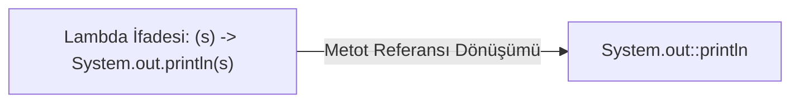
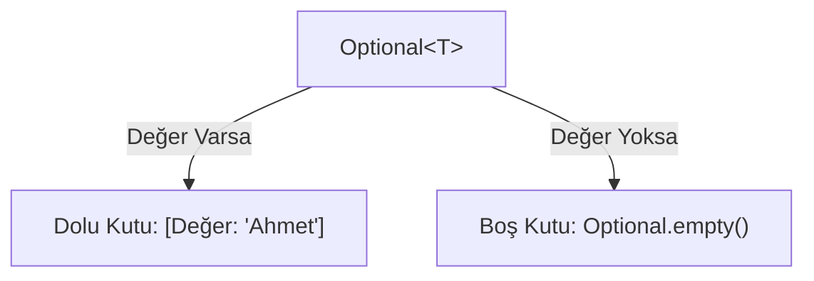

# 3. Fonksiyonel Programlama: Lambda İfadeleri ve Stream API

Bu doküman; Java 8 ile dilin yapısında devrim yaratan **Fonksiyonel Programlama (Functional Programming)** paradigmasını, **Lambda İfadelerini (`->`)**, **Fonksiyonel Arayüzleri (`@FunctionalInterface`)**, **Metot Referanslarını (`::`)**, veri yığınlarını deklaratif olarak işlememizi sağlayan **Stream API**'yi ve `NullPointerException` kabusunu ortadan kaldıran **`Optional<T>`** sınıfını tüm detaylarıyla ele almaktadır.

---

> 📖 **İlgili Bölüm Dokümanları:**
> - 🔙 [Önceki Bölüm: En Yaygın Hazır Sınıflar ve Tarih-Saat API (2_hazir_siniflar_ve_tarih_saat.md)](./2_hazir_siniflar_ve_tarih_saat.md)
> - 🏠 [İleri Konular Modül Listesi](readme.md)
> - 🔜 [Sonraki Bölüm: Multithreading ve Eşzamanlılık (4_multithreading_ve_es_zamanlilik.md)](./4_multithreading_ve_es_zamanlilik.md)

---

## 📌 İçindekiler
1. [Java'da Paradigma Değişimi: Emirsel (Imperative) vs. Bildirimsel (Declarative)](#1-javada-paradigma-değişimi)
2. [Lambda İfadeleri (Lambda Expressions)](#2-lambda-ifadeleri-lambda-expressions)
   - [Sözdizimi (Syntax) ve Sadeleşme Kuralları](#sözdizimi-ve-sadeleşme-kuralları)
   - [Değişken Kapsamı (Variable Capture) ve "Effectively Final" Kuralı](#değişken-kapsamı)
3. [Fonksiyonel Arayüzler (`@FunctionalInterface`)](#3-fonksiyonel-arayüzler-functionalinterface)
   - [Tek Soyut Metot (SAM - Single Abstract Method) Prensibi](#tek-soyut-metot-prensibi)
   - [Standart Kütüphane Arayüzleri (`java.util.function`)](#standart-kütüphane-arayüzleri)
     - `Predicate<T>` (Doğrulama / Filtreleme)
     - `Function<T, R>` (Dönüştürme / Haritalama)
     - `Consumer<T>` (Tüketme / Eyleme Geçirme)
     - `Supplier<T>` (Tedarik Etme / Üretme)
4. [Metot Referansları (Method References - `::`)](#4-metot-referansları-method-references)
   - [Statik Metot Referansı](#statik-metot-referansı)
   - [Belirli Bir Nesnenin Metot Referansı](#belirli-bir-nesnenin-metot-referansı)
   - [Belirli Bir Tipin Rastgele Nesnesinin Metot Referansı](#belirli-bir-tipin-metot-referansı)
   - [Kurucu Metot (Constructor) Referansı](#kurucu-metot-referansı)
5. [Stream API: Veri Akışlarını Deklaratif İşleme](#5-stream-api-veri-akışlarını-deklaratif-işleme)
   - [Stream Boru Hattı (Pipeline) Mantığı](#stream-boru-hattı-mantığı)
   - [Tembel Değerlendirme (Lazy Evaluation) Prensibi](#tembel-değerlendirme-prensibi)
   - [Ara İşlemler (Intermediate Operations): `filter`, `map`, `sorted`, `distinct`, `limit`, `skip`](#ara-işlemler)
   - [Uç İşlemler (Terminal Operations): `collect`, `forEach`, `reduce`, `count`, `anyMatch`](#uç-işlemler)
   - [`Collectors` ile Gruplama ve Toplama (`groupingBy`, `joining`, `toList`)](#collectors-ile-gruplama)
   - [İlkel Tip Akışları (`IntStream`, `DoubleStream`)](#ilkel-tip-akışları)
6. [Boş Değer Güvenliği: `Optional<T>`](#6-boş-değer-güvenliği-optionalt)
   - [Neden `null` Kontrolü Yerine `Optional`?](#neden-null-kontrolü-yerine-optional)
   - [`Optional.of()`, `ofNullable()`, `orElse()`, `orElseThrow()`, `map()`](#optional-metotları)
7. [Adım Adım Çalıştırılabilir Kod Örnekleri](#7-adım-adım-çalıştırılabilir-kod-örnekleri)
   - [Örnek 1: Klasik Döngü vs. Stream API Karşılaştırması](#örnek-1-klasik-döngü-vs-stream-api)
   - [Örnek 2: Çalışanlar ve Departman Maaş Analiz Uygulaması (`SirketAnalizi.java`)](#örnek-2-çalışanlar-ve-departman-maaş-analiz-uygulaması)
8. [Sık Yapılan Hatalar ve Önemli Kurallar](#8-sık-yapılan-hatalar-ve-önemli-kurallar)
9. [Öğrenciler İçin Pekiştirici Sınıf İçi Alıştırmalar](#9-öğrenciler-için-pekiştirici-sınıf-içi-alıştırmalar)
10. [Ödev Konuları ve Mini Projeler](#10-ödev-konuları-ve-mini-projeler)

---

## 1. Java'da Paradigma Değişimi

Java 8 öncesinde Java, tamamen **Emirsel (Imperative)** bir nesne yönelimli dildi. Bir listenin içindeki çift sayıları bulup karesini almak için bilgisayara adım adım **nasıl** yapacağını anlatmak zorundaydık:
1. Geçici bir liste aç,
2. Bir sayaç döngüsü başlat,
3. Her elemanı if ile kontrol et,
4. Çift ise çarp ve yeni listeye ekle.

Fonksiyonel ve **Bildirimsel (Declarative)** yaklaşımda ise bilgisayara *nasıl* yapacağını değil, **ne istediğimizi** söyleriz:
*"Listeyi filtrele (yalnızca çiftler), her birini karesine dönüştür ve yeni bir liste olarak topla."*

```
Emirsel Yaklaşım (NASIL?):
[Adım 1] -> [Adım 2] -> [Sayaç Kontrolü] -> [Bellek Tahsisi] -> [Ekleme]

Bildirimsel Yaklaşım (NE?):
[Veri Akışı] -> [Filtre: Çift Sayılar] -> [Dönüştür: Karesi] -> [Topla]
```

---

## 2. Lambda İfadeleri (Lambda Expressions)

Lambda ifadesi; bir sınıfa ait olmadan, bağımsız bir şekilde tanımlanabilen, parametre alıp değer dönebilen **isimsiz (anonim) bir fonksiyondur**.

### Sözdizimi (Syntax) ve Sadeleşme Kuralları

Genel sözdizimi:
$$\text{(parametreler)} \rightarrow \{\text{gövde}\}$$

```java
// 1. Standart biçim:
(int a, int b) -> { return a + b; }

// 2. Tip çıkarımı (Type Inference) sayesinde parametre tipleri yazılmayabilir:
(a, b) -> { return a + b; }

// 3. Gövde tek bir ifadeden oluşuyorsa süslü parantezler ve 'return' atılabilir:
(a, b) -> a + b

// 4. Tek bir parametre varsa normal parantezler de atılabilir:
x -> x * x

// 5. Parametre yoksa boş parantez zorunludur:
() -> System.out.println("Merhaba Dünya!")
```

### Değişken Kapsamı ve "Effectively Final" Kuralı

Lambda ifadeleri, tanımlandıkları dış metodun yerel değişkenlerine erişebilir. Ancak bu değişkenler **kesinlikle değiştirilemez (final veya effectively final)** olmalıdır:

```java
int katsayi = 2; // final yazılmasa bile effectively final'dır.

Consumer<Integer> carp = sayi -> {
    System.out.println(sayi * katsayi); // ✅ Okumak serbest!
    // katsayi = 5; // ❌ DERLEME HATASI! Dış değişken değiştirilemez!
};

// katsayi = 10; // ❌ Burada değiştirilirse lambda içindeki "effectively final" bozulur ve derlenmez!
```

---

## 3. Fonksiyonel Arayüzler (`@FunctionalInterface`)

Bir arayüzün (interface) Lambda ifadesi ile temsil edilebilmesi için **yalnızca TEK bir soyut metoda (SAM - Single Abstract Method)** sahip olması gerekir. Bu tür arayüzlere **Fonksiyonel Arayüz** denir.

`@FunctionalInterface` anotasyonu zorunlu değildir ancak arayüze kazara ikinci bir soyut metot eklenmesini derleme zamanında engeller.

```java
@FunctionalInterface
public interface MatematikIslemi {
    int hesapla(int a, int b); // Tek soyut metot!

    // default veya static metotlar bulunabilir, kuralı bozmaz:
    default void bilgiVer() {
        System.out.println("İşlem çalıştırılıyor...");
    }
}
```

Kullanımı:
```java
MatematikIslemi toplama = (x, y) -> x + y;
MatematikIslemi carpma = (x, y) -> x * y;

System.out.println("Toplam: " + toplama.hesapla(5, 3)); // 8
System.out.println("Çarpım: " + carpma.hesapla(5, 3)); // 15
```

---

### Standart Kütüphane Arayüzleri (`java.util.function`)

Java geliştiricilerinin çoğu zaman kendi fonksiyonel arayüzünü yazmasına gerek kalmaz. Standart kütüphane 4 ana kalıp sunar:

| Arayüz | Metot İmzası | Mantık | Örnek Lambda |
|---|---|---|---|
| **`Predicate<T>`** | `boolean test(T t)` | Bir koşulu test eder, `true/false` döner | `sayi -> sayi % 2 == 0` |
| **`Function<T, R>`**| `R apply(T t)` | $T$ tipinde girdi alır, $R$ tipinde çıktı döner | `metin -> metin.length()` |
| **`Consumer<T>`** | `void accept(T t)` | $T$ tipinde girdi alır, işlem yapar, hiçbir şey dönmez | `mesaj -> System.out.println(mesaj)` |
| **`Supplier<T>`** | `T get()` | Hiçbir parametre almaz, geriye bir $T$ üretir | `() -> Math.random()` |

Ek olarak `BiPredicate<T, U>`, `BiFunction<T, U, R>`, `BiConsumer<T, U>` gibi iki parametre alan türevleri de mevcuttur.

```java
import java.util.function.*;

public class StandartArayuzler {
    public static void main(String[] args) {
        // 1. Predicate: Pozitif mi?
        Predicate<Integer> pozitifMi = x -> x > 0;
        System.out.println(pozitifMi.test(10)); // true

        // 2. Function: String'i Integer'a çevir
        Function<String, Integer> uzunlukBul = str -> str.length();
        System.out.println(uzunlukBul.apply("Merhaba")); // 7

        // 3. Consumer: Ekrana yazdır
        Consumer<String> yazici = s -> System.out.println("Log: " + s);
        yazici.accept("Sistem başladı");

        // 4. Supplier: Rastgele UUID veya Sayı üret
        Supplier<Double> rastgele = () -> Math.random();
        System.out.println("Üretilen: " + rastgele.get());
    }
}
```

---

## 4. Metot Referansları (`::`)

Bir lambda ifadesi yalnızca var olan hazır bir metodu çağırıyorsa, lambdayı daha da sadeleştirmek için **Metot Referansı (`::`)** sözdizimi kullanılır.



| Tür | Lambda Sözdizimi | Metot Referansı Sözdizimi |
|---|---|---|
| **Statik Metot** | `x -> Math.abs(x)` | `Math::abs` |
| **Mevcut Nesne Metodu**| `x -> System.out.println(x)` | `System.out::println` |
| **Tipe Ait Örnek Metot** | `s -> s.toUpperCase()` | `String::toUpperCase` |
| **Kurucu (Constructor)**| `() -> new ArrayList<>()` | `ArrayList::new` |

---

## 5. Stream API: Veri Akışlarını Deklaratif İşleme

Stream API; koleksiyonlar (`List`, `Set`, `Map`) veya diziler üzerinde filtreleme, haritalama, sıralama ve gruplama işlemlerini SQL sorgusu yazar gibi deklaratif biçimde yapmamızı sağlayan bir veri işleme motorudur.

> [!IMPORTANT]
> **Stream Bir Veri Yapısı Değildir!**
> Stream elemanları kendi içinde saklamaz. Kaynaktan (örneğin bir `ArrayList`) verileri tek tek boru hattına akıtır, dönüştürür ve bir hedefe aktarır. Asıl koleksiyonu asla değiştirmez!

```
[Veri Kaynağı] ---> [filter()] ---> [map()] ---> [sorted()] ---> [collect() / forEach()]
  (Koleksiyon)        \                                   /       \                    /
                      +------- Ara İşlemler -------------+        +--- Uç İşlem ------+
                               (Tembel / Lazy)                        (Tetikleyici)
```

### Tembel Değerlendirme (Lazy Evaluation) Prensibi
Stream boru hattındaki ara işlemler (`filter`, `map`, vb.), en sonda bir **Uç İşlem (Terminal Operation - `collect`, `count`, `forEach`)** çağrılana kadar **KESİNLİKLE ÇALIŞMAZ**. Uç işlem çağrıldığında tüm boru hattı optimize edilmiş tek bir döngü halinde yürütülür.

### Ara İşlemler (Intermediate Operations)
Her zaman yeni bir `Stream` nesnesi dönerler, art arda zincirlenebilirler:
- `filter(Predicate)`: Şarta uymayan elemanları eler.
- `map(Function)`: Her elemanı başka bir değere veya tipe dönüştürür.
- `sorted()` / `sorted(Comparator)`: Elemanları doğal veya özel sırada dizer.
- `distinct()`: Tekrar eden (`equals`) elemanları temizler.
- `limit(n)`: İlk $n$ adet elemanı alır, gerisini keser.
- `skip(n)`: İlk $n$ adet elemanı atlar.

### Uç İşlemler (Terminal Operations)
Stream akışını sonlandırır ve sonuç üretirler:
- `collect(Collector)`: Akışı bir `List`, `Set`, `Map` veya `String` olarak toplar.
- `forEach(Consumer)`: Her eleman için bir işlem tetikler.
- `count()`: Akıştaki toplam eleman adedini döner.
- `reduce(...)`: Elemanları tek bir nihai değere indirger (örneğin toplam veya çarpım).
- `anyMatch(Predicate)` / `allMatch(Predicate)`: Elemanlardan en az biri / hepsi şarta uyuyor mu?

### `Collectors` ile Gruplama ve Toplama

```java
List<String> isimler = List.of("Ali", "Ayşe", "Mehmet", "Ahmet", "Zeynep", "Can");

// 1. A ile başlayanları filtrele, büyük harfe çevir ve List olarak topla
List<String> aIleBaslayanlar = isimler.stream()
        .filter(s -> s.startsWith("A"))
        .map(String::toUpperCase)
        .collect(Collectors.toList());
System.out.println(aIleBaslayanlar); // [ALİ, AYŞE, AHMET]

// 2. Virgülle birleştirme
String birlestirilmis = isimler.stream()
        .collect(Collectors.joining(", ", "İsimler: [", "]"));
System.out.println(birlestirilmis); // İsimler: [Ali, Ayşe, Mehmet, Ahmet, Zeynep, Can]

// 3. Uzunluğa göre gruplama (Map<Integer, List<String>>)
Map<Integer, List<String>> uzunlugaGore = isimler.stream()
        .collect(Collectors.groupingBy(String::length));
System.out.println(uzunlugaGore); // {3=[Ali, Can], 4=[Ayşe], 5=[Ahmet], 6=[Mehmet, Zeynep]}
```

---

## 6. Boş Değer Güvenliği: `Optional<T>`

`Optional<T>`, bir değerin var olabileceğini veya boş (`null`) olabileceğini açıkça belirten kapsayıcı (wrapper) bir sınıftır. Java'nın mucidi Sir Tony Hoare'un "milyar dolarlık hata" dediği `NullPointerException` (NPE) riskini kodlama aşamasında minimize etmek için tasarlanmıştır.



### `Optional` Temel Metotları:

```java
import java.util.Optional;

public class OptionalKullanimi {
    public static void main(String[] args) {
        // 1. Optional Nesnesi Oluşturma
        Optional<String> doluKutu = Optional.of("Java");
        Optional<String> bosKutu = Optional.empty();
        String potansiyelNull = null;
        Optional<String> guvenliKutu = Optional.ofNullable(potansiyelNull); // NPE fırlatmaz, empty döner!

        // 2. Güvenli Değer Okuma (orElse ve orElseGet)
        String deger = guvenliKutu.orElse("Varsayılan Değer");
        System.out.println("Sonuç: " + deger); // Varsayılan Değer

        // 3. Değer Varsa İşlem Yap (ifPresent)
        doluKutu.ifPresent(val -> System.out.println("Değer mevcut: " + val.toUpperCase()));

        // 4. Değer Yoksa Hata Fırlat (orElseThrow)
        try {
            bosKutu.orElseThrow(() -> new IllegalArgumentException("Kayıt bulunamadı!"));
        } catch (Exception e) {
            System.out.println("Hata yakalandı: " + e.getMessage());
        }
    }
}
```

> [!WARNING]
> Bir `Optional` üzerinde asla doğrudan `.get()` metodunu kontrolsüzce çağırmayınız! Eğer kutu boşsa `NoSuchElementException` fırlatır ve normal `NullPointerException`'dan hiçbir farkı kalmaz.

---

## 7. Adım Adım Çalıştırılabilir Kod Örnekleri

### Örnek 1: Klasik Döngü vs. Stream API Karşılaştırması

Bu örnekte; 1'den 10'a kadar olan sayılardan çift olanları seçip, karelerini alacak ve 20'den büyük olanları listeleyeceğiz.

```java
import java.util.ArrayList;
import java.util.List;
import java.util.stream.Collectors;

public class KarsilastirmaTesti {
    public static void main(String[] args) {
        List<Integer> sayilar = List.of(1, 2, 3, 4, 5, 6, 7, 8, 9, 10);

        // 1. KLASİK EMİRSEL YÖNTEM (ESKİ YOL)
        List<Integer> sonucKlasik = new ArrayList<>();
        for (Integer s : sayilar) {
            if (s % 2 == 0) { // çift mi?
                int kare = s * s;
                if (kare > 20) {
                    sonucKlasik.add(kare);
                }
            }
        }
        System.out.println("Klasik Sonuç: " + sonucKlasik);

        // 2. STREAM API YÖNTEMİ (MODERN YOL)
        List<Integer> sonucStream = sayilar.stream()
                .filter(s -> s % 2 == 0)
                .map(s -> s * s)
                .filter(kare -> kare > 20)
                .collect(Collectors.toList());

        System.out.println("Stream Sonuç: " + sonucStream);
    }
}
```

#### Konsol Çıktısı:
```text
Klasik Sonuç: [36, 64, 100]
Stream Sonuç: [36, 64, 100]
```

---

### Örnek 2: Çalışanlar ve Departman Maaş Analiz Uygulaması (`SirketAnalizi.java`)

```java
import java.util.*;
import java.util.stream.Collectors;

class Calisan {
    private String ad;
    private String departman;
    private double maas;

    public Calisan(String ad, String departman, double maas) {
        this.ad = ad;
        this.departman = departman;
        this.maas = maas;
    }

    public String getAd() { return ad; }
    public String getDepartman() { return departman; }
    public double getMaas() { return maas; }

    @Override
    public String toString() {
        return ad + " (" + departman + " - " + maas + " TL)";
    }
}

public class SirketAnalizi {
    public static void main(String[] args) {
        List<Calisan> calisanlar = List.of(
            new Calisan("Ahmet Yılmaz", "Yazılım", 85000),
            new Calisan("Ayşe Demir", "Yazılım", 95000),
            new Calisan("Mehmet Kaya", "İnsan Kaynakları", 50000),
            new Calisan("Fatma Çelik", "Pazarlama", 62000),
            new Calisan("Can Erdem", "Yazılım", 110000),
            new Calisan("Elif Aksoy", "İnsan Kaynakları", 55000)
        );

        System.out.println("=== 1. 70.000 TL Üzeri Maaş Alan Yazılımcılar ===");
        calisanlar.stream()
                .filter(c -> c.getDepartman().equals("Yazılım"))
                .filter(c -> c.getMaas() > 70000)
                .map(Calisan::getAd)
                .forEach(ad -> System.out.println("• " + ad));

        System.out.println("\n=== 2. Departmanlara Göre Gruplanmış Çalışanlar ===");
        Map<String, List<Calisan>> departmanGruplari = calisanlar.stream()
                .collect(Collectors.groupingBy(Calisan::getDepartman));

        departmanGruplari.forEach((dep, liste) -> {
            System.out.println("[" + dep + " - Toplam: " + liste.size() + " kişi]");
            liste.forEach(c -> System.out.println("   -> " + c.getAd()));
        });

        System.out.println("\n=== 3. Departman Bazlı Ortalama Maaşlar ===");
        Map<String, Double> ortalamaMaaslar = calisanlar.stream()
                .collect(Collectors.groupingBy(
                        Calisan::getDepartman,
                        Collectors.averagingDouble(Calisan::getMaas)
                ));

        ortalamaMaaslar.forEach((dep, ort) -> 
            System.out.printf("%s Departmanı Ortalaması: %.2f TL\n", dep, ort)
        );

        System.out.println("\n=== 4. Şirketin En Yüksek Maaş Alan Çalışanı ===");
        Optional<Calisan> enCokKazan = calisanlar.stream()
                .max(Comparator.comparingDouble(Calisan::getMaas));

        enCokKazan.ifPresent(c -> System.out.println("Zirvedeki İsim: " + c));
    }
}
```

#### Konsol Çıktısı:
```text
=== 1. 70.000 TL Üzeri Maaş Alan Yazılımcılar ===
• Ahmet Yılmaz
• Ayşe Demir
• Can Erdem

=== 2. Departmanlara Göre Gruplanmış Çalışanlar ===
[Pazarlama - Toplam: 1 kişi]
   -> Fatma Çelik
[Yazılım - Toplam: 3 kişi]
   -> Ahmet Yılmaz
   -> Ayşe Demir
   -> Can Erdem
[İnsan Kaynakları - Toplam: 2 kişi]
   -> Mehmet Kaya
   -> Elif Aksoy

=== 3. Departman Bazlı Ortalama Maaşlar ===
Pazarlama Departmanı Ortalaması: 62000,00 TL
Yazılım Departmanı Ortalaması: 96666,67 TL
İnsan Kaynakları Departmanı Ortalaması: 52500,00 TL

=== 4. Şirketin En Yüksek Maaş Alan Çalışanı ===
Zirvedeki İsim: Can Erdem (Yazılım - 110000.0 TL)
```

---

## 8. Sık Yapılan Hatalar ve Önemli Kurallar

1. ❌ **Aynı Stream'i İki Kez Kullanmaya Çalışmak:**
   - Bir Stream uç işlem (`collect`, `count`, vb.) ile tüketildikten sonra **kapanır**. İkinci kez kullanılmaya çalışılırsa `IllegalStateException: stream has already been operated upon or closed` hatası fırlatır. Yeni bir işlem için `koleksiyon.stream()` yeniden çağrılmalıdır.
2. ❌ **Stream İçinde Yan Etki (Side-Effect) Üretmek:**
   - Stream içindeki `filter` veya `map` fonksiyonlarında dışarıdaki bir koleksiyona eleman eklemek (`list.add()`) veya global durumları değiştirmek çok tehlikelidir; paralel stream (`parallelStream`) devreye girdiğinde veri bozulmasına (race condition) yol açar.
3. ❌ **`Optional` Parametresi Olan Metotlar Yazmak:**
   - `Optional` bir metodun dönüş tipi (return type) olarak tasarlanmıştır. Metot parametresi veya sınıf üyesi (`field`) olarak `Optional` kullanmak önerilmez.
4. ❌ **`Optional.get()` Metodunu Kontrolsüz Çağırmak:**
   - Her zaman `.orElse()`, `.orElseGet()`, `.orElseThrow()` veya `.ifPresent()` kullanılmalıdır.
5. ❌ **Basit İşlemlerde Gereksizce Stream Kullanarak Kodu Karmaşıklaştırmak:**
   - 3 elemanlı basit bir diziyi ekrana basmak için Stream zinciri kurmak yerine basit bir `for` döngüsü bazen çok daha okunabilirdir.

---

## 9. Öğrenciler İçin Pekiştirici Sınıf İçi Alıştırmalar

### Alıştırma 1: Kelime Uzunluğu Filtresi
Verilen bir `List<String>` kelime listesinde:
1. Uzunluğu 5 karakterden büyük olanları bulunuz.
2. Hepsini küçük harfe çeviriniz.
3. Alfabetik olarak sıralayıp ekrana yazdırınız.

<details>
<summary>🔍 <b>Çözümü Göster</b></summary>

```java
import java.util.List;

public class KelimeFiltresi {
    public static void main(String[] args) {
        List<String> kelimeler = List.of("Bilgisayar", "Masa", "Programlama", "Ev", "Algoritma", "Kod");

        kelimeler.stream()
                .filter(k -> k.length() > 5)
                .map(String::toLowerCase)
                .sorted()
                .forEach(System.out::println);
    }
}
```
</details>

---

### Alıştırma 2: `reduce` ile Sayıların Çarpımı
Bir sayı listesindeki tüm elemanların çarpımını Stream API'nin `reduce` metodunu kullanarak tek satırda hesaplayınız.

<details>
<summary>🔍 <b>Çözümü Göster</b></summary>

```java
import java.util.List;

public class CarpimHesapla {
    public static void main(String[] args) {
        List<Integer> sayilar = List.of(2, 3, 4, 5);

        // 1 başlangıç değeri (identity), her adımda (a, b) -> a * b
        int carpim = sayilar.stream()
                .reduce(1, (a, b) -> a * b);

        System.out.println("Çarpım: " + carpim); // 120
    }
}
```
</details>

---

## 10. Ödev Konuları ve Mini Projeler

---

### 🟢 Ödev 1 (Temel Seviye): Sayı Analiz Hattı (`SayiAnaliz.java`)

**Gereksinimler:**
1. 1 ile 100 arasında 20 adet rastgele tamsayıdan oluşan bir `List<Integer>` üretiniz.
2. Stream API kullanarak:
   - Tek sayıları eleyiniz (yalnızca çift sayılar kalsın).
   - Tekrar eden sayıları temizleyiniz (`distinct`).
   - Küçükten büyüğe sıralayınız.
   - Her sayının küpünü alınız.
   - Sonuçları aralarına tire (` - `) koyarak tek bir satırda yazdırınız.

---

### 🟡 Ödev 2 (Orta Seviye): E-Ticaret Sipariş Analiz Motoru (`SiparisAnaliz.java`)

**Gereksinimler:**
1. `Siparis` sınıfı tasarlayınız: `siparisNo`, `musteriAdi`, `kategori` (Elektronik, Giyim, Kitap vb.), `tutar`, `onaylandiMi`.
2. En az 8 farklı siparişten oluşan bir liste oluşturunuz.
3. Stream API kullanarak şu raporları üretiniz:
   - Onaylanmış siparişlerin toplam cirosu (`sum`).
   - Kategori başına düşen toplam sipariş adedi (`groupingBy` + `counting`).
   - En yüksek tutarlı siparişi veren müşterinin adı (`Optional` ile güvenli şekilde).

---

### 🔴 Ödev 3 (İleri Seviye): Kütüphane Kitap ve Yazar Raporlama Sistemi (`KutuphaneRaporu.java`)

**Gereksinimler:**
1. `Kitap` sınıfı (`ad`, `yazar`, `sayfaSayisi`, `baskiYili`, `fiyat`) tasarlayınız.
2. Stream API boru hatlarını kullanarak:
   - Yazarlara göre kitapları gruplayıp her yazarın yazdığı toplam sayfa sayısını hesaplayınız (`groupingBy` + `summingInt`).
   - 2000 yılından sonra basılmış ve fiyatı 100 TL'nin altında olan kitapların adlarını virgülle ayrılmış tek bir `String` metin olarak birleştiriniz.
   - Verilen bir yazar adına göre arama yapan ve geriye `Optional<Kitap>` dönen bir metot yazınız; eğer kitap bulunamazsa `orElseThrow` ile özel bir `KitapBulunamadiException` fırlatınız.

