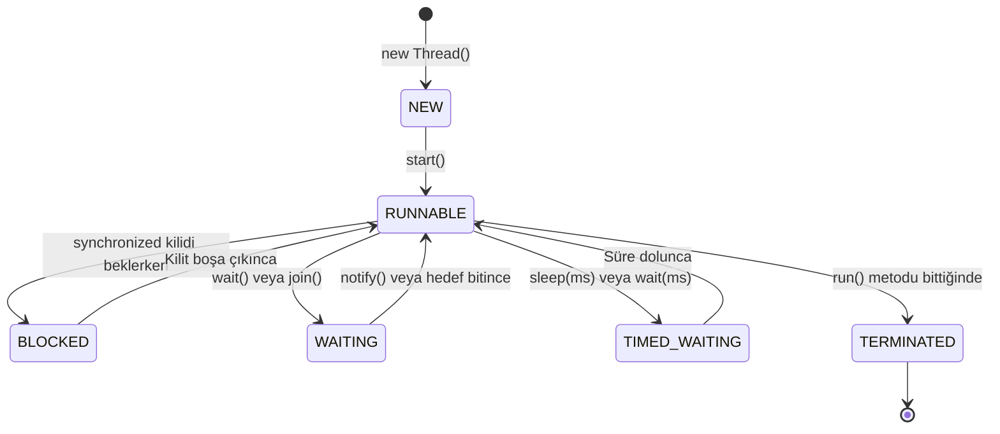
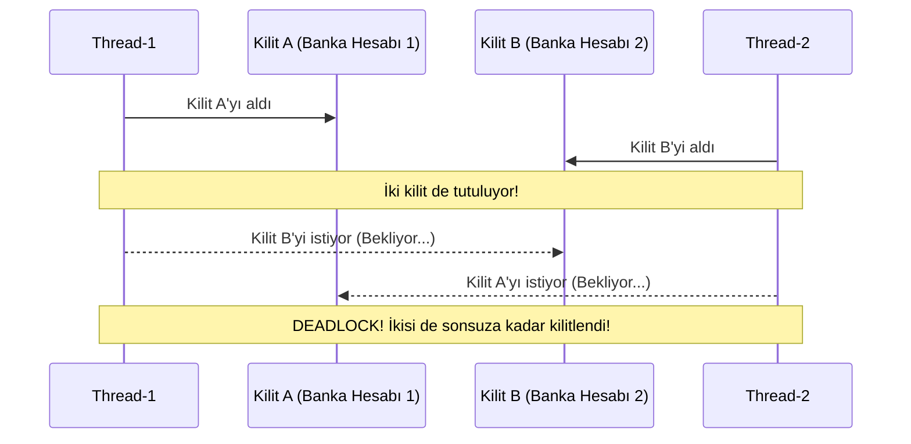
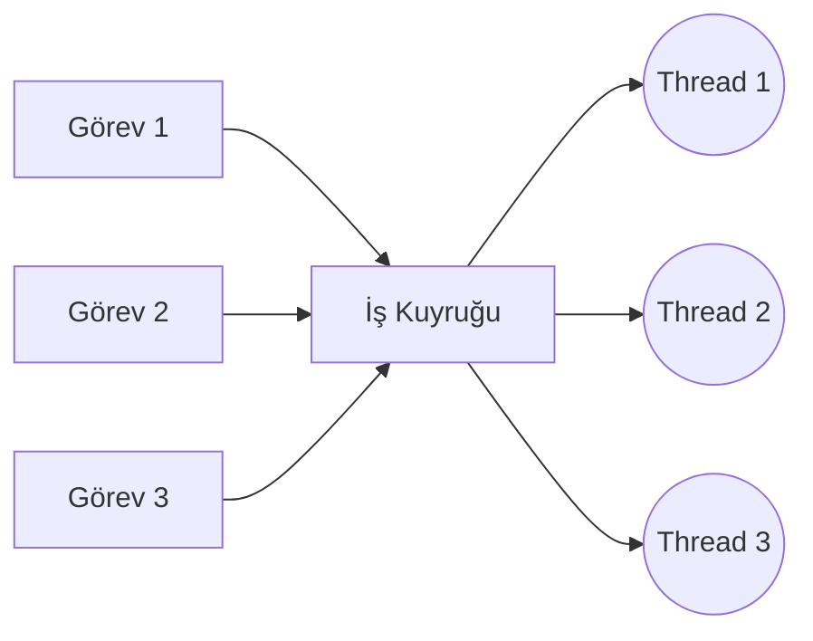

# 4. Multithreading ve Eşzamanlılık (Concurrency)

Bu doküman; modern çok çekirdekli işlemcilerin gücünden tam anlamıyla faydalanmak için Java'da kullanılan **Çoklu İş Parçacığı (Multithreading)** ve **Eşzamanlılık (Concurrency)** kavramlarını, iş parçacığı yaşam döngüsünü, **Yarış Durumu (Race Condition)** ve **Kritik Bölge (Critical Section)** problemlerini, senkronizasyon mekanizmalarını (`synchronized`, `volatile`, `Atomic`), **Deadlock (Ölümcül Kilitlenme)** tehlikesini ve modern **`ExecutorService` / Thread Pool** mimarisini tüm detaylarıyla ele almaktadır.

---

> 📖 **İlgili Bölüm Dokümanları:**
> - 🔙 [Önceki Bölüm: Fonksiyonel Programlama, Lambda ve Stream API (3_lambda_ve_stream_api.md)](./3_lambda_ve_stream_api.md)
> - 🏠 [İleri Konular Modül Listesi](readme.md)
> - 🔜 [Sonraki Bölüm: JDBC ve Veritabanı Programlama (5_jdbc_ve_veritabani.md)](./5_jdbc_ve_veritabani.md)

---

## 📌 İçindekiler
1. [Süreç (Process) vs. İş Parçacığı (Thread)](#1-süreç-process-vs-iş-parçacığı-thread)
   - [JVM'de İş Parçacığı Mimarisi ve Bellek Paylaşımı](#jvmde-iş-parçacığı-mimarisi)
2. [Java'da Thread Oluşturma Yolları](#2-javada-thread-oluşturma-yolları)
   - [Yol 1: `Thread` Sınıfından Kalıtım Almak](#yol-1-thread-sınıfından-kalıtım-almak)
   - [Yol 2: `Runnable` Arayüzünü Uygulamak (Önerilen)](#yol-2-runnable-arayüzünü-uygulamak)
   - [Yol 3: Lambda İfadeleri ile Anonim Thread](#yol-3-lambda-ifadeleri-ile-anonim-thread)
   - [`start()` vs. `run()` Metodu Farkı](#start-vs-run-metodu-farkı)
3. [Thread Yaşam Döngüsü (Thread Life Cycle)](#3-thread-yaşam-döngüsü-thread-life-cycle)
   - [NEW, RUNNABLE, BLOCKED, WAITING, TIMED_WAITING, TERMINATED](#durumlar)
4. [Temel Thread Kontrol Metotları](#4-temel-thread-kontrol-metotları)
   - [`Thread.sleep()`: Geçici Uyutma](#threadsleep)
   - [`join()`: Başka Bir Thread'in Bitmesini Bekleme](#join)
   - [`interrupt()`: Güvenli Kesinti Sinyali](#interrupt)
5. [Eşzamanlılık Tuzakları: Yarış Durumu (Race Condition) ve Kritik Bölge](#5-eşzamanlılık-tuzakları)
   - [Bozuk Sayaç Problemi (`count++` Neden Güvenli Değildir?)](#bozuk-sayaç-problemi)
6. [Senkronizasyon ve Veri Bütünlüğü](#6-senkronizasyon-ve-veri-bütünlüğü)
   - [`synchronized` Metotlar](#synchronized-metotlar)
   - [`synchronized` Bloklar ve İçsel Kilit (Intrinsic Lock / Monitor)](#synchronized-bloklar)
   - [`volatile` Anahtar Kelimesi (Görünürlük Garantisi)](#volatile-anahtar-kelimesi)
   - [Atomik Değişkenler (`AtomicInteger`, `AtomicBoolean` - CAS Algoritması)](#atomik-değişkenler)
7. [Thread'ler Arası İletişim: `wait()`, `notify()`, `notifyAll()`](#7-threadler-arası-iletişim)
   - [Üretici - Tüketici (Producer-Consumer) Deseni](#üretici---tüketici-deseni)
8. [Ölümcül Kilitlenme (Deadlock) Nedir ve Nasıl Önlenir?](#8-ölümcül-kilitlenme-deadlock)
9. [Modern Eşzamanlılık: `ExecutorService` ve Thread Havuzları (Thread Pools)](#9-modern-eşzamanlılık-executorservice)
   - [Neden `new Thread()` Bir Anti-Pattern'dir?](#neden-new-thread-anti-pattern)
   - [`Executors.newFixedThreadPool`](#newfixedthreadpool)
   - [`Callable<T>` vs. `Runnable` ve `Future<T>`](#callable-ve-future)
   - [Havuzun Güvenli Kapatılması (`shutdown`, `awaitTermination`)](#havuzun-güvenli-kapatılması)
10. [Adım Adım Çalıştırılabilir Kod Örnekleri](#10-adım-adım-çalıştırılabilir-kod-örnekleri)
    - [Örnek 1: Yarış Durumu ve `synchronized` ile Çözümü (`BankaBakiyeTest.java`)](#örnek-1-yarış-durumu-ve-synchronized)
    - [Örnek 2: `ExecutorService` ve `Future` ile Paralel Görev Dağıtımı (`ParalelGorevler.java`)](#örnek-2-executorservice-ve-future)
11. [Sık Yapılan Hatalar ve Önemli Kurallar](#11-sık-yapılan-hatalar-ve-önemli-kurallar)
12. [Öğrenciler İçin Pekiştirici Sınıf İçi Alıştırmalar](#12-öğrenciler-için-pekiştirici-sınıf-içi-alıştırmalar)
13. [Ödev Konuları ve Mini Projeler](#13-ödev-konuları-ve-mini-projeler)

---

## 1. Süreç (Process) vs. İş Parçacığı (Thread)

İşletim sistemlerinde çalışan her bir uygulama (örneğin Spotify, Chrome veya Java JVM) bir **Süreçtir (Process)**. Her sürecin işletim sistemi tarafından tahsis edilmiş kendine ait izole bir bellek alanı (RAM) vardır.

Bir sürecin içinde eşzamanlı olarak çalışan en küçük yürütme birimine ise **İş Parçacığı (Thread)** denir.

```
+-------------------------------------------------------------+
| İŞLETİM SİSTEMİ SÜRECİ (JVM Process)                       |
|                                                             |
| Ortak Alan (Shared Memory):                                 |
| [ Heap Bellek (Nesneler) ]  [ Metaspace (Sınıf Kodları) ]  |
|                                                             |
| +--------------------+ +--------------------+                |
| | Thread-1           | | Thread-2           | ...            |
| | - Thread Stack     | | - Thread Stack     |                |
| | - Program Counter  | | - Program Counter  |                |
| +--------------------+ +--------------------+                |
+-------------------------------------------------------------+
```

> [!NOTE]
> Thread'lerin en büyük avantajı da en büyük tehlikesi de aynıdır: **Aynı bellek alanındaki (Heap) nesneleri ortaklaşa paylaşırlar.** Bu paylaşım çok hızlı veri aktarımı sağlar ancak senkronize edilmezse veriler çorba olur!

---

## 2. Java'da Thread Oluşturma Yolları

### Yol 1: `Thread` Sınıfından Kalıtım Almak
```java
class DosyaIndirici extends Thread {
    @Override
    public void run() {
        System.out.println("Dosya indiriliyor... Thread: " + Thread.currentThread().getName());
    }
}

// Başlatma:
DosyaIndirici t1 = new DosyaIndirici();
t1.start(); // run() değil start() çağrılır!
```

### Yol 2: `Runnable` Arayüzünü Uygulamak (Önerilen)
Java'da tekli kalıtım kuralı olduğundan, başka bir sınıftan miras alan bir sınıf `Thread`'i miras alamaz. Bu yüzden iş mantığını **`Runnable`** arayüzü ile modellemek en doğru nesne yönelimli tasarımdır:

```java
class EpostaGonderici implements Runnable {
    @Override
    public void run() {
        System.out.println("E-posta gönderiliyor... Thread: " + Thread.currentThread().getName());
    }
}

// Başlatma:
Thread t2 = new Thread(new EpostaGonderici(), "Eposta-Is-Parcacigi");
t2.start();
```

### Yol 3: Lambda İfadeleri ile Anonim Thread
`Runnable` fonksiyonel bir arayüz (`@FunctionalInterface`) olduğu için tek satırda lambda ile thread başlatılabilir:

```java
Thread t3 = new Thread(() -> {
    System.out.println("Lambda ile çalışan Thread: " + Thread.currentThread().getName());
});
t3.start();
```

### `start()` vs. `run()` Metodu Farkı

| Metot | Ne Yapar? | Yeni Thread Açılır mı? |
|---|---|---|
| **`t.start()`** | İşletim sisteminde yepyeni bir iş parçacığı oluşturur ve onun içinde `run()` metodunu çalıştırır. | **EVET** (Ayrı bir hatta paralel yürütülür) |
| **`t.run()`** | Normal bir metot gibi o anki mevcut çağıran thread (genelde `main`) içinde senkron olarak çalışır. | **HAYIR** (Asla paralel çalışmaz!) |

---

## 3. Thread Yaşam Döngüsü (Thread Life Cycle)

Bir Java iş parçacığı yaşamı boyunca 6 farklı durumdan (State) geçer:



1. **`NEW`**: Nesne oluşturuldu (`new Thread()`), ancak henüz `start()` çağrılmadı.
2. **`RUNNABLE`**: İşletim sistemi CPU kuyruğunda yürütülüyor veya yürütülmeye hazır.
3. **`BLOCKED`**: Bir `synchronized` bloğuna girmek için başka bir thread'in elindeki monitör kilidinin (lock) serbest kalmasını bekliyor.
4. **`WAITING`**: Başka bir thread'in sinyal göndermesini (`wait()`, `join()`) süresiz bekliyor.
5. **`TIMED_WAITING`**: Belirli bir zaman aşımı süresince (`sleep(1000)`, `join(500)`) bekliyor.
6. **`TERMINATED`**: `run()` metodu çalışmasını tamamladı veya yakalanmamış bir istisna ile sonlandı.

---

## 4. Temel Thread Kontrol Metotları

### `Thread.sleep(milisaniye)`
Mevcut çalışan thread'i belirtilen milisaniye kadar beklemeye alır (`TIMED_WAITING`). `InterruptedException` fırlatabileceğinden `try-catch` gerektirir:
```java
try {
    Thread.sleep(2000); // 2 saniye bekle
} catch (InterruptedException e) {
    System.out.println("Uyku yarıda kesildi!");
}
```

### `join()`
Bir thread'in çalışmasını tamamlamasını beklemek için kullanılır. Örneğin ana programın (main thread) bir dosya indirme thread'i bitmeden devam etmesini engellemek için:
```java
Thread indirici = new Thread(() -> { /* indirme işlemi */ });
indirici.start();

indirici.join(); // main thread burada durur, indirici bitene kadar bekler!
System.out.println("İndirme bitti, artık dosyayı açabiliriz.");
```

### `interrupt()`
Bir thread'i dışarıdan zorla öldürmek (eski `stop()` metodu gibi) bellek sızıntılarına yol açar ve Java'da yasaklanmıştır (deprecated). Bunun yerine thread'e nazikçe "durman gerekiyor" sinyali vermek için `interrupt()` kullanılır:
```java
Thread t = new Thread(() -> {
    while (!Thread.currentThread().isInterrupted()) {
        // İşlem yap...
    }
    System.out.println("Temizlik yapıldı ve thread güvenle kapandı.");
});
t.start();

// Bir süre sonra:
t.interrupt(); // Thread'in bayrağını true yapar
```

---

## 5. Eşzamanlılık Tuzakları: Yarış Durumu (Race Condition)

Birden fazla iş parçacığı aynı bellek alanındaki bir değişkene aynı anda okuma ve yazma yapmaya kalktığında ve nihai sonuç işlemlerin çalışma sırasına göre rastgele değiştiğinde buna **Yarış Durumu (Race Condition)** denir.

### Bozuk Sayaç Problemi: `count++` Neden Güvenli Değildir?

`count++` tek bir işlem gibi görünür ancak işlemci seviyesinde 3 adımdan oluşur:
1. `READ`: Değişkenin değerini bellekten oku (Örn: 5).
2. `MODIFY`: Değere 1 ekle (5 + 1 = 6).
3. `WRITE`: Yeni değeri belleğe geri yaz (6).

```
Thread A: [Oku: 5] -----------> [1 Ekle: 6] -----------> [Yaz: 6]
Thread B:        [Oku: 5] ---------------> [1 Ekle: 6] ---------> [Yaz: 6]
```
İki thread de sayacı 1 artırmıştır fakat bellek sonucunda sayaç 7 olması gerekirken **6** kalır!

---

## 6. Senkronizasyon ve Veri Bütünlüğü

### `synchronized` Metotlar
Bir metoda `synchronized` eklendiğinde, o nesnenin **içsel kilidini (Monitor Lock)** ele geçirir. Bir thread o metodun içindeyken, başka hiçbir thread aynı nesnenin herhangi bir `synchronized` metoduna giremez, kapıda (`BLOCKED` durumunda) sırasını bekler.

```java
public class GuvenliSayac {
    private int count = 0;

    public synchronized void artir() {
        count++; // Artık atomik ve thread-safe!
    }

    public synchronized int getCount() {
        return count;
    }
}
```

### `synchronized` Bloklar
Bütün metodu kilitlemek performansı düşürebilir. Sadece kritik birkaç satırı kilitlemek en iyi pratiktir:

```java
public void paraTransferi(Hesap hedef, double tutar) {
    // Kilit gerektirmeyen hazırlık işlemleri (loglama, validasyon)...
    
    synchronized (this) { // Yalnızca kritik bölge kilitlenir
        this.bakiye -= tutar;
        hedef.bakiye += tutar;
    }
}
```

### `volatile` Anahtar Kelimesi (Görünürlük Garantisi)
Modern çok çekirdekli işlemcilerde her çekirdeğin kendi L1/L2 önbelleği (Cache) vardır. Bir thread bir değişkeni güncellediğinde, bu değişiklik hemen ana RAM'e yansımayabilir ve diğer çekirdekteki thread eski değeri okuyabilir.

`volatile` anahtar kelimesi, değişkenin **asla CPU önbelleğinde tutulmayacağını, her okuma ve yazmanın doğrudan ana belleğe (RAM) yapılacağını** garanti eder:

```java
public class Sunucu {
    // Tüm thread'ler güncel değeri anında görsün:
    private volatile boolean calisiyor = true;

    public void durdur() {
        this.calisiyor = false; // RAM'e anında yazılır
    }

    public void baslat() {
        while (calisiyor) {
            // RAM'den doğrudan okunur
        }
    }
}
```

> [!WARNING]
> `volatile` sadece tekil okuma/yazmalarda görünürlük (visibility) sağlar. `count++` gibi bileşik işlemlerde (read-modify-write) atomiklik sağlamaz!

### Atomik Değişkenler (`java.util.concurrent.atomic`)
Kilit (`synchronized`) kullanmak thread'leri beklettiği için maliyetlidir. Donanım seviyesindeki **CAS (Compare-And-Swap)** CPU komutlarını kullanan `AtomicInteger`, `AtomicLong`, `AtomicBoolean` sınıfları kilit kullanmadan (lock-free) ışık hızında thread güvenliği sağlar:

```java
import java.util.concurrent.atomic.AtomicInteger;

public class HizliSayac {
    private AtomicInteger sayac = new AtomicInteger(0);

    public void artir() {
        sayac.incrementAndGet(); // Thread-safe ve kilit mekanizmasından kat kat hızlı!
    }

    public int getDeger() {
        return sayac.get();
    }
}
```

---

## 7. Thread'ler Arası İletişim: `wait()` ve `notify()`

Ortak bir kaynağı paylaşan thread'lerin birbirini beklemesi ve uyandırması gerektiğinde (Örn: Depo doluysa üretici beklesin, ürün gelince tüketici uyansın) kullanılır.

> [!CAUTION]
> `wait()`, `notify()` ve `notifyAll()` metotları **KESİNLİKLE** bir `synchronized` bloğu içinde çağrılmalıdır; aksi takdirde `IllegalMonitorStateException` fırlatılır!

```java
synchronized (kilit) {
    while (kuyruk.isEmpty()) {
        kilit.wait(); // Kilidi bırakır ve WAITING durumunda uykuya geçer!
    }
    // Veriyi tüket...
    kilit.notifyAll(); // Diğer bekleyen thread'leri uyandırır
}
```

---

## 8. Ölümcül Kilitlenme (Deadlock)

Deadlock; iki veya daha fazla thread'in birbirinin elindeki kilidi serbest bırakmasını sonsuza kadar beklemesi durumunda sistemin kilitlenip donmasıdır.



### Deadlock'tan Kaçınma Kuralı: Kilit Alma Sırası (Lock Ordering)
Tüm thread'ler kilitleri **daima aynı sırada** almalıdır (Örn: Önce her zaman ID'si küçük olan hesap, sonra büyük olan kilitlenmelidir).

---

## 9. Modern Eşzamanlılık: `ExecutorService` ve Thread Havuzları

### Neden `new Thread()` Bir Anti-Pattern'dir?
İşletim sisteminde bir thread oluşturmak CPU ve bellek açısından çok pahalı bir işlemdir (yaklaşık 1 MB stack bellek tahsis edilir). Her istek için `new Thread()` açarsanız, 10.000 eşzamanlı kullanıcıda sunucunuz bellek yetersizliğinden (`OutOfMemoryError`) çöker.

**Çözüm: Thread Pool (İş Parçacığı Havuzu).**
Tıpkı bir taksi durağı gibi sabit sayıda iş parçacığı önceden açılır. Gelen görevler kuyruğa girer, boşta kalan taksi (thread) görevi alır, bitirince ölmez ve havuzda yeni görevi bekler!



### `Callable<T>` vs. `Runnable` ve `Future<T>`

- **`Runnable`**: Değer dönemez (`void`) ve checked exception fırlatamaz.
- **`Callable<T>`**: Bir sonuç (`T`) döner ve `Exception` fırlatabilir.
- **`Future<T>`**: Henüz tamamlanmamış asenkron bir görevin sonucunu temsil eder.

```java
import java.util.concurrent.*;

public class ExecutorOrnegi {
    public static void main(String[] args) throws ExecutionException, InterruptedException {
        // 3 iş parçacığından oluşan havuz:
        ExecutorService havuz = Executors.newFixedThreadPool(3);

        // Callable görevi: 5 saniyelik bir hesaplama simülasyonu
        Callable<Integer> gorev = () -> {
            System.out.println("Hesaplanıyor... " + Thread.currentThread().getName());
            Thread.sleep(1000);
            return 42 * 2;
        };

        // Görevi havuza veriyoruz ve geriye Future alıyoruz:
        Future<Integer> sonucGelecek = havuz.submit(gorev);

        System.out.println("Ana thread başka işlerini yapıyor...");

        // Sonucu bekle ve al (get metodu iş bitene kadar bloklar):
        Integer nihaiSonuc = sonucGelecek.get();
        System.out.println("Hesaplanan Sonuç: " + nihaiSonuc);

        // Havuzu kapatmayı ASLA unutmayın:
        havuz.shutdown();
    }
}
```

---

## 10. Adım Adım Çalıştırılabilir Kod Örnekleri

### Örnek 1: Yarış Durumu ve `synchronized` ile Çözümü (`BankaBakiyeTest.java`)

Aynı banka hesabına 2 farklı ATM'den aynı anda biner adet 1 TL para yatırıldığında senkronizasyonun hayati önemini kanıtlayan örnek:

```java
class BankaHesabi {
    private int bakiye = 0;

    // synchronized kaldırılırsa bakiye 2000 çıkmaz, veri bozulur!
    public synchronized void paraYatir(int miktar) {
        bakiye += miktar;
    }

    public int getBakiye() {
        return bakiye;
    }
}

public class BankaBakiyeTest {
    public static void main(String[] args) throws InterruptedException {
        BankaHesabi hesap = new BankaHesabi();

        // 1. ATM Thread'i: 1000 kez 1 TL yatırır
        Thread atm1 = new Thread(() -> {
            for (int i = 0; i < 1000; i++) {
                hesap.paraYatir(1);
            }
        });

        // 2. ATM Thread'i: 1000 kez 1 TL yatırır
        Thread atm2 = new Thread(() -> {
            for (int i = 0; i < 1000; i++) {
                hesap.paraYatir(1);
            }
        });

        atm1.start();
        atm2.start();

        // İki thread'in de işinin bitmesini bekle:
        atm1.join();
        atm2.join();

        System.out.println("Beklenen Bakiye: 2000 TL");
        System.out.println("Gerçekleşen Bakiye: " + hesap.getBakiye() + " TL");
    }
}
```

#### Konsol Çıktısı:
```text
Beklenen Bakiye: 2000 TL
Gerçekleşen Bakiye: 2000 TL
```

---

### Örnek 2: `ExecutorService` ve `Future` ile Paralel Görev Dağıtımı (`ParalelGorevler.java`)

```java
import java.util.ArrayList;
import java.util.List;
import java.util.concurrent.*;

public class ParalelGorevler {
    public static void main(String[] args) throws InterruptedException, ExecutionException {
        // CPU çekirdek sayısı kadar thread açalım:
        int cekirdekSayisi = Runtime.getRuntime().availableProcessors();
        ExecutorService havuz = Executors.newFixedThreadPool(cekirdekSayisi);

        List<Future<String>> sonuclar = new ArrayList<>();

        for (int i = 1; i <= 5; i++) {
            final int gorevId = i;
            Callable<String> gorev = () -> {
                long basla = System.currentTimeMillis();
                Thread.sleep(500); // 0.5 saniyelik iş simülasyonu
                return "Görev #" + gorevId + " tamamlandı (" + Thread.currentThread().getName() + ")";
            };
            sonuclar.add(havuz.submit(gorev));
        }

        // Tüm sonuçları topla
        for (Future<String> f : sonuclar) {
            System.out.println("-> " + f.get());
        }

        havuz.shutdown();
        if (havuz.awaitTermination(5, TimeUnit.SECONDS)) {
            System.out.println("Tüm işler başarıyla bitti ve havuz kapandı.");
        }
    }
}
```

---

## 11. Sık Yapılan Hatalar ve Önemli Kurallar

1. ❌ **`start()` Yerine Yanlışlıkla `run()` Çağırmak:**
   - `t.run()` çağrısı yeni bir iş parçacığı oluşturmaz; kodu `main` thread'i içinde sırayla çalıştırır. Asla multithreading gerçekleşmez!
2. ❌ **`ExecutorService` Nesnesini `shutdown()` ile Kapatmayı Unutmak:**
   - Havuz kapatılmazsa arka plandaki thread'ler JVM'i canlı tutar ve programınız `main` metodu bitse bile asla sonlanmaz, askıda kalır.
3. ❌ **`wait()` ve `notify()` Metotlarını `synchronized` Dışında Çağırmak:**
   - Çalışma anında `IllegalMonitorStateException` patlamasına neden olur.
4. ❌ **`Future.get()` Metodunu Erken Çağırıp Paralelliği Öldürmek:**
   - Bir döngü içinde `Future f = havuz.submit(); f.get();` yazarsanız, her görev bitmeden bir sonrakine geçemez ve kod tamamen sıralı (senkron) çalışmaya geri döner!
5. ❌ **Aynı Anda İki Nesneyi Farklı Sıralarla Kilitlemek:**
   - Deadlock davetiyesidir. Kilitler daima global bir sıra hiyerarşisiyle alınmalıdır.

---

## 12. Öğrenciler İçin Pekiştirici Sınıf İçi Alıştırmalar

### Alıştırma 1: `AtomicInteger` ile Güvenli Tıklama Sayacı
Bir web sitesinin ziyaretçi sayacını simüle ediniz. 5 farklı thread aynı anda bu sayacı 500'er kez artırsın. Senkronizasyon kilidi (`synchronized`) yerine `AtomicInteger` kullanarak nihai sonucun tam 2500 olduğunu doğrulayınız.

<details>
<summary>🔍 <b>Çözümü Göster</b></summary>

```java
import java.util.concurrent.atomic.AtomicInteger;

public class ZiyaretciSayaciTest {
    public static void main(String[] args) throws InterruptedException {
        AtomicInteger sayac = new AtomicInteger(0);
        Thread[] threadler = new Thread[5];

        for (int i = 0; i < 5; i++) {
            threadler[i] = new Thread(() -> {
                for (int j = 0; j < 500; j++) {
                    sayac.incrementAndGet();
                }
            });
            threadler[i].start();
        }

        for (Thread t : threadler) {
            t.join();
        }

        System.out.println("Toplam Ziyaretçi: " + sayac.get()); // 2500
    }
}
```
</details>

---

### Alıştırma 2: Thread İsimlerini ve Durumlarını İzleme
Bir thread oluşturup `NEW`, `RUNNABLE`, `TIMED_WAITING` ve `TERMINATED` durumlarını konsola yazdıran bir durum takipçisi yazınız.

<details>
<summary>🔍 <b>Çözümü Göster</b></summary>

```java
public class ThreadDurumTakip {
    public static void main(String[] args) throws InterruptedException {
        Thread t = new Thread(() -> {
            try {
                Thread.sleep(500);
            } catch (InterruptedException e) {
                e.printStackTrace();
            }
        });

        System.out.println("1. Durum: " + t.getState()); // NEW
        t.start();
        System.out.println("2. Durum: " + t.getState()); // RUNNABLE

        Thread.sleep(100);
        System.out.println("3. Durum: " + t.getState()); // TIMED_WAITING

        t.join();
        System.out.println("4. Durum: " + t.getState()); // TERMINATED
    }
}
```
</details>

---

## 13. Ödev Konuları ve Mini Projeler

---

### 🟢 Ödev 1 (Temel Seviye): Paralel Geri Sayım ve Yarış Simülatörü (`KosuYarisi.java`)

**Gereksinimler:**
1. `KosuYarisi` sınıfı tasarlayınız.
2. 4 adet atlet (`Thread`) oluşturunuz (Örn: "Ahmet", "Mehmet", "Ayşe", "Fatma").
3. Her koşucu 100 metrelik pisti rastgele aralıklarla (`Thread.sleep(rnd.nextInt(200))`) 10'ar metre koşarak tamamlasın.
4. 100 metreye ilk ulaşan koşucu konsola `"🏆 BİRİNCİ: [İsim] yarışı kazandı!"` yazdırsın ve diğerlerinin derecelerini sırayla konsola basınız.

---

### 🟡 Ödev 2 (Orta Seviye): Çok İş Parçacıklı İndirme Yöneticisi (`ParalelIndirici.java`)

**Gereksinimler:**
1. 10 adet URL veya büyük dosya simülasyonu içeren bir liste hazırlayınız.
2. En fazla 3 eşzamanlı indirmeye izin veren bir `Executors.newFixedThreadPool(3)` oluşturunuz.
3. Her indirme işlemi `Callable<String>` olarak dosya adı, boyutu ve geçen süreyi hesaplasın.
4. Ana thread'de tüm indirmelerin tamamlanmasını bekleyip toplam indirilen veri ve geçen süreyi raporlayınız.

---

### 🔴 Ödev 3 (İleri Seviye): Üretici - Tüketici Fırın Simülasyonu (`FirinSimulasyonu.java`)

**Gereksinimler:**
1. Maksimum 10 ekmek alabilen kapasitesi sınırlı bir `EkmekKutusu` sınıfı tasarlayınız.
2. `Firin` (Üretici):
   - Kutu doluysa (`kapasite == 10`) `wait()` ile beklesin.
   - Ekmek üretince kutuya eklesin ve `notifyAll()` ile müşterileri uyandırsın.
3. `Musteri` (Tüketici):
   - Kutu boşsa (`kapasite == 0`) `wait()` ile ekmek çıkmasını beklesin.
   - Ekmek alınca kutudan düşsün ve fırıncıyı uyandırsın.
4. 2 adet Fırıncı Thread'i ve 5 adet Müşteri Thread'i başlatıp senkronizasyonu `synchronized`, `wait()` ve `notifyAll()` ile hatasız işletiniz.

