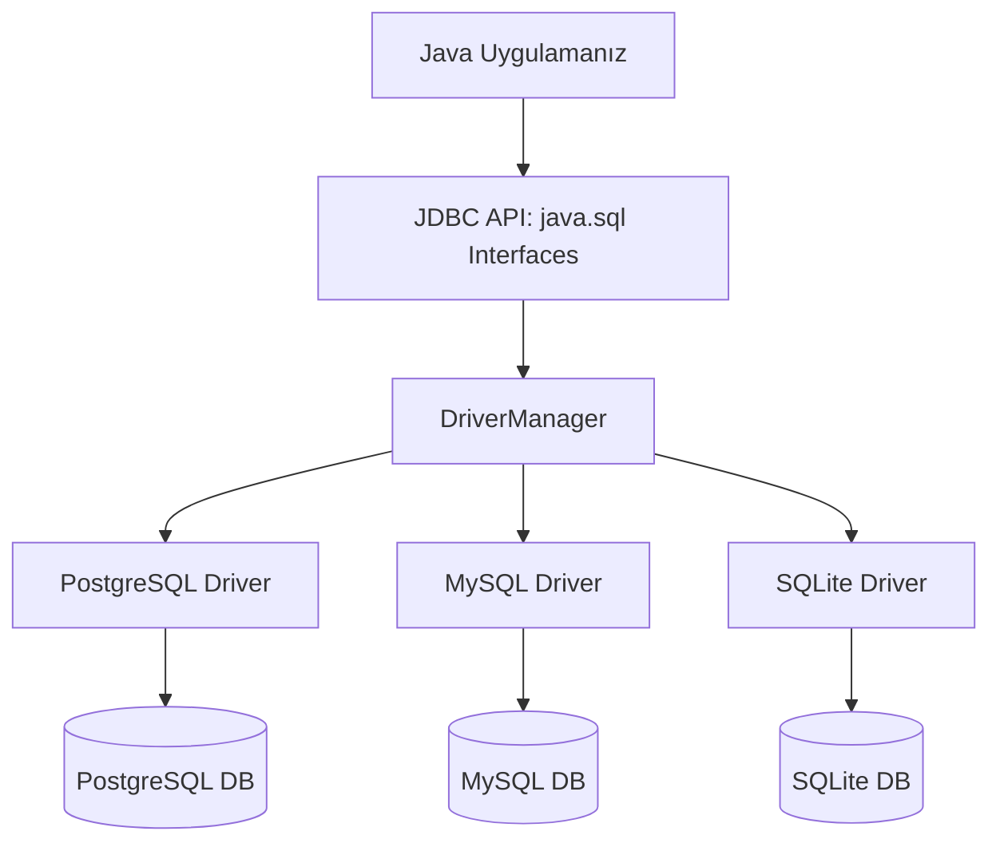

# 5. JDBC ve Veritabanı Programlama

Bu doküman; Java uygulamalarının ilişkisel veritabanlarıyla (PostgreSQL, MySQL, SQLite, Oracle) iletişim kurmasını sağlayan endüstri standardı **JDBC (Java Database Connectivity)** mimarisini, **`Connection`**, **`Statement`**, siber güvenlik açısından hayati olan **`PreparedStatement`** ve **SQL Enjeksiyonu (SQL Injection)** savunmasını, **`ResultSet`** ile veri okumayı, **Transaction (İşlem - `commit`/`rollback`)** yönetimini ve kurumsal yazılım geliştirmede vazgeçilmez olan **DAO (Data Access Object)** tasarım desenini tüm detaylarıyla ele almaktadır.

---

> 📖 **İlgili Bölüm Dokümanları:**
> - 🔙 [Önceki Bölüm: Multithreading ve Eşzamanlılık (4_multithreading_ve_es_zamanlilik.md)](./4_multithreading_ve_es_zamanlilik.md)
> - 🏠 [İleri Konular Modül Listesi](readme.md)
> - 🔜 [Sonraki Bölüm: Yazılım Kalitesi ve Birim Testleri: JUnit 5 (6_birim_testleri_junit5.md)](./6_birim_testleri_junit5.md)

---

## 📌 İçindekiler
1. [JDBC Nedir ve Nasıl Çalışır? (Mimari Yapı)](#1-jdbc-nedir-ve-nasıl-çalışır)
   - [JDBC Sürücüleri (Drivers) ve Veritabanı Bağımsızlığı](#jdbc-sürücüleri)
2. [JDBC Temel Bileşenleri](#2-jdbc-temel-bileşenleri)
   - [`DriverManager`: Bağlantı Sağlayıcı](#drivermanager)
   - [`Connection`: Veritabanı Oturumu](#connection)
   - [`Statement` vs. `PreparedStatement`](#statement-vs-preparedstatement)
   - [`ResultSet`: Veri İmleci (Cursor)](#resultset)
3. [Bağlantı Dizesi (Connection URL) Yapısı](#3-bağlantı-dizesi-connection-url-yapısı)
4. [Siber Güvenlik: SQL Injection Tehdidi ve Savunması](#4-siber-güvenlik-sql-injection-tehdidi-ve-savunması)
   - [Klasik Bir Güvenlik Açığı: `admin' OR '1'='1`](#klasik-güvenlik-açığı)
   - [`PreparedStatement` ve Parametrik Sorgular (`?`) ile Tam Koruma](#preparedstatement-ile-tam-koruma)
5. [CRUD İşlemleri (Create, Read, Update, Delete)](#5-crud-işlemleri)
   - [`executeUpdate()` vs. `executeQuery()`](#executeupdate-vs-executequery)
6. [İşlem Yönetimi (Transactions) ve ACID Prensipleri](#6-işlem-yönetimi-transactions)
   - [`setAutoCommit(false)`, `commit()` ve `rollback()`](#setautocommit-commit-rollback)
7. [Modern Kaynak Kapatma: `try-with-resources` ile Bellek Sızıntılarını Önleme](#7-modern-kaynak-kapatma)
8. [Kurumsal Mimari Deseni: DAO (Data Access Object) Deseni](#8-kurumsal-mimari-deseni-dao-deseni)
   - [Model (Entity) Sınıfı](#model-sınıfı)
   - [DAO Arayüzü (Interface)](#dao-arayüzü)
   - [DAO Uygulaması (Implementation)](#dao-uygulaması)
9. [Adım Adım Çalıştırılabilir Kod Örnekleri](#9-adım-adım-çalıştırılabilir-kod-örnekleri)
   - [Örnek 1: SQLite / H2 Bellek İçi Veritabanında Tablo Oluşturma ve Ekleme](#örnek-1-tablo-ve-ekleme)
   - [Örnek 2: Tam Teşekküllü Öğrenci DAO Uygulaması (`OgrenciYonetimTest.java`)](#örnek-2-öğrenci-dao-uygulaması)
10. [Sık Yapılan Hatalar ve Önemli Kurallar](#10-sık-yapılan-hatalar-ve-önemli-kurallar)
11. [Öğrenciler İçin Pekiştirici Sınıf İçi Alıştırmalar](#11-öğrenciler-için-pekiştirici-sınıf-içi-alıştırmalar)
12. [Ödev Konuları ve Mini Projeler](#12-ödev-konuları-ve-mini-projeler)

---

## 1. JDBC Nedir ve Nasıl Çalışır?

**JDBC (Java Database Connectivity)**; Java programlarının SQL tabanlı ilişkisel veritabanları (RDBMS) ile standart ve ortak bir arayüz üzerinden haberleşmesini sağlayan bir Java SE API'sidir (`java.sql` paketi).

JDBC'nin en büyük gücü **soyutlama katmanı** sağlamasıdır. Yazdığınız kod, hangi veritabanını kullandığınızı bilmek zorunda değildir; sadece standart JDBC metotlarını çağırır. Aradaki çeviriyi o veritabanına özel üretilmiş **JDBC Driver (Sürücü)** kütüphanesi (JAR dosyası) yapar.



---

## 2. JDBC Temel Bileşenleri

| Bileşen | Görevi ve Önemi |
|---|---|
| **`DriverManager`** | Sisteme yüklenmiş veritabanı sürücülerini yönetir ve verilen URL/kullanıcı bilgileriyle bir `Connection` açar. |
| **`Connection`** | Veritabanı ile Java arasındaki açık oturumu temsil eder. SQL ifadeleri üretmek ve transaction yönetmek için kullanılır. |
| **`Statement`** | Statik, parametresiz SQL sorgularını çalıştırmak için kullanılır (Kullanıcı girdisi olan sorgularda **tercih edilmez**). |
| **`PreparedStatement`** | Önceden derlenmiş, parametre (`?`) alan, yüksek performanslı ve **SQL Injection'a karşı %100 güvenli** sorgu sınıfı. |
| **`ResultSet`** | Bir `SELECT` sorgusu sonucunda veritabanından dönen satırları tutan veri tablosudur (İmleç mantığıyla satır satır okunur). |

---

## 3. Bağlantı Dizesi (Connection URL) Yapısı

Her veritabanı motorunun kendine has bir bağlantı adresi (JDBC URL) formatı vardır:

$$\text{jdbc:}[\text{veritabani\_turu}]:[\text{alt\_protokol\_ve\_adres}]$$

- **MySQL:** `jdbc:mysql://localhost:3306/okul_db?useSSL=false&serverTimezone=UTC`
- **PostgreSQL:** `jdbc:postgresql://localhost:5432/okul_db`
- **SQLite (Dosya Tabanlı):** `jdbc:sqlite:C:/veritabanim/okul.db` veya hafızada `jdbc:sqlite::memory:`
- **Oracle:** `jdbc:oracle:thin:@localhost:1521:xe`

---

## 4. Siber Güvenlik: SQL Injection Tehdidi ve Savunması

### Klasik Bir Güvenlik Açığı: `Statement` Kullanımı

Bir kullanıcının giriş formundan gelen `kullaniciAdi` ve `sifre` metinlerini birleştirdiğinizi düşünün:

```java
// ⚠️ KESİNLİKLE YAPILMAMASI GEREKEN KOD! (GÜVENLİK AÇIĞI!)
String kullaniciAdi = form.getKullanici(); // Saldırgan girdi: admin' --
String sifre = form.getSifre();

String sql = "SELECT * FROM kullanicilar WHERE user = '" + kullaniciAdi + "' AND pass = '" + sifre + "'";
Statement stmt = connection.createStatement();
ResultSet rs = stmt.executeQuery(sql);
```

Saldırgan kullanıcı adına `admin' --` yazdığında SQL şu hale gelir:
```sql
SELECT * FROM kullanicilar WHERE user = 'admin' --' AND pass = '...'
```
`--` işareti SQL'de yorum satırı olduğu için şifre kontrolü tamamen devre dışı kalır ve saldırgan şifresiz şekilde sistem yöneticisi olarak sisteme girer!

---

### `PreparedStatement` ile Tam Koruma

`PreparedStatement`, SQL komut şablonunu veritabanına önceden derlemesi için gönderir. Değerlerin geleceği yerlere soru işareti (`?`) koyulur.

Veritabanı motoru, bu soru işaretlerinin yerine gelen girdileri **asla çalıştırılabilir bir SQL komutu olarak algılamaz**, sadece saf bir veri (`literal value`) olarak ele alır:

```java
// ✅ GÜVENLİ VE PROFESYONEL YOL!
String sql = "SELECT * FROM kullanicilar WHERE user = ? AND pass = ?";
PreparedStatement pstmt = connection.prepareStatement(sql);

pstmt.setString(1, kullaniciAdi); // 1. soru işareti
pstmt.setString(2, sifre);         // 2. soru işareti

ResultSet rs = pstmt.executeQuery();
```

> [!TIP]
> **Performans Artışı:** Veritabanı sorgu şablonunu bir kez derler ve yürütme planını (execution plan) önbelleğe alır. 10.000 kayıt eklerken `PreparedStatement` kullanmak normal `Statement`'a göre katlarca daha hızlıdır.

---

## 5. CRUD İşlemleri (Create, Read, Update, Delete)

Veritabanı işlemlerinde iki temel yürütme metodu kullanılır:

| Metot | Hangi SQL Komutlarında Kullanılır? | Ne Döner? |
|---|---|---|
| **`executeQuery()`** | Sadece **`SELECT`** sorgularında | Verileri içeren bir **`ResultSet`** döner. |
| **`executeUpdate()`**| **`INSERT`**, **`UPDATE`**, **`DELETE`**, `CREATE TABLE` vb. | Etkilenen satır sayısını (`int`) döner. |

### `ResultSet` ile Veri Okuma Döngüsü:

`ResultSet` bir imleç (cursor) gibi çalışır. İlk açıldığında ilk satırın hemen öncesinde durur. `rs.next()` metodu imleci bir sonraki satıra kaydırır; okunacak satır varsa `true`, bittiğinde `false` döner.

```java
// Sütun indeksleri 1'den başlar! Veya sütun adı verilir:
while (rs.next()) {
    int id = rs.getInt("id");             // veya rs.getInt(1);
    String ad = rs.getString("ad");       // veya rs.getString(2);
    double bakiye = rs.getDouble("bakiye");
    System.out.println(id + " - " + ad + " (" + bakiye + " TL)");
}
```

---

## 6. İşlem Yönetimi (Transactions) ve ACID Prensipleri

Bir banka havalesini ele alalım:
1. Ali'nin hesabından 1.000 TL düş (`UPDATE ...`).
2. Veli'nin hesabına 1.000 TL ekle (`UPDATE ...`).

Eğer 1. adım çalıştıktan sonra elektrikler kesilirse veya veritabanı çökerse ne olur? Ali'nin parası yok olmuş, Veli'ye ise geçmemiştir!

İşte bu tür çok adımlı kritik operasyonların ya **hep birlikte başarılı olmasını ya da en ufak bir hatada hiç yapılmamış gibi geri alınmasını** sağlayan mekanizmaya **Transaction (İşlem)** denir (ACID'in Atomicity ilkesi).

```java
try {
    // 1. Otomatik onaylamayı kapatıyoruz:
    connection.setAutoCommit(false);

    // 2. Adımları işlet:
    pstmt1.executeUpdate(); // Ali'den düş
    pstmt2.executeUpdate(); // Veli'ye ekle

    // 3. Her şey hatasız bittiyse kalıcı olarak kaydet:
    connection.commit();
    System.out.println("Transfer başarıyla tamamlandı.");

} catch (SQLException e) {
    // 4. En ufak bir hatada tüm işlemleri geri al:
    if (connection != null) {
        connection.rollback();
        System.err.println("Hata oluştu! Para iade edildi (Rollback).");
    }
} finally {
    connection.setAutoCommit(true); // Varsayılana geri dön
}
```

---

## 7. Modern Kaynak Kapatma: `try-with-resources`

JDBC nesneleri (`Connection`, `PreparedStatement`, `ResultSet`), işletim sistemi ve veritabanı sunucusu üzerinde açık bir soket ve kaynak tüketir. Kapatılmazlarsa bir süre sonra veritabanı bağlantı havuzu tükenir ve sunucu kilitlenir (**Connection Leak**).

Tüm bu sınıflar `AutoCloseable` arayüzünü uyguladığı için en temiz ve güvenli yaklaşım **`try-with-resources`** bloklarıdır:

```java
String sql = "SELECT id, ad FROM ogrenciler WHERE bolum = ?";

try (Connection conn = DriverManager.getConnection(URL, USER, PASS);
     PreparedStatement pstmt = conn.prepareStatement(sql)) {

    pstmt.setString(1, "Bilgisayar");
    
    try (ResultSet rs = pstmt.executeQuery()) {
        while (rs.next()) {
            System.out.println("Öğrenci: " + rs.getString("ad"));
        }
    }
} // rs, pstmt ve conn burada otomatik olarak hatasız kapatılır!
```

---

## 8. Kurumsal Mimari Deseni: DAO (Data Access Object)

Gerçek dünyadaki kurumsal projelerde SQL sorguları asla buton tıklama olaylarının veya iş mantığının içine gömülmez. Veritabanı erişim kodlarını iş mantığından izole etmek için **DAO Deseni** uygulanır.

```mermaid
flowchart LR
    UI[Kullanıcı Arayüzü / Controller] --> Service[İş Mantığı / Service]
    Service --> DAOInterface[OgrenciDAO (Arayüz)]
    DAOInterface -.-> DAOImpl[OgrenciDAOImpl (JDBC Kodları)]
    DAOImpl --> DB[(Veritabanı)]
```

### Katmanlar:
1. **Model (Entity):** Veritabanı tablosunu temsil eden POJO sınıfı (`Ogrenci.java`).
2. **DAO Arayüzü:** Yapılabilecek işlemleri soyutlayan sözleşme (`OgrenciDAO.java`).
3. **DAO Gerçekleştirmesi:** SQL sorgularını ve JDBC çağrılarını barındıran sınıf (`OgrenciDAOImpl.java`).

---

## 9. Adım Adım Çalıştırılabilir Kod Örnekleri

### Örnek 2: Tam Teşekküllü Öğrenci DAO Uygulaması (`OgrenciYonetimTest.java`)

Aşağıda harici bir veritabanı kurulumu gerektirmeyen mantıkla tam bir DAO mimarisi örneği yer almaktadır:

```java
// 1. MODEL SINIFI (Entity)
class Ogrenci {
    private int id;
    private String ad;
    private String bolum;
    private double gano;

    public Ogrenci(int id, String ad, String bolum, double gano) {
        this.id = id;
        this.ad = ad;
        this.bolum = bolum;
        this.gano = gano;
    }

    public Ogrenci(String ad, String bolum, double gano) {
        this(0, ad, bolum, gano);
    }

    public int getId() { return id; }
    public void setId(int id) { this.id = id; }
    public String getAd() { return ad; }
    public String getBolum() { return bolum; }
    public double getGano() { return gano; }

    @Override
    public String toString() {
        return "Öğrenci [ID=" + id + ", Ad=" + ad + ", Bölüm=" + bolum + ", GANO=" + gano + "]";
    }
}
```

```java
// 2. DAO ARAYÜZÜ (Data Access Object Interface)
import java.util.List;
import java.util.Optional;

interface OgrenciDAO {
    void kaydet(Ogrenci ogrenci);
    void guncelle(Ogrenci ogrenci);
    void sil(int id);
    Optional<Ogrenci> idIleBul(int id);
    List<Ogrenci> tumunuGetir();
}
```

```java
// 3. DAO GERÇEKLEŞTİRMESİ (Implementation)
import java.sql.*;
import java.util.ArrayList;
import java.util.List;
import java.util.Optional;

class OgrenciDAOImpl implements OgrenciDAO {
    private static final String URL = "jdbc:sqlite:universite.db"; // SQLite örneği

    public OgrenciDAOImpl() {
        // Tablo yoksa otomatik oluşturalım:
        try (Connection conn = DriverManager.getConnection(URL);
             Statement stmt = conn.createStatement()) {
            String sql = "CREATE TABLE IF NOT EXISTS ogrenciler (" +
                         "id INTEGER PRIMARY KEY AUTOINCREMENT, " +
                         "ad TEXT NOT NULL, " +
                         "bolum TEXT NOT NULL, " +
                         "gano REAL NOT NULL)";
            stmt.execute(sql);
        } catch (SQLException e) {
            e.printStackTrace();
        }
    }

    @Override
    public void kaydet(Ogrenci ogrenci) {
        String sql = "INSERT INTO ogrenciler(ad, bolum, gano) VALUES(?, ?, ?)";
        try (Connection conn = DriverManager.getConnection(URL);
             PreparedStatement pstmt = conn.prepareStatement(sql, Statement.RETURN_GENERATED_KEYS)) {
            
            pstmt.setString(1, ogrenci.getAd());
            pstmt.setString(2, ogrenci.getBolum());
            pstmt.setDouble(3, ogrenci.getGano());
            pstmt.executeUpdate();

            // Otomatik oluşan ID'yi alıp nesneye set edelim:
            try (ResultSet generatedKeys = pstmt.getGeneratedKeys()) {
                if (generatedKeys.next()) {
                    ogrenci.setId(generatedKeys.getInt(1));
                }
            }
            System.out.println("✅ Öğrenci kaydedildi: " + ogrenci.getAd());
        } catch (SQLException e) {
            System.err.println("Kayıt hatası: " + e.getMessage());
        }
    }

    @Override
    public List<Ogrenci> tumunuGetir() {
        List<Ogrenci> liste = new ArrayList<>();
        String sql = "SELECT id, ad, bolum, gano FROM ogrenciler";

        try (Connection conn = DriverManager.getConnection(URL);
             Statement stmt = conn.createStatement();
             ResultSet rs = stmt.executeQuery(sql)) {

            while (rs.next()) {
                Ogrenci o = new Ogrenci(
                    rs.getInt("id"),
                    rs.getString("ad"),
                    rs.getString("bolum"),
                    rs.getDouble("gano")
                );
                liste.add(o);
            }
        } catch (SQLException e) {
            System.err.println("Listeleme hatası: " + e.getMessage());
        }
        return liste;
    }

    @Override
    public Optional<Ogrenci> idIleBul(int id) {
        String sql = "SELECT id, ad, bolum, gano FROM ogrenciler WHERE id = ?";
        try (Connection conn = DriverManager.getConnection(URL);
             PreparedStatement pstmt = conn.prepareStatement(sql)) {
            
            pstmt.setInt(1, id);
            try (ResultSet rs = pstmt.executeQuery()) {
                if (rs.next()) {
                    return Optional.of(new Ogrenci(
                        rs.getInt("id"),
                        rs.getString("ad"),
                        rs.getString("bolum"),
                        rs.getDouble("gano")
                    ));
                }
            }
        } catch (SQLException e) {
            System.err.println("Bulma hatası: " + e.getMessage());
        }
        return Optional.empty();
    }

    @Override
    public void guncelle(Ogrenci o) { /* UPDATE sorgusu */ }

    @Override
    public void sil(int id) {
        String sql = "DELETE FROM ogrenciler WHERE id = ?";
        try (Connection conn = DriverManager.getConnection(URL);
             PreparedStatement pstmt = conn.prepareStatement(sql)) {
            pstmt.setInt(1, id);
            pstmt.executeUpdate();
            System.out.println("🗑️ Öğrenci silindi (ID: " + id + ")");
        } catch (SQLException e) {
            System.err.println("Silme hatası: " + e.getMessage());
        }
    }
}
```

```java
// 4. TEST VE ÇALIŞTIRMA SINIFI
public class OgrenciYonetimTest {
    public static void main(String[] args) {
        OgrenciDAO ogrenciDAO = new OgrenciDAOImpl();

        // Öğrenci Ekleme
        Ogrenci ogr1 = new Ogrenci("Mert Kılıç", "Yazılım Mühendisliği", 3.75);
        Ogrenci ogr2 = new Ogrenci("Selin Demir", "Endüstri Mühendisliği", 3.40);
        ogrenciDAO.kaydet(ogr1);
        ogrenciDAO.kaydet(ogr2);

        // Tümünü Listeleme
        System.out.println("\n--- Sistemdeki Öğrenciler ---");
        List<Ogrenci> ogrenciler = ogrenciDAO.tumunuGetir();
        ogrenciler.forEach(System.out::println);

        // ID ile Arama
        System.out.println("\n--- ID'ye Göre Arama (ID: 1) ---");
        ogrenciDAO.idIleBul(1).ifPresentOrElse(
            o -> System.out.println("Bulunan: " + o),
            () -> System.out.println("Öğrenci bulunamadı!")
        );
    }
}
```

---

## 10. Sık Yapılan Hatalar ve Önemli Kurallar

1. ❌ **`ResultSet` Sütun İndeksini 0'dan Başlatmak:**
   - Java dizileri ve listeleri 0 tabanlıdır fakat **JDBC `ResultSet` sütunları 1'den başlar!** `rs.getString(0)` çağrısı `SQLException: Column index out of range` hatası verir.
2. ❌ **`Statement` ve `Connection`'ı Kapatmayı Unutmak:**
   - Açık kalan bağlantılar veritabanını tüketir. Her zaman `try-with-resources` kullanınız.
3. ❌ **Kullanıcı Girdilerini Metin Birleştirme (`+`) ile SQL'e Eklemek:**
   - Siber korsanların SQL Enjeksiyonu ile tüm veritabanınızı çalmasına veya silmesine davetiye çıkarır. İstisnasız her zaman `PreparedStatement` kullanınız.
4. ❌ **`setAutoCommit(false)` Yapıp `commit()` Çağırmayı Unutmak:**
   - Yapılan işlemler veritabanına asla kalıcı olarak yazılmaz; oturum kapandığında otomatik olarak geri alınır (rollback olur) ve "Neden verilerim kaydedilmedi?" diye saatlerce arayabilirsiniz.
5. ❌ **Sorgu Tipine Uygun Olmayan Metot Çağırmak:**
   - `INSERT` yaparken `executeQuery()` çağrılırsa hata fırlatılır. `SELECT` için `executeQuery()`, veri değiştiren işlemler için `executeUpdate()` kullanılmalıdır.

---

## 11. Öğrenciler İçin Pekiştirici Sınıf İçi Alıştırmalar

### Alıştırma 1: Güvenli Şifre Doğrulama Metodu
`PreparedStatement` kullanarak kullanıcı adı ve şifresi verilen bir kullanıcının veritabanında olup olmadığını kontrol eden ve boolean dönen `boolean girisYap(String kAdi, String sifre)` metodunu yazınız.

<details>
<summary>🔍 <b>Çözümü Göster</b></summary>

```java
import java.sql.*;

public class GuvenliGiris {
    public static boolean girisYap(Connection conn, String kAdi, String sifre) {
        String sql = "SELECT COUNT(*) FROM kullanicilar WHERE kullanici_adi = ? AND parola = ?";
        try (PreparedStatement pstmt = conn.prepareStatement(sql)) {
            pstmt.setString(1, kAdi);
            pstmt.setString(2, sifre);
            try (ResultSet rs = pstmt.executeQuery()) {
                if (rs.next()) {
                    return rs.getInt(1) > 0;
                }
            }
        } catch (SQLException e) {
            System.err.println("Giriş sorgulama hatası: " + e.getMessage());
        }
        return false;
    }
}
```
</details>

---

### Alıştırma 2: Batch Processing (Toplu Kayıt Ekleme)
1000 adet log kaydını veritabanına tek tek eklemek yerine JDBC'nin `addBatch()` ve `executeBatch()` yeteneğini kullanarak tek bir ağ çağrısında veritabanına gönderen kodu yazınız.

<details>
<summary>🔍 <b>Çözümü Göster</b></summary>

```java
import java.sql.*;

public class TopluKayit {
    public static void topluEkle(Connection conn) throws SQLException {
        String sql = "INSERT INTO sistem_loglari(mesaj, zaman) VALUES(?, ?)";
        try (PreparedStatement pstmt = conn.prepareStatement(sql)) {
            for (int i = 1; i <= 1000; i++) {
                pstmt.setString(1, "Log Kaydı #" + i);
                pstmt.setTimestamp(2, new Timestamp(System.currentTimeMillis()));
                pstmt.addBatch(); // Toplu pakete ekle

                if (i % 100 == 0) { // Her 100 kayıtta bir veritabanına yolla
                    pstmt.executeBatch();
                }
            }
            pstmt.executeBatch(); // Kalanları yolla
        }
    }
}
```
</details>

---

## 12. Ödev Konuları ve Mini Projeler

---

### 🟢 Ödev 1 (Temel Seviye): Kişisel Telefon Rehberi (`RehberYonetici.java`)

**Gereksinimler:**
1. SQLite veya H2 kullanarak `rehber` adında bir tablo (`id`, `ad`, `soyad`, `telefon`) oluşturunuz.
2. Kullanıcıya konsol menüsü sununuz:
   - 1: Yeni Kişi Ekle (`PreparedStatement`)
   - 2: İsme Göre Kişi Ara (`LIKE ?`)
   - 3: Kişi Sil
   - 4: Tüm Rehberi Listele
3. Tüm veritabanı işlemlerini `try-with-resources` ile güvenle kapatınız.

---

### 🟡 Ödev 2 (Orta Seviye): Ürün Stok ve Sipariş Transaction Sistemi (`StokYonetim.java`)

**Gereksinimler:**
1. İki tablo tasarlayınız: `urunler` (`id`, `urun_adi`, `stok_miktari`, `fiyat`) ve `siparisler` (`id`, `urun_id`, `adet`, `toplam_tutar`).
2. `siparisVer(int urunId, int adet)` metodu yazınız:
   - Transaction başlatınız (`setAutoCommit(false)`).
   - Ürünün mevcut stoğunu kontrol ediniz.
   - Eğer stok yetersizse işlem iptal edilsin (`rollback`) ve kullanıcıya `"Yetersiz Stok!"` mesajı verilsin.
   - Eğer stok yeterliyse `urunler` tablosundan stok düşülsün ve `siparisler` tablosuna sipariş kaydedilsin.
   - İki işlem de başarıyla tamamlandığında `commit()` çağrılsın.

---

### 🔴 Ödev 3 (İleri Seviye): Kütüphane Otomasyonu Tam DAO Katmanı (`KutuphaneDAOProjesi.java`)

**Gereksinimler:**
1. `Kitap` ve `Yazar` varlıkları (Entity) oluşturunuz.
2. `KitapDAO` ve `YazarDAO` arayüzlerini ve bunların JDBC implementasyonlarını yazınız.
3. Bir yazar silindiğinde o yazara ait tüm kitapların da silinmesini (Cascade Delete veya Transaction ile) sağlayınız.
4. Kitapları yazarlarına göre filtreleyip getiren `List<Kitap> yazarinaGoreGetir(int yazarId)` metodunu yazınız.
5. Konsol üzerinden tam fonksiyonel bir kütüphane yönetim menüsü ile sistemi test ediniz.

