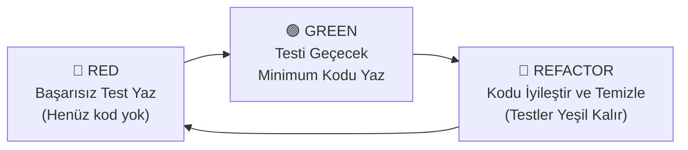
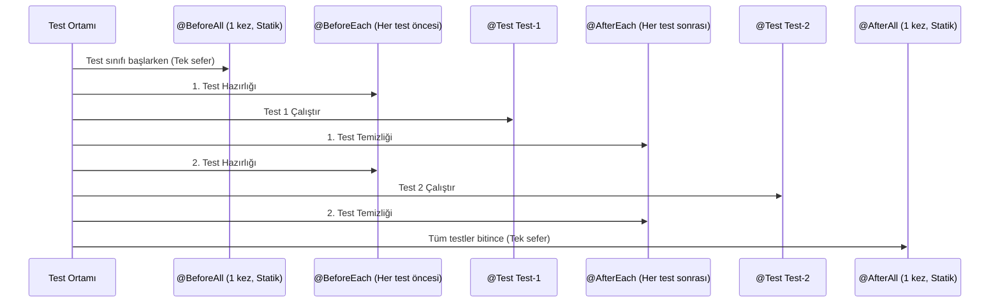

# 6. Yazılım Kalitesi ve Birim Testleri: JUnit 5

Bu doküman; profesyonel yazılım mühendisliğinin en temel taşlarından biri olan **Birim Testlerini (Unit Testing)**, modern Java dünyasının standart test çatısı **JUnit 5 (Jupiter)** mimarisini, **Test Güdümlü Geliştirme (TDD - Test Driven Development)** felsefesini, test yaşam döngüsü anotasyonlarını (`@Test`, `@BeforeEach`, `@AfterEach`, `@BeforeAll`, `@AfterAll`), zengin **Doğrulama (Assertion)** kütüphanesini, istisna testlerini (`assertThrows`) ve **Parametreli Testleri (`@ParameterizedTest`)** tüm ayrıntılarıyla ele almaktadır.

---

> 📖 **İlgili Bölüm Dokümanları:**
> - 🔙 [Önceki Bölüm: JDBC ve Veritabanı Programlama (5_jdbc_ve_veritabani.md)](./5_jdbc_ve_veritabani.md)
> - 🏠 [İleri Konular Modül Listesi](readme.md)

---

## 📌 İçindekiler
1. [Neden Test Yazarız? (Yazılım Kalitesi ve Güven)](#1-neden-test-yazarız)
   - [Manuel Test vs. Otomatik Test](#manuel-test-vs-otomatik-test)
   - [Regresyon (Geriye Gitme) Hatalarını Engelleme](#regresyon-hatalarını-engelleme)
   - [Test Piramidi (Test Pyramid)](#test-piramidi)
2. [Test Güdümlü Geliştirme (TDD - Test Driven Development)](#2-test-güdümlü-geliştirme-tdd)
   - [Kırmızı - Yeşil - Refactor (Red-Green-Refactor) Döngüsü](#kırmızı---yeşil---refactor-döngüsü)
3. [JUnit 5 Mimarisi (JUnit Platform, Jupiter, Vintage)](#3-junit-5-mimarisi)
4. [JUnit 5 Temel Yaşam Döngüsü Anotasyonları](#4-junit-5-temel-yaşam-döngüsü-anotasyonları)
   - [`@Test`, `@DisplayName`, `@Disabled`](#test-displayname-disabled)
   - [`@BeforeEach` ve `@AfterEach`](#beforeeach-ve-aftereach)
   - [`@BeforeAll` ve `@AfterAll`](#beforeall-ve-afterall)
5. [Doğrulama Metotları (Assertions)](#5-doğrulama-metotları-assertions)
   - [`assertEquals`, `assertNotEquals`](#assertequals-assertnotequals)
   - [`assertTrue`, `assertFalse`](#asserttrue-assertfalse)
   - [`assertNull`, `assertNotNull`](#assertnull-assertnotnull)
   - [İstisna Testi: `assertThrows`](#istisna-testi-assertthrows)
   - [Toplu Doğrulama: `assertAll` (Grup Assertions)](#toplu-doğrulama-assertall)
   - [Zaman Aşımı Testi: `assertTimeout`](#zaman-aşımı-testi-asserttimeout)
6. [Parametreli Testler (`@ParameterizedTest`)](#6-parametreli-testler-parameterizedtest)
   - [`@ValueSource` ile Çoklu Veri Testi](#valuesource)
   - [`@CsvSource` ile Girdi-Çıktı Tablosu Testi](#csvsource)
7. [Adım Adım Çalıştırılabilir Kod Örnekleri](#7-adım-adım-çalıştırılabilir-kod-örnekleri)
   - [Adım 1: Test Edilecek İş Mantığı Sınıfı (`BankaHesabi.java`)](#adım-1-iş-mantığı-sınıfı)
   - [Adım 2: Kapsamlı Test Sınıfı (`BankaHesabiTest.java`)](#adım-2-test-sınıfı)
8. [Sık Yapılan Hatalar ve Önemli Kurallar](#8-sık-yapılan-hatalar-ve-önemli-kurallar)
9. [Öğrenciler İçin Pekiştirici Sınıf İçi Alıştırmalar](#9-öğrenciler-için-pekiştirici-sınıf-içi-alıştırmalar)
10. [Ödev Konuları ve Mini Projeler](#10-ödev-konuları-ve-mini-projeler)

---

## 1. Neden Test Yazarız?

Bir yazılımcının en büyük korkusu, sistemdeki bir özelliği güncellerken ya da yeni bir metot eklerken **daha önce çalışan başka bir yeri farkında olmadan bozmaktır (Regresyon)**.

Yazdığınız kodları her seferinde `main` metodu içine `System.out.println` yazıp konsoldan gözle kontrol etmek:
- Çok yavaştır,
- İnsan hatasına açıktır,
- Kod tabanı büyüdükçe sürdürülemez hale gelir.

**Birim Testleri (Unit Tests)**; uygulamanın en küçük mantıksal parçalarını (genellikle tek bir metodu) dış dünyadan ve bağımlılıklarından izole ederek saniyeler içinde otomatik olarak test eden kod bloklarıdır.

```mermaid
flowchart TD
    subgraph Test Piramidi (Test Pyramid)
        E2E["Kullanıcı Arayüzü / E2E Testleri (Yavaş, Pahalı, Az Sayıda)"]
        IT["Entegrasyon Testleri (Orta Hızlı, Veritabanı/Servis)"]
        UT["Birim Testleri (Unit Tests) - (Işık Hızında, Çok Sayıda, Ucuz)"]
    end
    E2E --- IT
    IT --- UT
```

---

## 2. Test Güdümlü Geliştirme (TDD)

**TDD (Test Driven Development)**; üretim kodunu yazmadan **ÖNCE** o kodun testini yazmayı ilke edinen bir yazılım geliştirme metodolojisidir.



1. **🔴 RED (Kırmızı):** Henüz var olmayan bir özellik için testi yazarsınız. Metot veya sınıf bile tanımlanmadığı için test **başarısız olur** (kırmızı yanar).
2. **🟢 GREEN (Yeşil):** Testi geçirebilecek en basit, en yalın kodu yazarsınız. Test çalıştırıldığında başarıyla geçer (yeşil yanar).
3. **🔵 REFACTOR (İyileştirme):** Testlerin yeşil olmasının verdiği özgüvenle kodun tasarımını güzelleştirir, gereksiz tekrarları temizlersiniz. Testler yine yeşil kalmalıdır!

---

## 3. JUnit 5 Mimarisi

Önceki JUnit 4 tek parça bir kütüphaneyken, modern **JUnit 5** üç ayrı modülün birleşiminden oluşur:

$$\text{JUnit 5} = \text{JUnit Platform} + \text{JUnit Jupiter} + \text{JUnit Vintage}$$

- **JUnit Platform:** Test motorlarını JVM üzerinde çalıştırmak ve IDE'lere (IntelliJ, Eclipse, VS Code) bağlamak için temel altyapıdır.
- **JUnit Jupiter:** Yeni nesil programlama modelini, anotasyonları (`@Test`, vb.) ve assertion kütüphanesini barındıran asıl JUnit 5 modülüdür.
- **JUnit Vintage:** Eski JUnit 3 ve JUnit 4 ile yazılmış eski testleri geriye dönük uyumlulukla çalıştırmayı sağlar.

---

## 4. JUnit 5 Temel Yaşam Döngüsü Anotasyonları

Bir test sınıfı çalıştırıldığında test metotlarının çalışma sırası şöyledir:



### Anotasyon Tablosu

| Anotasyon | Çalışma Zamanı | Metot Tipi | Kullanım Amacı |
|---|---|---|---|
| **`@Test`** | Test çağrıldığında | Örnek metot | Metodun bir test vakası olduğunu belirtir. |
| **`@DisplayName("...")`** | Raporlama ekranında | Örnek/Sınıf | Teste okunabilir, Türkçe açıklamalı bir başlık verir. |
| **`@BeforeEach`** | Her `@Test` metodundan **hemen önce** | Örnek metot | Her test için temiz bir nesne örneği hazırlamak. |
| **`@AfterEach`** | Her `@Test` metodundan **hemen sonra** | Örnek metot | Geçici dosya veya verileri temizlemek. |
| **`@BeforeAll`** | Sınıftaki hiçbir test başlamadan **önce 1 kez** | `static` metot | Ağır kurulumlar (Veritabanı bağlantısı açma vb.). |
| **`@AfterAll`** | Tüm testler bittikten sonra **en son 1 kez** | `static` metot | Genel kaynakları kapatma (Veritabanını kapatma). |
| **`@Disabled`** | Test atlanır | Örnek metot | Geçici olarak o testi devre dışı bırakmak. |

---

## 5. Doğrulama Metotları (Assertions)

Testlerin kalbi `org.junit.jupiter.api.Assertions` sınıfıdır. Bir testin başarılı sayılması için içindeki tüm assertion'ların doğru çıkması gerekir.

### `assertEquals` ve `assertNotEquals`
Beklenen değer (`expected`) ile gerçekleşen değerin (`actual`) eşitliğini kontrol eder:
```java
// Kural: assertEquals(beklenen, gerceklesen, hataMesaji)
assertEquals(10, hesapMakinesi.topla(7, 3), "7 + 3 sonucu 10 olmalıdır!");
```

### `assertTrue` ve `assertFalse`
Boolean şartları doğrular:
```java
assertTrue(ogrenci.gectiMi(), "GANO 2.0 üzeri ise öğrenci geçmiş olmalıdır!");
```

### `assertNull` ve `assertNotNull`
Referansın boş veya dolu olduğunu denetler:
```java
assertNotNull(kullanici.getId(), "Kayıt sonrası ID null olamaz!");
```

### İstisna Testi: `assertThrows`
Bir metodun belirli bir hatalı durumda **beklenen bir istisnayı fırlatıp fırlatmadığını** doğrular:
```java
// Sıfıra bölme yapıldığında ArithmeticException fırlatılmalı:
assertThrows(ArithmeticException.class, () -> {
    hesapMakinesi.bol(10, 0);
});
```

### Toplu Doğrulama: `assertAll` (Grup Assertions)
Klasik assertion'larda ilk hata olduğunda test hemen kesilir ve sonraki satırlar test edilemez. `assertAll` ise **tüm doğrulamaları sonuna kadar işletir** ve başarısız olanların hepsini tek bir raporda gösterir:

```java
assertAll("Kullanıcı Bilgileri Doğrulaması",
    () -> assertEquals("Ahmet", kullanici.getAd()),
    () -> assertEquals("Yılmaz", kullanici.getSoyad()),
    () -> assertEquals("ahmet@mail.com", kullanici.getEposta())
);
```

---

## 6. Parametreli Testler (`@ParameterizedTest`)

Bazen aynı testi 10 farklı girdi verisiyle tekrar tekrar koşturmak gerekir. Kod kopyalamak yerine `@ParameterizedTest` kullanılır:

### `@ValueSource` Örneği:
```java
@ParameterizedTest
@ValueSource(ints = {2, 4, 6, 8, 10, 100})
@DisplayName("Çift Sayı Kontrolü")
void ciftSayiTesti(int sayi) {
    assertTrue(Matematik.ciftMi(sayi));
}
```

### `@CsvSource` Örneği (Girdi ve Beklenen Sonuç Tablosu):
```java
@ParameterizedTest(name = "{0} + {1} = {2} olmalı")
@CsvSource({
    "1, 1, 2",
    "5, 3, 8",
    "10, -2, 8",
    "0, 0, 0"
})
void toplamaTesti(int a, int b, int beklenen) {
    assertEquals(beklenen, Matematik.topla(a, b));
}
```

---

## 7. Adım Adım Çalıştırılabilir Kod Örnekleri

### Adım 1: Test Edilecek İş Mantığı Sınıfı (`BankaHesabi.java`)

```java
public class BankaHesabi {
    private String hesapNo;
    private double bakiye;

    public BankaHesabi(String hesapNo, double baslangicBakiyesi) {
        if (baslangicBakiyesi < 0) {
            throw new IllegalArgumentException("Başlangıç bakiyesi negatif olamaz!");
        }
        this.hesapNo = hesapNo;
        this.bakiye = baslangicBakiyesi;
    }

    public void paraYatir(double miktar) {
        if (miktar <= 0) {
            throw new IllegalArgumentException("Yatırılacak miktar 0 veya negatif olamaz!");
        }
        this.bakiye += miktar;
    }

    public void paraCek(double miktar) {
        if (miktar <= 0) {
            throw new IllegalArgumentException("Çekilecek miktar 0 veya negatif olamaz!");
        }
        if (miktar > this.bakiye) {
            throw new IllegalStateException("Yetersiz bakiye! Mevcut bakiye: " + this.bakiye);
        }
        this.bakiye -= miktar;
    }

    public double getBakiye() {
        return bakiye;
    }

    public String getHesapNo() {
        return hesapNo;
    }
}
```

---

### Adım 2: Kapsamlı Test Sınıfı (`BankaHesabiTest.java`)

```java
import org.junit.jupiter.api.*;
import org.junit.jupiter.params.ParameterizedTest;
import org.junit.jupiter.params.provider.ValueSource;

import static org.junit.jupiter.api.Assertions.*;

@DisplayName("Banka Hesabı Birim Test Paketi")
public class BankaHesabiTest {

    private BankaHesabi hesap;

    // Her testten önce sıfır ve temiz bir hesap oluşturalım:
    @BeforeEach
    void setUp() {
        hesap = new BankaHesabi("TR123456", 1000.0);
    }

    @Test
    @DisplayName("Başlangıç bakiyesi doğru atanmalıdır")
    void baslangicBakiyesiDogruOlmali() {
        assertEquals(1000.0, hesap.getBakiye(), 0.001);
    }

    @Test
    @DisplayName("Geçerli miktar yatırıldığında bakiye artmalıdır")
    void paraYatirBasarili() {
        hesap.paraYatir(500.0);
        assertEquals(1500.0, hesap.getBakiye(), 0.001, "Para yatırma sonrası bakiye 1500 olmalıydı!");
    }

    @Test
    @DisplayName("Negatif veya sıfır para yatırıldığında IllegalArgumentException fırlatılmalıdır")
    void negatifParaYatirmaHatasi() {
        assertThrows(IllegalArgumentException.class, () -> {
            hesap.paraYatir(-50.0);
        });
    }

    @Test
    @DisplayName("Yeterli bakiye varken para çekme başarılı olmalıdır")
    void paraCekmeBasarili() {
        hesap.paraCek(400.0);
        assertEquals(600.0, hesap.getBakiye(), 0.001);
    }

    @Test
    @DisplayName("Bakiyeden fazla para çekilmeye çalışıldığında IllegalStateException fırlatılmalıdır")
    void yetersizBakiyeHatasi() {
        IllegalStateException istisna = assertThrows(IllegalStateException.class, () -> {
            hesap.paraCek(1500.0);
        });

        assertTrue(istisna.getMessage().contains("Yetersiz bakiye"));
    }

    @Test
    @DisplayName("Hesap bilgileri topluca doğrulanabilmelidir")
    void hesapBilgileriGrupDogrulama() {
        assertAll("Hesap Durumu Kontrolü",
            () -> assertEquals("TR123456", hesap.getHesapNo()),
            () -> assertTrue(hesap.getBakiye() > 0),
            () -> assertNotNull(hesap.getHesapNo())
        );
    }

    @ParameterizedTest
    @ValueSource(doubles = {100.0, 250.0, 500.0, 999.0})
    @DisplayName("Farklı geçerli miktarlar başarıyla çekilebilmelidir")
    void cokluGecerliCekimTesti(double cekilecekTutar) {
        hesap.paraCek(cekilecekTutar);
        assertTrue(hesap.getBakiye() >= 0);
    }
}
```

---

## 8. Sık Yapılan Hatalar ve Önemli Kurallar

1. ❌ **Parametre Sırasını Ters Yazmak (`actual, expected`):**
   - JUnit'te kural daima `assertEquals(expected, actual)` şeklindedir. Ters yazılırsa test geçer fakat hata durumunda raporda beklenen ile gerçekleşen birbirine karışır.
2. ❌ **Testlerin Birbirine Bağımlı Olması:**
   - Test 2'nin çalışması için Test 1'in veritabanına kayıt atmasına güvenmek ölümcül bir test tasarımı hatasıdır! Testler rastgele sırada bile çalıştırılsa her biri tamamen bağımsız (`isolated`) ve kendi kendine yeterli olmalıdır.
3. ❌ **`@BeforeAll` Metodunu `static` Yapmamak:**
   - Varsayılan test yaşam döngüsünde `@BeforeAll` ve `@AfterAll` metotları **kesinlikle `static`** olmak zorundadır.
4. ❌ **İstisna Testinde `try-catch` Kullanıp `fail()` Çağırmayı Unutmak:**
   - Eski usul `try-catch` yerine daima zarif ve modern olan **`assertThrows`** kullanınız.
5. ❌ **Tek Bir Test Metodunda Onlarca Farklı Şeyi Test Etmek:**
   - Bir test metodu tek bir senaryoya ve tek bir amaca odaklanmalıdır ("Single Responsibility").

---

## 9. Öğrenciler İçin Pekiştirici Sınıf İçi Alıştırmalar

### Alıştırma 1: Palindrom Kontrolü İçin Parametreli Test
Verilen bir kelimenin tersten okunuşuyla aynı olup olmadığını (`kayak`, `radar`, `kabak` vb.) test eden bir JUnit parametreli testi yazınız.

<details>
<summary>🔍 <b>Çözümü Göster</b></summary>

```java
import org.junit.jupiter.params.ParameterizedTest;
import org.junit.jupiter.params.provider.ValueSource;
import static org.junit.jupiter.api.Assertions.assertTrue;

public class PalindromTest {

    public static boolean palindromMu(String metin) {
        String ters = new StringBuilder(metin).reverse().toString();
        return metin.equalsIgnoreCase(ters);
    }

    @ParameterizedTest
    @ValueSource(strings = {"kayak", "radar", "kabak", "madam", "aga"})
    void testPalindromKelimeler(String kelime) {
        assertTrue(palindromMu(kelime), kelime + " bir palindrom olmalıdır!");
    }
}
```
</details>

---

### Alıştırma 2: E-Posta Format İstisnası Testi
`KullaniciKayit.kaydet("hatalimail")` çağrıldığında `GecersizEpostaException` fırlatıldığını `assertThrows` ile test ediniz.

<details>
<summary>🔍 <b>Çözümü Göster</b></summary>

```java
import org.junit.jupiter.api.Test;
import static org.junit.jupiter.api.Assertions.assertThrows;

public class EpostaTest {
    @Test
    void hataliEpostaIstisnaFirlatmali() {
        assertThrows(IllegalArgumentException.class, () -> {
            // Test edilecek çağrı:
            if (!"hatalimail".contains("@")) {
                throw new IllegalArgumentException("Geçersiz e-posta!");
            }
        });
    }
}
```
</details>

---

## 10. Ödev Konuları ve Mini Projeler

---

### 🟢 Ödev 1 (Temel Seviye): Hesap Makinesi TDD Projesi (`HesapMakinesiTest.java`)

**Gereksinimler:**
1. Henüz `HesapMakinesi` sınıfını yazmadan önce test sınıfını oluşturunuz (TDD yaklaşımı).
2. Şu metotlar için en az 2'şer test vaka metodu yazınız:
   - `topla(a, b)`
   - `cikar(a, b)`
   - `carp(a, b)`
   - `bol(a, b)` (0'a bölme durumunda `ArithmeticException` fırlatmalı)
3. Testleri çalıştırıp hepsinin kırmızı olduğunu görünüz, ardından `HesapMakinesi` sınıfını kodlayıp tüm testleri yeşile çeviriniz.

---

### 🟡 Ödev 2 (Orta Seviye): E-Ticaret Sepet İndirim Motoru Testi (`SepetTest.java`)

**Gereksinimler:**
1. `Sepet` sınıfı: Ürün ekleme, silme, toplam tutar hesaplama ve kupon kodu uygulama (`yuzdeIndirimUygula(int yuzde)`).
2. `SepetTest` sınıfı:
   - `@BeforeEach` ile her testten önce boş bir sepet açınız.
   - İndirim kuponu uygulandığında toplam tutarın doğru düştüğünü test ediniz.
   - %0'dan küçük veya %100'den büyük kupon girildiğinde hata fırlatıldığını test ediniz.
   - `assertAll` kullanarak sepet kalem adedi, ara toplam ve vergi tutarlarını tek seferde doğrulayınız.

---

### 🔴 Ödev 3 (İleri Seviye): Şifre Güvenlik Denetleyicisi ve Parametreli Test Süiti (`SifreDenetleyiciTest.java`)

**Gereksinimler:**
1. `SifreDenetleyici.guvenliMi(String sifre)` metodu:
   - En az 8 karakter,
   - En az 1 büyük harf, 1 küçük harf, 1 rakam ve 1 özel karakter içermelidir.
2. `@ParameterizedTest` ve `@CsvSource` kullanarak en az 8 farklı şifre varyasyonunu (eksik karakterli, çok kısa, mükemmel şifreler) tek bir parametrik testte hem `true` hem `false` senaryolarıyla eksiksiz doğrulayınız.

