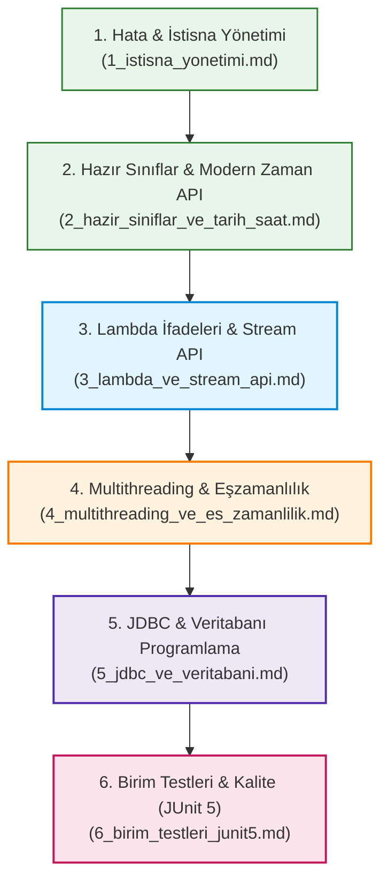

# 8. Modül: Java İleri Seviye Konular ve Profesyonel Yazılım Geliştirme

Bu dizin; temel ve nesne yönelimli Java eğitimini tamamlamış yazılımcı adaylarını kurumsal düzeyde üretim ortamlarına (production-ready) hazırlayan **İleri Düzey Java Yetkinlikleri** modülüdür.

Her doküman; konu anlatımları, mimari diyagramlar, gerçek hayat analojileri, tam çalıştırılabilir kaynak kodları, kritik tuzaklar ve `
` ile gizlenmiş çözümlü alıştırmalar ve 3 kademeli (🟢 Temel, 🟡 Orta, 🔴 İleri) ödev projeleriyle zenginleştirilmiştir.

---

## 🧭 İleri Düzey Konular Öğrenim Yol Haritası (Roadmap)

---

## 📋 Modül Konu Başlıkları Tablosu

| No | Doküman | Konu Başlığı | Temel Kazanımlar ve Kapsam |
| :---: | :--- | :--- | :--- |
| **01** | [**1_istisna_yonetimi.md**](./1_istisna_yonetimi.md) | **Hata ve İstisna Yönetimi (Exception Handling)** | • `Throwable`, `Error` ve `Exception` hiyerarşisi • Denetimli (*Checked*) vs. Denetimsiz (*Unchecked*) istisnalar • `try-catch-finally`, çoklu yakalama (Multi-Catch) • `throw` ve `throws` farkı, Özel Hata Sınıfları (*Custom Exceptions*) • `AutoCloseable` ve modern `try-with-resources` kaynak yönetimi |
| **02** | [**2_hazir_siniflar_ve_tarih_saat.md**](./2_hazir_siniflar_ve_tarih_saat.md) | **Hazır Sınıflar ve Tarih-Saat API** | • `Math`, `Random` ve `ThreadLocalRandom` yetenekleri • `String` vs `StringBuilder` vs `StringBuffer` bellek ve hız farkları • Finansal hassasiyet: `BigDecimal` ve `BigInteger` (Kuruş şaşmayan hesaplama) • Modern `java.time` (JSR-310): `LocalDate`, `LocalTime`, `LocalDateTime`, `ZonedDateTime` • `Period`, `Duration` ile zaman farkı ve `DateTimeFormatter` |
| **03** | [**3_lambda_ve_stream_api.md**](./3_lambda_ve_stream_api.md) | **Fonksiyonel Programlama & Stream API** | • Emirsel (*Imperative*) vs. Bildirimsel (*Declarative*) kodlama mantığı • Lambda ifadeleri (`->`) ve `@FunctionalInterface` (SAM prensibi) • Standart fonksiyonlar: `Predicate<T>`, `Function<T, R>`, `Consumer<T>`, `Supplier<T>` • Metot referansları (`::`), Stream ara (`filter`, `map`, `sorted`) ve uç (`collect`, `reduce`) işlemleri • `Collectors.groupingBy()` ile veri gruplama ve `Optional<T>` ile NPE sonlandırma |
| **04** | [**4_multithreading_ve_es_zamanlilik.md**](./4_multithreading_ve_es_zamanlilik.md) | **Multithreading ve Eşzamanlılık (Concurrency)** | • Süreç (*Process*) vs. İş Parçacığı (*Thread*) mimarisi ve yaşam döngüsü • `Thread`, `Runnable` ve lambda ile asenkron görev başlatma (`start` vs `run`) • Yarış Durumu (*Race Condition*), Kritik Bölge ve `synchronized` (İçsel kilit) • `volatile` anahtar kelimesi ve kilit gerektirmeyen `AtomicInteger` (CAS) • Modern thread yönetimi: `ExecutorService`, Thread Pools, `Callable<T>`, `Future<T>` |
| **05** | [**5_jdbc_ve_veritabani.md**](./5_jdbc_ve_veritabani.md) | **JDBC ve Veritabanı Programlama** | • JDBC mimarisi: `DriverManager`, `Connection`, `Statement`, `ResultSet` • Siber güvenlik: SQL Injection tehlikesi ve `PreparedStatement` (`?`) ile mutlak savunma • ACID ilkeleri doğrultusunda Transaction yönetimi (`commit`, `rollback`) • `try-with-resources` ile veritabanı sızıntılarını (*Connection Leaks*) önleme • Kurumsal mimari: DAO (*Data Access Object*) tasarım deseni ile katmanlı mimari |
| **06** | [**6_birim_testleri_junit5.md**](./6_birim_testleri_junit5.md) | **Yazılım Kalitesi ve Birim Testleri (JUnit 5)** | • Otomatik birim testlerinin önemi ve Test Piramidi • Test Güdümlü Geliştirme (TDD): *Red - Green - Refactor* döngüsü • JUnit 5 yaşam döngüsü: `@Test`, `@BeforeEach`, `@AfterEach`, `@BeforeAll`, `@AfterAll` • Zengin Assertions: `assertEquals`, `assertTrue`, `assertThrows`, `assertAll` • Parametreli testler: `@ParameterizedTest`, `@ValueSource`, `@CsvSource` |

---

## 💡 Bu Modülü Çalışırken Tavsiye Edilen Yöntem

1. **Sırayı Takip Edin:** Konular birbirinin üzerine inşa edilmiştir. Örneğin Stream API ve Lambda'yı anlamadan modern `CompletableFuture` veya reaktif yapıları anlamak güçtür.
2. **Kodu Mutlaka Çalıştırın:** Dokümanlardaki kod örneklerini sadece okumakla yetinmeyin; bir Java dosyasında derleyip çalıştırınız ve konsol çıktılarını gözlemleyiniz.
3. **Ödevleri Seviyesine Göre Çözün:** Her bölümün sonundaki 🟢 Temel, 🟡 Orta ve 🔴 İleri seviye ödevleri sırayla tamamlamak, sizi sıradan bir kod yazıcıdan kurumsal yazılım mühendisi seviyesine taşıyacaktır.

